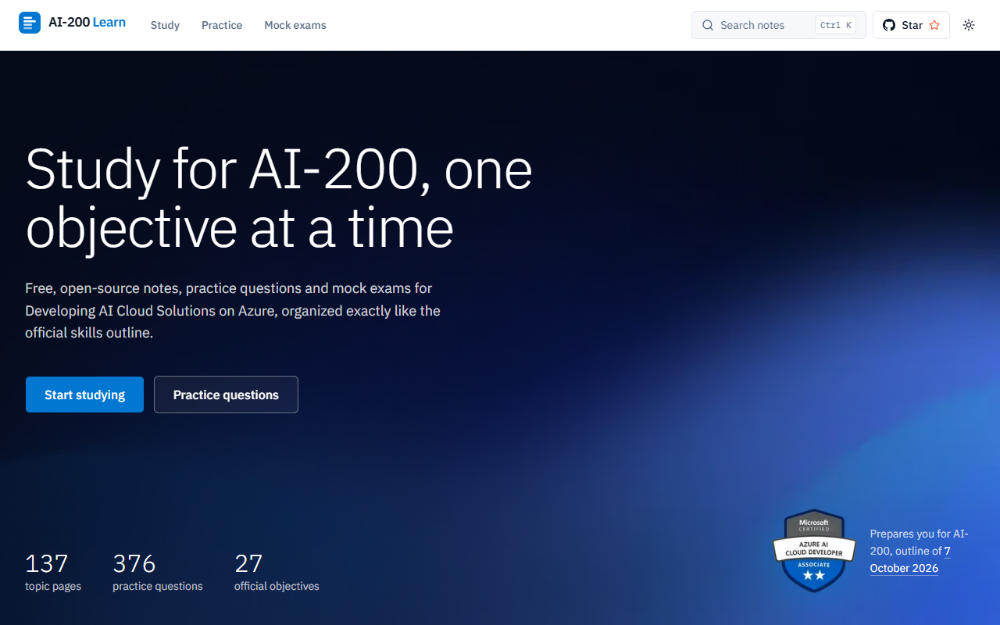
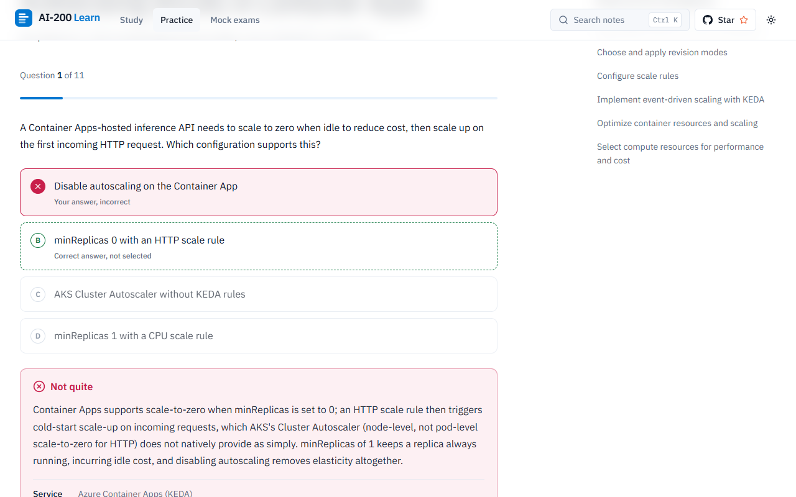
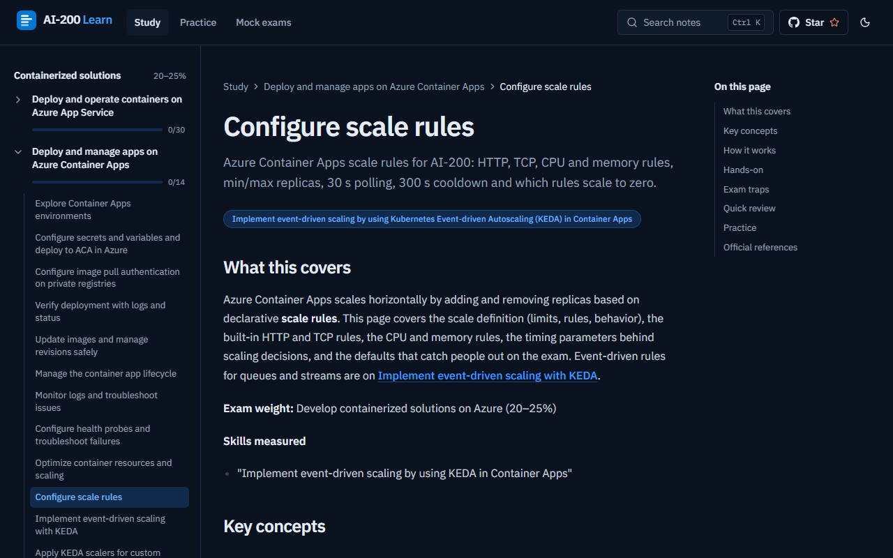

# AI-200 Learn

**Free, open-source study notes and practice questions for Microsoft Exam AI-200: Developing AI Cloud Solutions on Azure** (Microsoft Certified: Azure AI Cloud Developer Associate). Every study page and practice set maps to the 27 objectives in the official skills outline (version of October 7, 2026), so you can study from start to finish in one place.

**Live site: [azure.sura.work](https://azure.sura.work)**

[](LICENSE)
[](content/LICENSE)
[](https://github.com/Suralmk/learn-AI-200/stargazers)

> ⭐ **Star this repo if it helps you prepare.** Stars help other candidates find it.



## Features

- **137 study pages across 9 learning paths and 8 quick-reference guides**, grouped by the four official skill areas. Each page has key concepts, a Mermaid diagram where useful, Azure CLI and Python (C# where Microsoft shows it), exam-trap callouts, a quick review and links to the Microsoft Learn sources.
- **376 practice questions** (300 originals + 76 new), with **at least 10 for each of the 27 objectives**. Single and multi-select, and every answer explains why each option is right or wrong.
- **Mock exams:** a full-length run with an optional 120-minute timer, scored out of 1,000 (700 to pass), with accuracy per skill area; plus focused tests for each area.
- **Practice your way:** see answers after each question or at the end, review wrong answers, and use the keyboard (1–9 / A–D to choose, Enter to check, N for next).
- **Progress that stays in your browser:** topics read and best scores, with no account or backend.
- **Search** across every title and heading (Ctrl K or /).
- Light and dark themes, WCAG 2.2 AA contrast, responsive from 360 px, statically generated.

| Practice with explanations | Study notes (dark mode) |
|---|---|
|  |  |

## Quick start

```bash
git clone https://github.com/Suralmk/learn-AI-200.git && cd learn-AI-200
npm install
npm run dev
```

Then open http://localhost:3000. Node.js 20+ is required.

## Project structure

```text
app/                    Next.js App Router routes (home, /study, /practice, /questions, /exam, search, sitemap, OG images)
components/
  shell/                Top bar, search, sidebar, footer, GitHub links
  doc/                  Study page layout: DocPage, TocPanel, Callout, ComparisonTable, Mermaid, PrevNext
  quiz/                 QuizSession, QuestionCard, OptionButton, ScoreSummary, SetBest
  seo/                  JSON-LD helpers (WebSite, Course, LearningResource, Quiz, BreadcrumbList)
  ui/                   shadcn/base-ui primitives
  viz.tsx               Meter, BlueprintBars, StatTile, AccuracyBars
content/
  study/                Markdown notes: learning-paths/, topics/<path>/, guides/
  questions/            Practice questions (JSON) and objective-map.json
lib/                    Exam outline, loaders, zod schemas, scoring, progress, search, SEO helpers
scripts/                validate-content and question tooling
tests/                  Vitest unit tests
docs/                   Content template, design spec and plan, screenshots
```

## How content is organized

- **Exam outline:** `lib/exam-outline.ts` is the single source for the 4 skill areas, their weights and the 27 objectives. Each learning path belongs to one area.
- **Study pages:** Markdown with frontmatter (`title`, `pathSlug`, `moduleName`, `description`, `last_reviewed`, `source_version`, `tags`, `objectives`), following [docs/content-template.md](docs/content-template.md).
- **Questions:** JSON validated by `lib/schemas.ts`. Originals map to objectives through `content/questions/objective-map.json`; new questions carry `objective` and `source: "generated"`.
- `npm run validate:content` and `npm run build` fail on broken content.

### Add a topic

1. Create `content/study/topics/<path>/<slug>.md` from the template.
2. Add its title to the right module's `topics:` list in `content/study/learning-paths/<path>.md` (the filename must be the slug of that title).
3. Run `npm run validate:content -- --verbose`.

### Add a question

Append to `content/questions/generated-<area>.json` (or a new file) with an `objective` from `lib/exam-outline.ts`, then run `npm test`. See [CONTRIBUTING.md](CONTRIBUTING.md) for the schema and the explanation rules.

## Scripts

| Script | Purpose |
|---|---|
| `npm run dev` | Development server |
| `npm run build` / `npm start` | Production build and server |
| `npm run lint` | ESLint |
| `npm run typecheck` | TypeScript |
| `npm run validate:content` | Content checks (`-- --verbose` lists template warnings) |
| `npm test` | Unit tests |

## Deployment

azure.sura.work deploys from the `main` branch through the hosting provider's Git integration (there is no CI workflow in this repo). Every page is prerendered at build time, so any static-capable Next.js host works. The canonical origin is set in `lib/site.ts` (`SITE_URL`).

## Roadmap

- Review the 11 original questions flagged as possibly wrong or outdated (see CLAUDE.md, "Open items").
- Durable Functions and Container Apps dynamic sessions modules (on Microsoft Learn, not yet in the notes).
- More case-study questions that span several objectives.
- CI workflow that runs lint, typecheck, tests and content validation on every pull request.

## Contributing

Fixes and new questions are welcome. Read [CONTRIBUTING.md](CONTRIBUTING.md) and the [Code of Conduct](CODE_OF_CONDUCT.md). AI-assisted contributions should follow [CLAUDE.md](CLAUDE.md).

## License

Code: [MIT](LICENSE). Study notes and questions: [CC BY 4.0](content/LICENSE).

---

Not affiliated with or endorsed by Microsoft. Azure and Microsoft Learn are trademarks of Microsoft Corporation.
