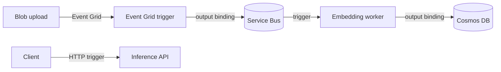

## What this covers

Azure Functions lets you run serverless AI workers (embedding pipelines, webhook handlers and lightweight APIs) without managing infrastructure. The exam tests two things: building functions with triggers and bindings, and configuring and deploying the function app. This guide summarizes both; the linked study pages go deeper.

**Exam weight:** Connect to and consume Azure services (20–25%)

**Skills measured**

- "Build serverless APIs, including implementing triggers and bindings"
- "Configure and deploy function apps"

## Key concepts

### Triggers and bindings

- **Triggers**: HTTP, Service Bus, Blob, Event Grid, Timer, Cosmos DB change feed. Exactly one per function.
- **Bindings**: input/output connections (Cosmos DB, Storage, Service Bus, Event Grid) declared with Python v2 decorators.
- HTTP auth levels: `anonymous`, `function` (key in `x-functions-key` or `?code=`), `admin`.
- HTTP requests time out at 230 seconds; long AI work goes to a queue (async request-reply).
- **Durable Functions**: orchestrate multi-step AI workflows (fan-out/fan-in, human approval). Advanced, covered by the path's Durable Functions module.

Deeper: [Build serverless APIs with triggers and bindings](/study/integrate-backend-services-for-ai-solutions/build-serverless-apis-with-azure-functions-triggers-and-bindings).

### Hosting and configuration

- **Flex Consumption** (recommended serverless): Linux, scale to zero, up to 1,000 instances, 512/2,048/4,096 MB instances, always-ready instances, VNet.
- **Premium**: pre-warmed instances (no cold start), VNet, slots, custom containers.
- Legacy Consumption: cold starts, no VNet; Linux Consumption retires in September 2028.
- **Managed identity**: authenticate to Key Vault, Storage and Cosmos DB without secrets in code. Use identity-based connections (`<prefix>__fullyQualifiedNamespace`, `__accountName`, `__accountEndpoint`) and Key Vault references in app settings.

Deeper: [Configure and deploy function apps](/study/integrate-backend-services-for-ai-solutions/configure-and-deploy-function-apps).

## How it works



## Hands-on

### Azure portal

1. Create a **Function App** on the **Flex Consumption** plan with the Python runtime.
2. Turn on the system-assigned identity and grant it data roles on Service Bus and Storage.
3. Add app settings for each binding's `connection` name.
4. Deploy from VS Code or Core Tools, then test HTTP functions with **Get function URL**.

### Azure CLI

```bash
# Create storage account (required for Functions)
az storage account create \
  --name stai200funcs \
  --resource-group rg-ai200 \
  --location eastus \
  --sku Standard_LRS

# Create Function App (Python) on Flex Consumption (recommended)
az functionapp create \
  --name func-ai200 \
  --resource-group rg-ai200 \
  --storage-account stai200funcs \
  --flexconsumption-location eastus \
  --runtime python \
  --runtime-version 3.11

# Legacy Linux Consumption form (retiring in 2028)
# az functionapp create --name func-ai200 --resource-group rg-ai200 \
#   --storage-account stai200funcs --consumption-plan-location eastus \
#   --runtime python --functions-version 4 --os-type Linux

# Deploy from the project folder
func azure functionapp publish func-ai200
```

### Python

Service Bus triggered embedding function:

```python
import azure.functions as func
import json
import logging

app = func.FunctionApp()

@app.service_bus_queue_trigger(
    arg_name="msg",
    queue_name="embed-jobs",
    connection="ServiceBusConnection",
)
def process_embedding(msg: func.ServiceBusMessage):
    payload = json.loads(msg.get_body().decode("utf-8"))
    doc_id = payload["documentId"]
    logging.info("Processing document %s", doc_id)
    # Fetch blob, generate embedding, store in Cosmos DB
```

With an identity-based connection, set the app setting `ServiceBusConnection__fullyQualifiedNamespace=<namespace>.servicebus.windows.net` and grant **Azure Service Bus Data Receiver**; no connection string is stored.

## Exam traps

| Scenario | Answer |
| --- | --- |
| Blob upload starts processing | Blob trigger or Event Grid trigger (Flex requires the Event Grid source for blobs) |
| Public API | HTTP trigger |
| Reliable background processing | Service Bus trigger |
| Nightly job | Timer trigger |
| Need no cold start | Premium, or Flex Consumption with always-ready instances |
| Need VNet access | Flex Consumption or Premium (not legacy Consumption) |

> [!WARNING]
> **Exam trap:** `AzureWebJobsStorage` is required by the host even if your code never touches Storage. Use a connection string or managed identity (`AzureWebJobsStorage__accountName`).

> [!WARNING]
> **Exam trap:** Match trigger type to scenario: blob upload maps to Blob/Event Grid trigger, API to HTTP, queued work to Service Bus.

> [!TIP]
> Connection strings vs managed identity: if the question mentions "no secrets", the answer is managed identity plus identity-based connections or Key Vault references.

## Quick review

- One trigger per function; bindings optional.
- Python v2 uses decorators in `function_app.py`.
- HTTP limit is 230 seconds; offload long work to Service Bus.
- Flex Consumption is the recommended serverless plan; Premium removes cold starts.
- Identity-based connections use `<prefix>__<property>` settings and RBAC.
- Deploy with `func azure functionapp publish` or zip deploy.

## Practice

- [Practice: Functions triggers and bindings questions](/practice/functions-triggers-bindings)
- [Practice: Function app configuration and deployment questions](/practice/functions-deploy)

## Official references

- [Azure Functions Python developer guide](https://learn.microsoft.com/en-us/azure/azure-functions/functions-reference-python)
- [Azure Functions triggers and bindings](https://learn.microsoft.com/en-us/azure/azure-functions/functions-triggers-bindings)
- [Build serverless AI backends with Azure Functions (module)](https://learn.microsoft.com/training/modules/build-backends-azure-functions/)
- [Flex Consumption plan hosting](https://learn.microsoft.com/azure/azure-functions/flex-consumption-plan)
- [Azure Functions hosting options](https://learn.microsoft.com/azure/azure-functions/functions-scale)
