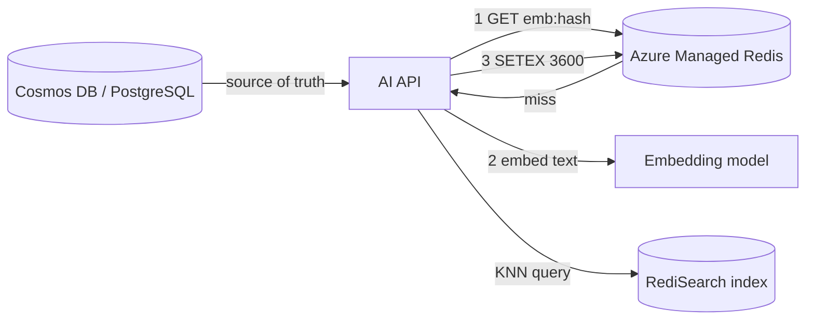

## What this covers

Azure Managed Redis (AMR) gives AI back ends low-latency caching and, with the RediSearch module, vector similarity search for retrieval workloads. This guide summarizes the parts the exam tests: provisioning choices, caching patterns, TTL and eviction, invalidation, connection resilience and vector indexes. Each section links to the detailed topic pages.

**Exam weight:** Develop AI solutions by using Azure data management services (30–35%)

**Skills measured**

- "Implement Azure Managed Redis data operations, including caching, expiration, and invalidation"
- "Implement vector indexing to enable similarity search"

## Key concepts

### Azure Managed Redis vs Azure Cache for Redis

AMR runs Redis Enterprise with several shards per node, connects at `<name>.<region>.redis.azure.net` on port **10000**, and is managed with **`az redisenterprise`**. Azure Cache for Redis Basic/Standard/Premium is community Redis at `<name>.redis.cache.windows.net` on port **6380**, managed with `az redis`. Both use the same client libraries. The tiers are Memory Optimized (8:1 memory to vCPU), Balanced (4:1), Compute Optimized (2:1) and Flash Optimized (RAM + NVMe). See [Explore Azure Managed Redis](/study/enhance-ai-solutions-with-azure-managed-redis/explore-azure-managed-redis).

### Caching patterns

- **Cache-aside** (lazy loading): read from Redis, and on a miss load from the database and write the value with a TTL. This is the default for embeddings and model responses.
- **Write-through**: write to the database and the cache together, so reads are always warm. It costs extra writes for data that may never be read.
- **Session and content caching**: keep only an ID in the cookie, and keep shared page fragments in Redis.

### TTL and eviction

- Set TTLs with `SETEX` / `EXPIRE`. `TTL` returns -1 when there is no expiry and -2 when the key is missing.
- **VolatileLRU** (`volatile-lru`) is the AMR default eviction policy. It evicts only keys that have a TTL, least recently used first. `AllKeysLRU`/`AllKeysLFU` suit a pure cache. **NoEviction** is required when RediSearch is enabled.

Details: [Implement data operations](/study/enhance-ai-solutions-with-azure-managed-redis/implement-data-operations).

### Cache invalidation for updated documents

Use TTLs for staleness you can tolerate. When a source document changes, delete the derived keys explicitly. For groups of keys, use `SCAN` + `DEL` by pattern, never `KEYS`. Use pub/sub to tell every app instance to clear its local cache ([broadcast vs coordinated distribution](/study/enhance-ai-solutions-with-azure-managed-redis/choose-between-broadcast-and-coordinated-distribution)). When a document's text changes, regenerate its embedding and overwrite the vector key, and the index updates itself.

### Connection resilience

Create one client per process and reuse it. redis-py pools connections, and StackExchange.Redis multiplexes one connection. Add retry with exponential backoff and connect/socket timeouts. Connect by host name over TLS. With Entra ID, refresh tokens before they expire; `redis-entraid` re-authenticates automatically. See [Client libraries and development best practices](/study/enhance-ai-solutions-with-azure-managed-redis/client-libraries-and-development-best-practices).

### Vector indexing

Enable **RediSearch at creation**, with the **Enterprise** clustering policy and **NoEviction**, on a non-Flash tier. Define `DIM` to match the embedding model, `DISTANCE_METRIC` (COSINE for text) and the algorithm (FLAT for small or exact, HNSW for large or fast). Store vectors as float32 bytes in hashes, or as arrays in JSON. Query with `KNN` and `DIALECT 2`. See [Index and query vector data](/study/enhance-ai-solutions-with-azure-managed-redis/index-and-query-vector-data) and [Choose vector types and indexing strategies](/study/enhance-ai-solutions-with-azure-managed-redis/choose-vector-types-and-indexing-strategies).

### Where Redis fits

Redis **complements** Cosmos DB or PostgreSQL. It doesn't replace them. Keep the system of record in the database, and use AMR for hot reads, embedding and response caches, sessions, rate limits, queues (Streams) and low-latency vector lookups over a working set.

## How it works



## Hands-on

### Azure CLI

```bash
# Azure Managed Redis (az redisenterprise, not az redis)
az extension add --upgrade --name redisenterprise
az redisenterprise create \
  --name redis-ai200 \
  --resource-group rg-ai200 \
  --location eastus \
  --sku Balanced_B1 \
  --clustering-policy EnterpriseCluster \
  --eviction-policy NoEviction \
  --modules name=RediSearch

# Host name (connect on port 10000 with TLS)
az redisenterprise show --name redis-ai200 --resource-group rg-ai200 --query hostName

# Access keys only if key auth is enabled (Entra ID is preferred)
az redisenterprise database list-keys --cluster-name redis-ai200 --resource-group rg-ai200
```

An earlier version of this guide used `az redis create --sku Basic --vm-size c0` and `az redis list-keys`. Those commands create and manage a Basic C0 **Azure Cache for Redis** instance, not Azure Managed Redis.

### Python: cache embeddings

```python
import hashlib
import json
import redis
from redis_entraid.cred_provider import create_from_default_azure_credential

provider = create_from_default_azure_credential(("https://redis.azure.com/.default",))
r = redis.Redis(
    host="redis-ai200.<region>.redis.azure.net",
    port=10000,
    ssl=True,
    credential_provider=provider,
)

def get_embedding_cached(text: str) -> list[float]:
    # sha256 is stable across processes; Python's hash() is randomized per process
    key = f"emb:{hashlib.sha256(text.encode()).hexdigest()}"
    cached = r.get(key)
    if cached:
        return json.loads(cached)

    embedding = call_embedding_model(text)  # Azure OpenAI, etc.
    r.setex(key, 3600, json.dumps(embedding))
    return embedding
```

## Exam traps

| Need | Answer |
|---|---|
| AMR connection | `*.redis.azure.net:10000`, TLS, Entra ID |
| Vector search prerequisites | RediSearch at creation + Enterprise policy + NoEviction, non-Flash tier |
| Evict only cache keys with TTL | `VolatileLRU` (default) |
| Invalidate across app instances | Pub/sub broadcast |
| Reliable background jobs | Streams + consumer groups |

> [!WARNING]
> **Exam trap:** `az redis create` and port 6380 belong to Azure Cache for Redis. AMR uses `az redisenterprise` and port 10000.

> [!WARNING]
> **Exam trap:** Python's built-in `hash()` changes between processes, so it can't be used as a shared cache key. Use a stable digest such as SHA-256.

> [!TIP]
> Redis sits in front of the system of record. It is not a replacement for Cosmos DB or PostgreSQL.

## Quick review

- AMR is managed with `az redisenterprise` and listens on port 10000 with TLS. Entra ID is on by default.
- Cache-aside with a TTL is the default pattern. Write-through keeps reads warm at extra write cost.
- The default eviction is VolatileLRU. RediSearch requires NoEviction.
- Invalidate with TTL, explicit `DEL`, `SCAN` by pattern, or a pub/sub broadcast.
- Vector indexes need a matching `DIM`, the right metric (COSINE for text), and FLAT or HNSW.

## Practice

[Practice: Azure Managed Redis data operations](/practice/redis-data-ops)

[Practice: Azure Managed Redis vector indexing](/practice/redis-vector)

## Official references

- [Azure Managed Redis](https://learn.microsoft.com/en-us/azure/redis/)
- [Redis vector search](https://redis.io/docs/latest/develop/interact/search-and-query/vectors/)
- [Learning path: Enhance AI solutions with Azure Managed Redis](https://learn.microsoft.com/training/paths/enhance-ai-solutions-azure-managed-redis/)
- [Redis modules in Azure Managed Redis](https://learn.microsoft.com/azure/redis/redis-modules)
- [Use Microsoft Entra for cache authentication](https://learn.microsoft.com/azure/redis/entra-for-authentication)
