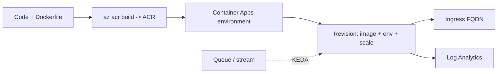

## What this covers

AI-200 expects you to package AI back ends (APIs, workers, inference services) as containers, store them in Azure Container Registry (ACR) and run them on Azure Container Apps, or on AKS when you need full Kubernetes control. This guide is a one-page map of the Container Apps part: environments, deployment, configuration, revisions, KEDA scaling and troubleshooting, with links to the detailed topic pages.

**Exam weight:** Develop containerized solutions on Azure (20–25%)

**Skills measured**

- "Deploy applications to Azure Container Apps, including environment configuration and revision management"
- "Implement event-driven scaling by using Kubernetes Event-driven Autoscaling (KEDA) in Container Apps"
- "Monitor and troubleshoot solutions on AKS and Container Apps by inspecting logs, events, and end-to-end connectivity"

## Key concepts

- **Azure Container Registry (ACR):** a private registry for your images. Container Apps pulls from it with a managed identity that has `AcrPull`. See [image pull authentication](/study/deploy-and-manage-apps-on-azure-container-apps/configure-image-pull-authentication-on-private-registries).
- **Azure Container Apps:** serverless container hosting on top of Kubernetes and KEDA, with scale to zero, revisions and built-in ingress.
- **Environment:** the shared boundary for networking, logs and workload profiles. See [Explore Container Apps environments](/study/deploy-and-manage-apps-on-azure-container-apps/explore-container-apps-environments).
- **Revision:** an immutable snapshot of the app template. Single mode (default) swaps with zero downtime. Multiple mode enables traffic splitting and labels. See [revision modes](/study/deploy-and-manage-apps-on-azure-container-apps/choose-and-apply-revision-modes).
- **Env vars vs secrets:** config goes in env vars. Credentials go in secrets (`secretref:`) or Key Vault references. See [secrets and variables](/study/deploy-and-manage-apps-on-azure-container-apps/configure-secrets-and-variables-and-deploy-to-aca-in-azure).
- **KEDA:** event-driven autoscaling on external metrics such as Service Bus queue depth or Event Hubs lag, not just CPU and memory. See [scale rules](/study/deploy-and-manage-apps-on-azure-container-apps/configure-scale-rules) and [KEDA](/study/deploy-and-manage-apps-on-azure-container-apps/implement-event-driven-scaling-with-keda).
- **AKS:** full Kubernetes when you need node-level control, custom operators or Kubernetes-native tooling.

## How it works



## Hands-on

### Azure portal

1. Create an ACR, then use **Tasks** or a local `docker push` to publish the image.
2. Create a Container App with a new environment, pick the ACR image and turn on managed identity.
3. Set ingress, env vars, secrets and scale rules, then check **Revisions and replicas** and **Log stream**.

### Azure CLI

```bash
# Create a resource group and ACR
az group create --name rg-ai200 --location eastus
az acr create --resource-group rg-ai200 --name acrailearn --sku Basic

# Build and push an image (cloud build)
az acr build --registry acrailearn --image ai-api:v1 .

# Create a Container Apps environment
az containerapp env create \
  --name cae-ai200 \
  --resource-group rg-ai200 \
  --location eastus

# Deploy a container app that pulls with its managed identity
az containerapp create \
  --name ai-api \
  --resource-group rg-ai200 \
  --environment cae-ai200 \
  --image acrailearn.azurecr.io/ai-api:v1 \
  --registry-server acrailearn.azurecr.io \
  --registry-identity system \
  --target-port 8000 \
  --ingress external \
  --min-replicas 0 \
  --max-replicas 5
```

### Python

A health check endpoint that ingress probes and smoke tests can call:

```python
from fastapi import FastAPI

app = FastAPI()

@app.get("/health")
def health():
    return {"status": "ok"}

@app.post("/embed")
async def embed(text: str):
    # Call Azure OpenAI or a local model
    return {"embedding": [0.1, 0.2, 0.3]}
```

## Exam traps

| Need | Choose |
|---|---|
| Serverless containers, scale to zero, revisions | Azure Container Apps |
| Full Kubernetes API, node pools, operators | AKS |
| Scale a worker on queue depth | Container Apps + KEDA custom rule |
| Canary release | Multiple revision mode + traffic weights |
| Private image pull without secrets | Managed identity + `AcrPull` |

> [!WARNING]
> **Exam trap:** CPU and memory scale rules can't scale to zero. Use HTTP, TCP or an event-driven rule when scale to zero is required.

> [!TIP]
> Container Apps vs AKS comes down to simplicity vs control.

## Quick review

- ACR stores images. Container Apps runs them in an environment.
- Revisions are immutable. Single mode is the default. Multiple mode enables traffic splits.
- Env vars hold config. Secrets and Key Vault hold credentials.
- KEDA scales on external metrics (queue depth, lag), not just CPU and memory.
- `az containerapp logs show --type system` for platform events.

## Practice

[Practice: Container Apps deployment questions](/practice/aca-deploy) · [Practice: KEDA scaling questions](/practice/aca-keda) · [Practice: container troubleshooting questions](/practice/containers-troubleshoot)

## Official references

- [Learning path: Deploy and manage apps on Azure Container Apps](https://learn.microsoft.com/en-us/training/paths/deploy-manage-apps-azure-container-apps/)
- [Azure Container Apps documentation](https://learn.microsoft.com/en-us/azure/container-apps/)
- [Azure Container Registry](https://learn.microsoft.com/en-us/azure/container-registry/)
- [AI-200 study guide](https://learn.microsoft.com/en-us/credentials/certifications/resources/study-guides/ai-200)
