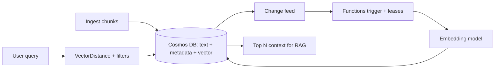

## What this covers

Azure Cosmos DB for NoSQL is the main document and vector store in AI-200. It holds chunked content, metadata and embeddings in the same item, answers semantic queries with `VectorDistance`, and streams changes so embeddings stay current. This guide summarizes the four Cosmos DB objectives and links to the detailed pages.

**Exam weight:** Develop AI solutions by using Azure data management services (30–35%). The skills-at-a-glance list and change log give 30–35%; the section heading in the study guide still says 25–30%.

**Skills measured**

- "Connect to Azure Cosmos DB for NoSQL by using the SDK and run queries"
- "Optimize query performance and Request Units (RUs) consumption by using indexing policies and consistency levels"
- "Store and retrieve embeddings and execute vector similarity search for semantic retrieval"
- "Implement a change feed processor to detect and handle new or updated items"

## Key concepts

### SDK and queries

- One singleton `CosmosClient`, authenticated with `DefaultAzureCredential` and a Cosmos DB data-plane role.
- Point reads (`id` + partition key) cost about 1 RU per KB; queries cost more, especially cross-partition.
- Parameterized queries, `SELECT VALUE`, `ARRAY_CONTAINS`, `JOIN` within an item, paging with continuation tokens.

Details: [SDK](/study/develop-ai-solutions-with-azure-cosmos-db-for-nosql/implement-the-azure-cosmos-db-for-nosql-sdk), [queries](/study/develop-ai-solutions-with-azure-cosmos-db-for-nosql/query-azure-cosmos-db-for-nosql).

### Vector embeddings

Numerical representations of text or images used for similarity search. A container needs a **vector embedding policy** (path, `float32`/`float16`/`int8`/`uint8`, dimensions, `cosine`/`dotproduct`/`euclidean`) and a **vector index**:

| Index | Max dimensions | Use |
| --- | --- | --- |
| `flat` | 505 | Exact, small or heavily filtered |
| `quantizedFlat` | 4,096 | Up to ~50,000 vectors per search scope |
| `diskANN` | 4,096 | Large scale, lowest RU and latency |

`quantizedFlat` and `diskANN` need 1,000+ vectors. Queries use `SELECT TOP N ... ORDER BY VectorDistance(c.embedding, @v)`; hybrid search uses `ORDER BY RANK RRF(VectorDistance(...), FullTextScore(...))`. Details: [store embeddings](/study/develop-ai-solutions-with-azure-cosmos-db-for-nosql/store-and-retrieve-embeddings-in-azure-cosmos-db), [similarity queries](/study/develop-ai-solutions-with-azure-cosmos-db-for-nosql/execute-vector-similarity-queries-for-semantic-search), [filters and hybrid](/study/develop-ai-solutions-with-azure-cosmos-db-for-nosql/combine-vector-similarity-results-with-metadata-filtering), [tuning](/study/develop-ai-solutions-with-azure-cosmos-db-for-nosql/tune-vector-indexes-for-embedding-workloads).

### Indexing policies and RU cost

Indexing policies affect query cost and RU consumption. The default range-indexes every path; an opt-in policy indexes only filtered paths (plus the partition key) and excludes embeddings. Multi-property `ORDER BY` needs a composite index. Details: [indexes](/study/develop-ai-solutions-with-azure-cosmos-db-for-nosql/understand-indexes-in-azure-cosmos-db), [composite](/study/develop-ai-solutions-with-azure-cosmos-db-for-nosql/configure-range-and-composite-indexes), [RU reduction](/study/develop-ai-solutions-with-azure-cosmos-db-for-nosql/reduce-ru-costs-with-strategic-indexing).

### Consistency levels

Session is the default and the common choice for app reads. Know Strong versus Eventual, and that Strong and Bounded staleness reads cost about 2× RUs. Details: [consistency](/study/develop-ai-solutions-with-azure-cosmos-db-for-nosql/choose-consistency-levels-for-optimal-performance).

### Change feed

React to new or updated documents (for example, re-embed them). The change feed processor pattern (Functions trigger or .NET/Java library with a lease container) powers async embedding pipelines; Python uses the trigger or the pull model. Details: [embedding refresh](/study/develop-ai-solutions-with-azure-cosmos-db-for-nosql/use-the-change-feed-to-trigger-embedding-refresh), [change feed processor](/study/develop-ai-solutions-with-azure-cosmos-db-for-nosql/implement-a-change-feed-processor-with-a-lease-container).

## How it works



## Hands-on

### Azure portal

1. Create an **Azure Cosmos DB for NoSQL** account; enable **Vector Search for NoSQL API** under **Features**.
2. In **Data Explorer**, create a container with partition key `/tenantId` and a vector policy on `/embedding`.

### Azure CLI

```bash
# Create Cosmos DB account (NoSQL API)
az cosmosdb create \
  --name cosmos-ai200 \
  --resource-group rg-ai200 \
  --locations regionName=eastus \
  --capabilities EnableNoSQLVectorSearch

az cosmosdb sql database create \
  --account-name cosmos-ai200 \
  --resource-group rg-ai200 \
  --name vectordb

az cosmosdb sql container create \
  --account-name cosmos-ai200 \
  --resource-group rg-ai200 \
  --database-name vectordb \
  --name documents \
  --partition-key-path "/tenantId"
```

### Python

```python
from azure.cosmos import CosmosClient
from azure.identity import DefaultAzureCredential

url = "https://cosmos-ai200.documents.azure.com:443/"
client = CosmosClient(url, credential=DefaultAzureCredential())  # or credential=key in a sandbox
container = client.get_database_client("vectordb").get_container_client("documents")

# Insert document with embedding vector
doc = {
    "id": "doc-1",
    "tenantId": "tenant-a",
    "content": "Azure AI services overview",
    "embedding": [0.12, 0.45, 0.78],  # simplified; real vectors match the policy's dimensions
}
container.upsert_item(doc)

# Vector similarity query
query = """
SELECT TOP 5 c.id, c.content, VectorDistance(c.embedding, @queryVector) AS score
FROM c
WHERE c.tenantId = @tenant
ORDER BY VectorDistance(c.embedding, @queryVector)
"""
items = list(container.query_items(
    query=query,
    parameters=[
        {"name": "@queryVector", "value": query_vector},
        {"name": "@tenant", "value": "tenant-a"},
    ],
    partition_key="tenant-a",
))
```

This query only works if the container was created with a vector embedding policy for `/embedding`; the plain CLI container above needs one added at creation (portal or SDK).

## Exam traps

| Need | Service or option |
| --- | --- |
| Global distribution, elastic scale, vectors beside JSON documents | Cosmos DB for NoSQL |
| Relational joins plus vectors in SQL | Azure Database for PostgreSQL with pgvector |
| Sub-millisecond cache and short-lived vectors | Azure Managed Redis |
| Large-scale vector search | `diskANN` index |
| Read your own write cheaply | Session consistency |
| Re-embed on update | Change feed with a lease container |

> [!WARNING]
> **Exam trap:** Without `TOP N`, a vector query tries to rank far more items than needed and burns RUs.

> [!WARNING]
> **Exam trap:** The change feed (latest version mode) doesn't capture deletes.

> [!TIP]
> Numbers to memorize: 1 RU point read, 400 RU/s manual minimum, 505 flat dimensions, 4,096 others, 1,000 vectors before ANN indexes kick in, 2× read RU for Strong.

## Quick review

- Partition key choice drives query cost and RU consumption.
- Exclude embeddings from range indexes; add a vector index.
- `ORDER BY VectorDistance` returns most similar first.
- Hybrid search fuses vector and BM25 with RRF.
- Session is the default consistency; overrides only weaken.
- The change feed processor checkpoints in a lease container and delivers at least once.

## Practice

[Practice: Cosmos DB SDK and query questions](/practice/cosmos-sdk-queries)

[Practice: Cosmos DB RU and indexing questions](/practice/cosmos-ru-indexing)

[Practice: Cosmos DB vector search questions](/practice/cosmos-vector-search)

[Practice: Cosmos DB change feed questions](/practice/cosmos-change-feed)

## Official references

- [Learning path: Develop AI solutions with Azure Cosmos DB for NoSQL](https://learn.microsoft.com/en-us/training/paths/develop-ai-solutions-azure-cosmos-db/)
- [Cosmos DB vector search](https://learn.microsoft.com/en-us/azure/cosmos-db/nosql/vector-search)
- [Change feed in Cosmos DB](https://learn.microsoft.com/en-us/azure/cosmos-db/change-feed)
- [Change feed processor](https://learn.microsoft.com/en-us/azure/cosmos-db/change-feed-processor)
- [Consistency levels](https://learn.microsoft.com/en-us/azure/cosmos-db/consistency-levels)
- [AI-200 study guide](https://learn.microsoft.com/en-us/credentials/certifications/resources/study-guides/ai-200)
