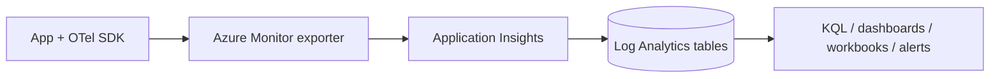

## What this covers

The observability half of the secure/monitor domain is end-to-end visibility into distributed AI apps: instrument with **OpenTelemetry**, export to **Azure Monitor Application Insights**, store in a **Log Analytics workspace**, and analyze with **KQL**, dashboards, workbooks and alerts. This guide is the one-page summary; the deep notes live in the learning path [Observe and troubleshoot apps on Azure](/study/observe-and-troubleshoot-apps-on-azure).

**Exam weight:** Secure, monitor, and troubleshoot Azure solutions (20–25%)

**Skills measured**

- "Trace distributed systems by using OpenTelemetry SDKs"
- "Write KQL queries to analyze logs and metrics"

## Key concepts

### Definitions

| Term | Definition |
|------|------------|
| **OpenTelemetry** | Vendor-neutral API/SDK for traces, metrics and logs |
| **Azure Monitor** | Azure's observability platform (metrics, logs, alerts, workbooks) |
| **Application Insights** | APM feature for app requests, dependencies, exceptions, traces |
| **Log Analytics workspace** | Shared log store queried with KQL |
| **KQL** | Kusto Query Language: pipeline queries over tables |
| **OperationId** | Correlation ID for one end-to-end request (= OTel trace ID) |
| **Custom dimensions** | Dynamic properties from span attributes (`customDimensions` classic, `Properties` workspace) |
| **Workbook** | Interactive parameterized analysis report |
| **Action group** | Notification and automation targets for alert rules |

### Vocabulary (OTel to Azure)

| OpenTelemetry | Application Insights |
|---------------|----------------------|
| Trace | Operation (`OperationId` / `operation_Id`) |
| SERVER / CONSUMER span | Request row (`AppRequests`) |
| CLIENT / PRODUCER / INTERNAL span | Dependency row (`AppDependencies`) |
| Attributes | `Properties` / `customDimensions` |
| `service.name` | Cloud role (`AppRoleName` / `cloud_RoleName`) |
| Context propagation | Distributed tracing (`traceparent`) |

### Standard tables

| Workspace table | Classic name | Contents |
|-----------------|--------------|----------|
| `AppRequests` | `requests` | Incoming requests |
| `AppDependencies` | `dependencies` | Outbound HTTP / DB / queue calls and internal spans |
| `AppTraces` | `traces` | Log messages |
| `AppExceptions` | `exceptions` | Exceptions |
| `AppMetrics` | `customMetrics` | Custom metrics |

Classic names work when you query from the Application Insights resource; `App*` names when you query the workspace. Tables are **pre-created**; you never define them.

## How it works



```text
App (OTel SDK) → Azure Monitor exporter → Application Insights
      → Log Analytics tables → KQL / dashboards / alerts
```

## Hands-on

### Azure CLI

Create a workspace and a workspace-based Application Insights resource:

```bash
az monitor log-analytics workspace create \
  --resource-group <resource-group> \
  --workspace-name <workspace-name> \
  --location eastus

az monitor app-insights component create \
  --app <app-insights-name> \
  --location eastus \
  --resource-group <resource-group> \
  --workspace <workspace-name>
```

### Python

Quick instrumentation:

```python
from azure.monitor.opentelemetry import configure_azure_monitor
from opentelemetry import trace

configure_azure_monitor()  # reads APPLICATIONINSIGHTS_CONNECTION_STRING
tracer = trace.get_tracer(__name__)

with tracer.start_as_current_span("generate_embedding") as span:
    span.set_attribute("gen_ai.model", "text-embedding-3-large")
    embedding = model.embed(text)
```

### KQL

Failures and P95 per hour for embedding requests:

```kql
AppRequests
| where TimeGenerated > ago(24h)
| where Name has "embed"
| summarize
    count(),
    Failures = countif(Success == false),
    P95 = percentile(DurationMs, 95)
  by bin(TimeGenerated, 1h)
| order by TimeGenerated desc
```

Full trace for one operation (`Type` = source table):

```kql
union AppRequests, AppDependencies, AppTraces, AppExceptions
| where OperationId == "abc123def456"
| project TimeGenerated, Type, Name, Message, DurationMs
| order by TimeGenerated asc
```

## Exam traps

| Need | Choose |
|------|--------|
| Instrument Python quickly | `azure-monitor-opentelemetry` + `configure_azure_monitor()` |
| Queue consumer joins the producer's trace | `extract()` context + `SpanKind.CONSUMER` |
| Control ingestion cost | Sampling (rate limited default, or fixed percentage) |
| Correlate rows of one request | `OperationId` |
| At-a-glance team health | Azure dashboard |
| Interactive investigation with parameters | Workbook |
| Alert on custom attribute or percentile | Log search alert |
| Alert without a known threshold | Smart detection |

> [!WARNING]
> **Exam trap:** `customDimensions`, `operation_Id`, `timestamp` and `duration` are **classic** column names. In `App*` tables use `Properties`, `OperationId`, `TimeGenerated` and `DurationMs`.

> [!WARNING]
> **Exam trap:** Prefer `has` over `contains`, `percentile` over `avg` for latency, and `sum(ItemCount)` over `count()` when sampling is on.

> [!TIP]
> Core KQL set: `where`, `project`/`extend`, `summarize`, `join`, `union`, `top`, `let`, `render`.

## Quick review

- Distro package (`azure-monitor-opentelemetry`) configures exporter + auto-instrumentation in one call.
- Spans map to `AppRequests` / `AppDependencies`; attributes to `Properties` / `customDimensions`.
- Tables such as `AppExceptions` are pre-created.
- Debug with `OperationId` across a `union` of App* tables.
- Use `countif` for error rate and `percentile` for latency.
- Alert on error rate, P95 latency and dependency failures via metric or log search rules.

## Practice

[Practice: OpenTelemetry questions](/practice/opentelemetry) · [Practice: KQL questions](/practice/kql)

Related study path topics:

- [Explore OpenTelemetry and its role in observability](/study/observe-and-troubleshoot-apps-on-azure/explore-opentelemetry-and-its-role-in-observability)
- [Add the OpenTelemetry SDK to an application](/study/observe-and-troubleshoot-apps-on-azure/add-the-opentelemetry-sdk-to-an-application)
- [Configure spans and traces](/study/observe-and-troubleshoot-apps-on-azure/configure-spans-and-traces)
- [Export telemetry to Azure Monitor](/study/observe-and-troubleshoot-apps-on-azure/export-telemetry-to-azure-monitor)
- [Debug distributed flows with trace data](/study/observe-and-troubleshoot-apps-on-azure/debug-distributed-flows-with-trace-data)
- [Write basic KQL queries](/study/observe-and-troubleshoot-apps-on-azure/write-basic-kql-queries)
- [Explore logs for errors and performance](/study/observe-and-troubleshoot-apps-on-azure/explore-logs-for-errors-and-performance)
- [Build dashboards for app telemetry](/study/observe-and-troubleshoot-apps-on-azure/build-dashboards-for-app-telemetry)
- [Create workbooks for interactive analysis](/study/observe-and-troubleshoot-apps-on-azure/create-workbooks-for-interactive-analysis)
- [Set alerts for app failures and anomalies](/study/observe-and-troubleshoot-apps-on-azure/set-alerts-for-app-failures-and-anomalies)

## Official references

- [Instrument an app with OpenTelemetry (Learn module)](https://learn.microsoft.com/en-us/training/modules/instrument-app-opentelemetry/)
- [Analyze app telemetry with logs and metrics (Learn module)](https://learn.microsoft.com/en-us/training/modules/analyze-telemetry-logs-metrics/)
- [Application Insights overview](https://learn.microsoft.com/en-us/azure/azure-monitor/app/app-insights-overview)
- [OpenTelemetry on Azure Monitor](https://learn.microsoft.com/en-us/azure/azure-monitor/app/opentelemetry-overview)
- [KQL quick reference](https://learn.microsoft.com/en-us/azure/data-explorer/kql-quick-reference)
- [AI-200 study guide](https://learn.microsoft.com/en-us/credentials/certifications/resources/study-guides/ai-200)
