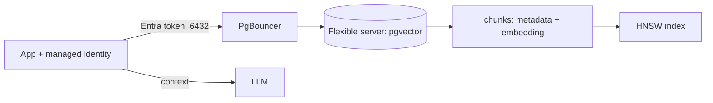

## What this covers

A one-page summary of the PostgreSQL part of AI-200. Azure Database for PostgreSQL flexible server with the **pgvector** extension stores embeddings next to relational data and runs similarity search for semantic retrieval and RAG. This guide covers all six PostgreSQL objectives and links to the detailed topic pages.

**Exam weight:** Develop AI solutions by using Azure data management services (30–35%)

**Skills measured**

- "Connect and query Azure Database for PostgreSQL by using SDKs"
- "Model schemas and implement indexing strategies, including designing tables and choosing appropriate data types"
- "Implement indexing strategies, including optimizing query latency and reducing pgvector compute overhead"
- "Configure compute, memory, and storage resources to support vector workloads"
- "Run vector similarity search, including storing embeddings, semantic retrieval, and implementing retrieval-augmented generation (RAG) patterns by using metadata filter"
- "Implement connection optimization to improve throughput and minimize latency"

## Key concepts

- **pgvector**: PostgreSQL extension (`CREATE EXTENSION vector`) for vector storage and distance queries. On flexible server, allow-list it in `azure.extensions` first.
- **Distance operators**: `<->` L2, `<=>` cosine distance, `<#>` negative inner product. Always `ORDER BY ... LIMIT k`.
- **HNSW / IVFFlat indexes**: approximate nearest neighbour indexes. HNSW (`m`, `ef_construction`, `hnsw.ef_search`) gives better recall per millisecond. IVFFlat (`lists`, `ivfflat.probes`) builds faster and uses less memory. **DiskANN** (`pg_diskann`) is Azure's option for very large sets.
- **Metadata filtering**: combine vector search with SQL `WHERE` clauses. Index filter columns, and use iterative scans or over-fetch so filtered ANN still returns k rows.
- **Schema design**: keep the embedding in the same row as filterable typed columns. Use a separate chunk table linked to a documents table for RAG citations. Use JSONB for the long tail of attributes, not for hot filters.
- **Compute/memory**: Memory Optimized when HNSW indexes must stay in RAM. `maintenance_work_mem` for builds, `SET LOCAL work_mem` for queries.
- **Connection pooling**: built-in PgBouncer (port 6432, General Purpose/Memory Optimized only, transaction mode) plus an app-side pool such as `psycopg_pool`.
- **Auth**: Microsoft Entra tokens (`https://ossrdbms-aad.database.windows.net/.default`) with managed identity; `sslmode=verify-full`.

## How it works



The app embeds the question, runs a filtered `ORDER BY embedding <=> $1 LIMIT k` query through a pool, and sends the returned chunks (with citation metadata) to the model.

## Hands-on

### Azure portal

1. Create a flexible server (Memory Optimized for production vector work) with Microsoft Entra authentication.
2. **Server parameters**: add `VECTOR` to `azure.extensions`; set `pgbouncer.enabled` to `true`.
3. Map your app's managed identity with `pgaadauth_create_principal`.

### Azure CLI

```bash
# Create PostgreSQL Flexible Server (lab sizing; keep the password in Key Vault in real scripts)
az postgres flexible-server create \
  --name pg-ai200 \
  --resource-group rg-ai200 \
  --location eastus \
  --admin-user pgadmin \
  --admin-password '<strong-password>' \
  --sku-name Standard_B2s \
  --tier Burstable \
  --version 16

# Allow Azure services (for Functions/Container Apps) - broad; prefer private access in production
az postgres flexible-server firewall-rule create \
  --resource-group rg-ai200 \
  --name pg-ai200 \
  --rule-name AllowAzure \
  --start-ip-address 0.0.0.0 \
  --end-ip-address 0.0.0.0

# Allow-list pgvector
az postgres flexible-server parameter set \
  --resource-group rg-ai200 --server-name pg-ai200 \
  --name azure.extensions --value vector
```

### Python

pgvector similarity search with metadata filtering:

```python
import numpy as np
import psycopg
from pgvector.psycopg import register_vector
from azure.identity import DefaultAzureCredential

token = DefaultAzureCredential().get_token("https://ossrdbms-aad.database.windows.net/.default").token
conn = psycopg.connect(host="pg-ai200.postgres.database.azure.com", dbname="vectordb",
                       user="<entra-user-or-identity>", password=token, sslmode="require")

conn.execute("CREATE EXTENSION IF NOT EXISTS vector")
register_vector(conn)  # register after the extension exists

query_embedding = np.random.rand(1536).astype(np.float32)  # replace with your model's output

with conn.cursor() as cur:
    cur.execute("""
        CREATE TABLE IF NOT EXISTS chunks (
            id SERIAL PRIMARY KEY,
            content TEXT,
            tenant_id TEXT,
            embedding vector(1536)
        )
    """)
    cur.execute("CREATE INDEX IF NOT EXISTS chunks_embedding_hnsw ON chunks USING hnsw (embedding vector_cosine_ops)")
    cur.execute("""
        INSERT INTO chunks (content, tenant_id, embedding)
        VALUES (%s, %s, %s)
    """, ("RAG chunk text", "tenant-a", query_embedding))

    cur.execute("""
        SELECT content, embedding <=> %s AS distance
        FROM chunks
        WHERE tenant_id = %s
        ORDER BY embedding <=> %s
        LIMIT 5
    """, (query_embedding, "tenant-a", query_embedding))
    print(cur.fetchall())

conn.commit()
```

## Exam traps

| Need | Choose |
| --- | --- |
| Best recall/latency, memory available | HNSW |
| Low memory, fast rebuilds | IVFFlat |
| 100M+ vectors or > 2,000 dims on Azure | DiskANN (`pg_diskann`) with product quantization |
| Many short-lived connections | PgBouncer on 6432 (not Burstable) + app pool |
| Large in-memory vector index | Memory Optimized tier |
| No secrets in app config | Managed identity + Entra auth |

> [!WARNING]
> **Exam trap:** The index operator class must match the query operator (`vector_cosine_ops` ↔ `<=>`), or PostgreSQL falls back to a sequential scan.

> [!WARNING]
> **Exam trap:** `CREATE EXTENSION vector` fails on flexible server until `vector` is allow-listed in `azure.extensions`.

> [!TIP]
> Separate embedding table vs JSONB? Store vectors in a typed `vector(n)` column, filters in typed columns, and only the long tail in JSONB.

## Quick review

- Allow-list, then `CREATE EXTENSION vector`; declare `vector(n)` to match the model.
- `<->` L2, `<=>` cosine, `<#>` negative inner product.
- HNSW: `m` 16, `ef_construction` 64, `hnsw.ef_search` 40 by default. IVFFlat: `lists`, `ivfflat.probes` (default 1).
- Filter with SQL `WHERE`; use iterative scans when filters starve results.
- Memory Optimized keeps indexes in RAM; storage only grows.
- PgBouncer on port 6432, transaction mode; use `SET LOCAL` for per-query knobs.

## Practice

- [Practice: connect and query](/practice/pg-connect-query)
- [Practice: schema and data types](/practice/pg-schema)
- [Practice: indexing](/practice/pg-indexing)
- [Practice: compute, memory and storage](/practice/pg-compute)
- [Practice: vector search and RAG](/practice/pg-vector-rag)
- [Practice: connection optimization](/practice/pg-connections)

## Official references

- [Learning path: Develop AI solutions with Azure Database for PostgreSQL](https://learn.microsoft.com/en-us/training/paths/develop-ai-solutions-azure-database-postgresql/)
- [Azure Database for PostgreSQL](https://learn.microsoft.com/en-us/azure/postgresql/)
- [Optimize performance when using pgvector](https://learn.microsoft.com/en-us/azure/postgresql/extensions/how-to-optimize-performance-pgvector)
- [Enable and use DiskANN](https://learn.microsoft.com/en-us/azure/postgresql/extensions/how-to-use-pgdiskann)
- [PgBouncer in flexible server](https://learn.microsoft.com/en-us/azure/postgresql/connectivity/concepts-pgbouncer)
- [pgvector extension](https://github.com/pgvector/pgvector)
- Topic pages: [Store and query embeddings](/study/develop-ai-solutions-with-azure-database-for-postgresql/store-and-query-embeddings-with-pgvector), [Choose and configure vector indexes](/study/develop-ai-solutions-with-azure-database-for-postgresql/choose-and-configure-vector-indexes), [Connection optimization](/study/develop-ai-solutions-with-azure-database-for-postgresql/connection-optimization)
