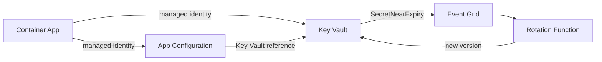

## What this covers

AI solutions handle API keys (Azure OpenAI, Azure AI services), connection strings and model endpoints. Azure Key Vault keeps the sensitive values safe; Azure App Configuration centralizes everything else, such as feature flags and tunable settings. This guide is the one-page summary of both. Each topic page in the [learning path](/study/manage-application-secrets-and-configuration-for-ai-solutions) goes deeper.

**Exam weight:** Secure, monitor, and troubleshoot Azure solutions (20–25%)

**Skills measured**

- "Secure secrets by using Azure Key Vault, including rotation and retrieval"
- "Store and retrieve app configuration information by using Azure App Configuration"

## Key concepts

### Azure Key Vault

- **Secrets**: API keys, connection strings, passwords (up to 25 KB each). Each write creates a new version.
- **Keys**: encryption and signing keys for customer-managed key (CMK) scenarios. Operations run inside the vault.
- **Certificates**: X.509 with private key and automatic renewal.
- **Managed identity**: apps authenticate to Key Vault without any credential in code.
- **Permission models**: Azure RBAC (recommended; roles such as Key Vault Secrets User) or legacy vault access policies.
- **Soft delete** (always on, 7–90 days) and **purge protection** (optional, irreversible).
- **Rotation**: expiry dates plus `SecretNearExpiry` events (30 days ahead) through Event Grid for secrets; native rotation policies for keys.
- **Throttling**: limits per vault per 10 seconds; cache secrets in the app.

### Azure App Configuration

- Key-values with **labels** for environments, e.g. model deployment name or rate limits per environment.
- **Feature flags** to turn features on or off, or roll them out gradually, without redeploying.
- **Key Vault references** so one `load()` returns settings and secrets.
- **Dynamic refresh** with a sentinel key, so you can change settings without redeploying containers.
- **Snapshots** for immutable release configuration and rollback.

Topic pages:

- [Store and organize secrets, keys, and certificates](/study/manage-application-secrets-and-configuration-for-ai-solutions/store-and-organize-secrets-keys-and-certificates)
- [Retrieve secrets using Azure SDK client libraries](/study/manage-application-secrets-and-configuration-for-ai-solutions/retrieve-secrets-using-azure-sdk-client-libraries)
- [Handle secret versioning and rotation](/study/manage-application-secrets-and-configuration-for-ai-solutions/handle-secret-versioning-and-rotation)
- [Implement caching strategies to reduce Key Vault calls](/study/manage-application-secrets-and-configuration-for-ai-solutions/implement-caching-strategies-to-reduce-key-vault-calls)
- [Connect to App Configuration from application code](/study/manage-application-secrets-and-configuration-for-ai-solutions/connect-to-app-configuration-from-application-code)
- [Organize settings with labels and feature flags](/study/manage-application-secrets-and-configuration-for-ai-solutions/organize-settings-with-labels-and-feature-flags)
- [Refresh configuration dynamically and use snapshots](/study/manage-application-secrets-and-configuration-for-ai-solutions/refresh-configuration-dynamically-and-use-snapshots)
- [Reference Key Vault secrets from App Configuration](/study/manage-application-secrets-and-configuration-for-ai-solutions/reference-key-vault-secrets-from-app-configuration)
- [Decide what to store in App Configuration vs Key Vault](/study/manage-application-secrets-and-configuration-for-ai-solutions/decide-what-to-store-in-app-configuration-vs-key-vault)

## How it works



The app loads settings and resolved secrets from App Configuration, caches them and refreshes on a schedule. Rotation writes new secret versions, which the app picks up through versionless references.

## Hands-on

### Azure portal

1. Create a Key Vault with **Azure role-based access control** and purge protection.
2. Turn on the Container App's **system-assigned identity**.
3. On the vault, assign **Key Vault Secrets User** to that identity.
4. Create an App Configuration store, assign **App Configuration Data Reader**, and add a Key Vault reference for the API key.

### Azure CLI

```bash
# Create Key Vault (RBAC permission model)
az keyvault create \
  --name kv-ai200 \
  --resource-group rg-ai200 \
  --location eastus \
  --enable-rbac-authorization true \
  --enable-purge-protection true

# Store the Azure OpenAI API key
az keyvault secret set \
  --vault-name kv-ai200 \
  --name openai-api-key \
  --value "<api-key>"

# Assign managed identity to Container App
PRINCIPAL_ID=$(az containerapp identity assign \
  --name ai-api \
  --resource-group rg-ai200 \
  --system-assigned \
  --query principalId -o tsv)

# Recommended: Azure RBAC
az role assignment create \
  --assignee-object-id "$PRINCIPAL_ID" \
  --assignee-principal-type ServicePrincipal \
  --role "Key Vault Secrets User" \
  --scope $(az keyvault show --name kv-ai200 --query id -o tsv)

# Legacy alternative: only on a vault that uses the access policy model
az keyvault set-policy \
  --name kv-ai200 \
  --object-id <principal-id> \
  --secret-permissions get list

# App Configuration with a Key Vault reference
az appconfig create --name appcs-ai200 --resource-group rg-ai200 --location eastus --sku Standard
az appconfig kv set-keyvault --name appcs-ai200 --key "OpenAI:ApiKey" \
  --secret-identifier "https://kv-ai200.vault.azure.net/secrets/openai-api-key" --yes
```

### Python

Read a secret with `DefaultAzureCredential`:

```python
from azure.identity import DefaultAzureCredential
from azure.keyvault.secrets import SecretClient

credential = DefaultAzureCredential()
client = SecretClient(vault_url="https://kv-ai200.vault.azure.net/", credential=credential)

api_key = client.get_secret("openai-api-key").value
```

Load settings and resolved secrets from App Configuration:

```python
from azure.appconfiguration.provider import load, WatchKey
from azure.identity import DefaultAzureCredential

credential = DefaultAzureCredential()
config = load(
    endpoint="https://appcs-ai200.azconfig.io",
    credential=credential,
    keyvault_credential=credential,
    refresh_on=[WatchKey("Sentinel")],
)
api_key = config["OpenAI:ApiKey"]
```

## Exam traps

| Need | Choose |
| --- | --- |
| API key, connection string, password | Key Vault secret |
| Model name, batch size, rate limit | App Configuration key-value |
| Turn a feature on without redeploying | App Configuration feature flag |
| App reads secrets with no stored credential | Managed identity + Key Vault Secrets User |
| Fine-grained, auditable vault access | Azure RBAC (not access policies) |
| Automatic secret rotation | Expiry + `SecretNearExpiry` → Event Grid → Function |
| Pick up config changes without restart | Sentinel key + `refresh()` |

> [!WARNING]
> **Exam trap:** `az keyvault set-policy` does nothing useful on a vault using the RBAC permission model. Know which model the vault uses: access policies vs RBAC.

> [!WARNING]
> **Exam trap:** Prefer managed identity over connection strings in production, for Key Vault, App Configuration and the target services themselves.

> [!TIP]
> App Configuration is the front door; Key Vault is the safe behind it.

## Quick review

- Use managed identity and `DefaultAzureCredential` everywhere.
- Key Vault Secrets User is the least-privilege read role.
- RBAC is recommended over access policies.
- New secret value = new version; versionless references pick it up.
- `SecretNearExpiry` fires 30 days before expiry.
- App Configuration labels separate environments; feature flags gate features.
- Key Vault references give one retrieval path for settings and secrets.
- Refresh configuration without redeploying containers by watching a sentinel key.

## Practice

[Practice: Azure Key Vault questions](/practice/key-vault)

[Practice: Azure App Configuration questions](/practice/app-configuration)

## Official references

- [Azure Key Vault](https://learn.microsoft.com/azure/key-vault/)
- [Azure App Configuration](https://learn.microsoft.com/azure/azure-app-configuration/)
- [Manage application secrets and configuration for AI solutions (learning path)](https://learn.microsoft.com/training/paths/manage-app-secrets-configuration/)
- [AI-200 study guide](https://learn.microsoft.com/credentials/certifications/resources/study-guides/ai-200)
