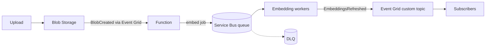

## What this covers

AI solutions often process documents, embeddings and inference requests asynchronously. Azure Service Bus queues and routes the work itself; Azure Event Grid announces that something happened so other services can react. Together they are the messaging half of AI-200's "Connect to and consume Azure services" area. This guide is the one-page summary; each topic links to a deeper study page.

**Exam weight:** Connect to and consume Azure services (20–25%)

**Skills measured**

- "Queue and process back-end operations by using Azure Service Bus, including dead-letter queue handling, messages, topics, and subscriptions"
- "Implement event-driven workflows by using Azure Event Grid, including filters, custom events, and retries"

## Key concepts

### Service Bus

- **Queues**: point-to-point messaging with competing consumers; each message goes to one receiver.
- **Topics/subscriptions**: pub/sub with SQL, correlation or boolean filters; each matching subscription gets a copy.
- **Peek-lock** (default) with complete, abandon, dead-letter and defer; lock duration up to 5 minutes.
- **Dead-letter queue (DLQ)**: failed messages kept for inspection and retry. Reasons include max delivery count exceeded (default 10) and TTL expired (when dead-lettering on expiration is enabled).
- Sessions for FIFO, duplicate detection on `message_id`, claim-check for payloads over 256 KB (Standard) or 100 MB (Premium).

Deeper: [concepts](/study/integrate-backend-services-for-ai-solutions/explore-azure-service-bus-concepts-and-messaging-in-ai-architectures), [queues vs topics](/study/integrate-backend-services-for-ai-solutions/choose-between-queues-and-topics-with-subscriptions), [message structure](/study/integrate-backend-services-for-ai-solutions/structure-messages-for-ai-workloads), [reliable processing](/study/integrate-backend-services-for-ai-solutions/process-messages-reliably).

### Event Grid

- **Reactive event routing**: blob uploaded, then Event Grid triggers the embedding job.
- System topics (Azure sources), custom topics (your events), namespace topics (pull delivery, MQTT).
- CloudEvents v1.0 is the recommended schema; filter by event type, subject prefix/suffix and advanced filters on `data`.
- Retries with exponential backoff for up to 24 hours (max 30 attempts by default); dead-letter to a Blob container (off by default).

Deeper: [concepts](/study/integrate-backend-services-for-ai-solutions/understand-azure-event-grid-concepts-and-event-driven-patterns-for-ai-solutions), [schemas and filters](/study/integrate-backend-services-for-ai-solutions/work-with-event-schemas-and-properties), [retries](/study/integrate-backend-services-for-ai-solutions/configure-delivery-and-retry-policies-for-reliable-event-processing), [publishing](/study/integrate-backend-services-for-ai-solutions/publish-custom-events-from-ai-applications).

## How it works



Event Grid tells the pipeline that work exists; Service Bus holds that work durably until a worker finishes it.

## Hands-on

### Azure portal

1. Create a **Standard** Service Bus namespace and a queue with max delivery count 5.
2. On a storage account, open **Events** and add an event subscription for **Blob Created** to a Function.
3. Use **Service Bus Explorer** to view the DLQ.

### Azure CLI

```bash
# Service Bus namespace and queue
az servicebus namespace create \
  --name sb-ai200 \
  --resource-group rg-ai200 \
  --location eastus \
  --sku Standard

az servicebus queue create \
  --name embed-jobs \
  --namespace-name sb-ai200 \
  --resource-group rg-ai200 \
  --max-delivery-count 5 \
  --enable-dead-lettering-on-message-expiration true

# Event Grid topic
az eventgrid topic create \
  --name eg-ai200 \
  --resource-group rg-ai200 \
  --location eastus \
  --input-schema cloudeventschemav1_0
```

### Python

Send an embedding job to the queue:

```python
from azure.servicebus import ServiceBusClient, ServiceBusMessage
import json

with ServiceBusClient.from_connection_string(conn_str) as client:
    sender = client.get_queue_sender("embed-jobs")
    with sender:
        message = ServiceBusMessage(
            json.dumps({"documentId": "doc-42", "blobUrl": "https://..."})
        )
        sender.send_messages(message)
```

Prefer `ServiceBusClient("<namespace>.servicebus.windows.net", DefaultAzureCredential())` with the **Azure Service Bus Data Sender** role in production.

Publish a custom event:

```python
from azure.identity import DefaultAzureCredential
from azure.core.messaging import CloudEvent
from azure.eventgrid import EventGridPublisherClient

client = EventGridPublisherClient("<topic-endpoint>", DefaultAzureCredential())
client.send(CloudEvent(type="com.contoso.ai.EmbeddingsRefreshed", source="/embeddings",
                       data={"documentId": "doc-42"}))
```

## Exam traps

| Need | Choose |
| --- | --- |
| Single consumer per message | Service Bus queue |
| Multiple subscribers, each with its own copy | Service Bus topic (or Event Grid for notifications) |
| Guaranteed processing, ordering, transactions | Service Bus |
| Lightweight, fire-and-forget notification of a state change | Event Grid |
| React to Azure resource changes | Event Grid system topic |

> [!WARNING]
> **Exam trap:** Know the Service Bus DLQ reasons: max delivery count exceeded and TTL expired (only when dead-lettering on expiration is on), plus anything your code dead-letters explicitly.

> [!WARNING]
> **Exam trap:** Event Grid vs Service Bus is events vs messages. Event Grid retries delivery but is unordered and drops events after retries unless a Blob dead-letter container is configured.

> [!TIP]
> Queue vs topic = one consumer vs many subscribers.

## Quick review

- Service Bus queues: one receiver per message; topics: one copy per subscription.
- Peek-lock + complete/abandon/dead-letter is the reliable processing loop.
- Max delivery count defaults to 10; lock duration max 5 minutes.
- Event Grid: at-least-once, unordered, retries up to 24 hours or 30 attempts.
- CloudEvents v1.0 is the recommended event schema.
- Use managed identity with data-plane roles for both services.

## Practice

- [Practice: Service Bus questions](/practice/service-bus)
- [Practice: Event Grid questions](/practice/event-grid)

## Official references

- [Azure Service Bus](https://learn.microsoft.com/en-us/azure/service-bus-messaging/)
- [Azure Event Grid](https://learn.microsoft.com/en-us/azure/event-grid/)
- [Queue and process AI operations with Azure Service Bus (module)](https://learn.microsoft.com/training/modules/queue-process-operations-service-bus/)
- [Develop event-driven AI workflows with Azure Event Grid (module)](https://learn.microsoft.com/training/modules/event-driven-workflows-event-grid/)
- [Compare Azure messaging services](https://learn.microsoft.com/azure/service-bus-messaging/compare-messaging-services)
