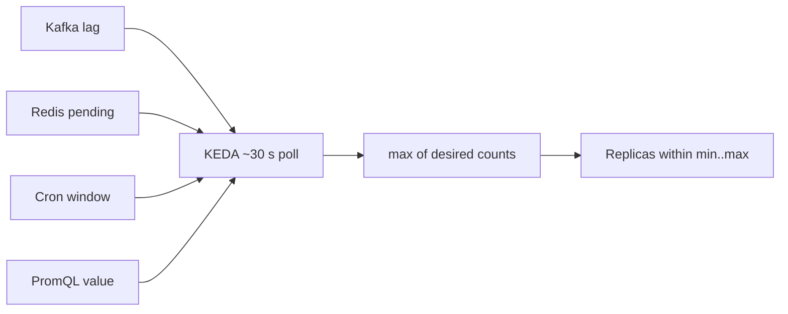

## What this covers

Beyond the Azure-native scalers, Container Apps accepts any **ScaledObject-based** KEDA scaler: Kafka consumer lag, Redis Lists and Streams, Prometheus queries, cron windows, PostgreSQL, MySQL, MongoDB and more. This page covers the common ones, how their metadata maps to replicas, how to combine scheduled and reactive scaling, and how to translate a Kubernetes KEDA `ScaledObject` into Container Apps scale rules.

**Exam weight:** Develop containerized solutions on Azure (20–25%)

**Skills measured**

- "Implement event-driven scaling by using Kubernetes Event-driven Autoscaling (KEDA) in Container Apps"

## Key concepts

### Scaler tiers

| Tier | Examples | Exam note |
|---|---|---|
| Microsoft-maintained | Service Bus, Event Hubs, Storage Queue | Prefer these for Azure resources |
| Community-maintained | Kafka, Redis, Cron, Prometheus, PostgreSQL | Support and docs vary |
| External scalers | Your own gRPC scaler service | Separate deployment. Not part of built-in ACA config |

Before using a scaler in production, check which auth methods it supports, what its metric means and how the threshold maps to replicas.

### When to use custom scalers

| Use custom KEDA scalers | Avoid or use alternatives |
|---|---|
| Kafka, Redis or Prometheus is already in your stack | The source is Service Bus or Event Hubs: use native scalers |
| Business metrics exist only in Prometheus | Simple HTTP API: use HTTP concurrency |
| Predictable peak hours (cron + HTTP) | You need sub-second reaction (KEDA polls about every 30 s) |
| Multi-cloud or hybrid messaging (Kafka) | You'd need an external gRPC scaler |

### Apache Kafka (`kafka`)

Scales on **consumer-group lag** (latest offset minus committed offset). Metadata: `bootstrapServers`, `consumerGroup`, `topic`, `lagThreshold` (lag per replica). Lag of 500 with a threshold of 100 gives 5 replicas. Auth supports SASL/PLAIN, SASL/SCRAM and TLS through secrets mapped to `sasl`, `username` and `password` (and `tls`). **Replicas ≤ partitions**, the same rule as Event Hubs. For greenfield Azure workloads, Event Hubs (which also speaks the Kafka protocol) has a first-party scaler.

### Redis

- **Redis Lists** (`redis`): `LLEN` on `listName` compared with `listLength`. Good for simple `LPUSH`/`BRPOP` work queues.
- **Redis Streams** (`redis-streams`): `pendingEntriesCount` for a `consumerGroup` on a `stream`. It counts delivered but **unacknowledged** entries, so work held by a crashed worker still counts.
- Cluster and Sentinel variants exist (`redis-cluster`, `redis-sentinel`, and so on). Pick the one that matches your topology.
- Don't use Redis as a durable, high-volume broker. Memory cost and eviction risk make Service Bus or Kafka the better fit for that.

### Cron (`cron`)

Requests a **fixed** `desiredReplicas` between `start` and `end` (cron expressions) in a `timezone`. Outside the window it has no effect. It sets a baseline, so pair it with a reactive rule.

### Prometheus (`prometheus`)

Runs the PromQL `query` against `serverAddress` and computes **result ÷ `threshold`** as the desired replica count. Use it for active sessions, pending transactions, SLO signals and other app-specific metrics. (`metricName` is optional in newer KEDA versions.)

### Multiple rules

When several scalers are active, Container Apps uses the **highest** replica count among them.

## How it works



### Converting a ScaledObject

| KEDA ScaledObject | Container Apps |
|---|---|
| `triggers[].type` | `--scale-rule-type` / `custom.type` |
| `triggers[].metadata` | `--scale-rule-metadata` / `custom.metadata` |
| `TriggerAuthentication` | Secrets + `--scale-rule-auth` / `auth[]`, or `--scale-rule-identity` |
| `minReplicaCount` / `maxReplicaCount` | `--min-replicas` / `--max-replicas` |

Container Apps has no `TriggerAuthentication` resource. You reference secrets inline. External scalers and custom polling intervals may not be available.

## Hands-on

### Azure portal

1. Open **Application > Scale > Add > Custom**.
2. Enter the KEDA type exactly as KEDA names it (`kafka`, `redis`, `redis-streams`, `cron`, `prometheus`) and add the metadata pairs.
3. Add authentication by mapping app secrets to trigger parameters. Save, then watch **Replica count**.

### Azure CLI

```bash
# Kafka lag scaler
az containerapp update --name ai-stream-processor --resource-group rg-ai200 \
  --min-replicas 1 --max-replicas 32 \
  --secrets "kafka-sasl=plaintext" "kafka-user=<user>" "kafka-password=<password>" \
  --scale-rule-name kafka-scaling --scale-rule-type kafka \
  --scale-rule-metadata "bootstrapServers=kafka:9092" "consumerGroup=embedding-workers" \
      "topic=document-events" "lagThreshold=50" \
  --scale-rule-auth "sasl=kafka-sasl" "username=kafka-user" "password=kafka-password"

# Cron baseline during business hours
az containerapp update --name chat-api --resource-group rg-ai200 \
  --scale-rule-name business-hours --scale-rule-type cron \
  --scale-rule-metadata "timezone=America/New_York" "start=0 8 * * 1-5" \
      "end=0 18 * * 1-5" "desiredReplicas=5"

# Prometheus query scaler
az containerapp update --name llm-gateway --resource-group rg-ai200 \
  --scale-rule-name prometheus-scaling --scale-rule-type prometheus \
  --scale-rule-metadata "serverAddress=http://prometheus:9090" \
      "metricName=active_inference_requests" "query=sum(active_inference_requests)" "threshold=20"
```

YAML for Redis and cron + HTTP:

```yaml
scale:
  minReplicas: 0
  maxReplicas: 20
  rules:
    - name: redis-list-scaling
      custom:
        type: redis
        metadata:
          address: "redis-cache.redis.cache.windows.net:6380"
          listName: "embedding-jobs"
          listLength: "10"
          enableTLS: "true"
        auth:
          - secretRef: redis-password
            triggerParameter: password
    - name: business-hours
      custom:
        type: cron
        metadata:
          timezone: "America/New_York"
          start: "0 8 * * 1-5"
          end: "0 18 * * 1-5"
          desiredReplicas: "5"
    - name: http-scaling
      http:
        metadata:
          concurrentRequests: "50"
```

ScaledObject to Container Apps:

```yaml
# KEDA (Kubernetes)
apiVersion: keda.sh/v1alpha1
kind: ScaledObject
metadata:
  name: order-processor
spec:
  scaleTargetRef:
    name: order-processor
  minReplicaCount: 0
  maxReplicaCount: 50
  triggers:
    - type: kafka
      metadata:
        bootstrapServers: kafka:9092
        consumerGroup: order-consumers
        topic: orders
        lagThreshold: "100"
      authenticationRef:
        name: kafka-auth
---
# Container Apps equivalent (template.scale)
scale:
  minReplicas: 0
  maxReplicas: 50
  rules:
    - name: kafka-scaling
      custom:
        type: kafka
        metadata:
          bootstrapServers: "kafka:9092"
          consumerGroup: "order-consumers"
          topic: "orders"
          lagThreshold: "100"
        auth:
          - secretRef: kafka-sasl
            triggerParameter: sasl
          - secretRef: kafka-user
            triggerParameter: username
          - secretRef: kafka-password
            triggerParameter: password
```

### Python

A Redis Streams worker that acknowledges entries, so `pendingEntriesCount` reflects work that is actually unfinished:

```python
# pip install redis
import redis

r = redis.Redis(host="<redis-host>", port=6380, ssl=True, password="<from-secret-env>")
try:
    r.xgroup_create("inference-tasks", "gpu-workers", id="0", mkstream=True)
except redis.ResponseError:
    pass  # group exists

while True:
    for _, entries in r.xreadgroup("gpu-workers", "replica-1", {"inference-tasks": ">"},
                                   count=5, block=5000) or []:
        for entry_id, fields in entries:
            # run inference ...
            r.xack("inference-tasks", "gpu-workers", entry_id)
```

## Exam traps

| Signal | Scaler | Threshold key |
|---|---|---|
| Kafka consumer lag | `kafka` | `lagThreshold` |
| Redis list length | `redis` | `listLength` |
| Redis unacked entries | `redis-streams` | `pendingEntriesCount` |
| Business-hours baseline | `cron` | `desiredReplicas` |
| Custom app metric | `prometheus` | `threshold` |

> [!WARNING]
> **Exam trap:** Cron alone doesn't react to load. During the window it holds `desiredReplicas` even when idle, and that costs money. Combine it with HTTP or queue rules.

> [!WARNING]
> **Exam trap:** If the source is on Azure (Service Bus, Event Hubs, Storage Queue), the expected answer is the first-party scaler, not a community one.

> [!TIP]
> Multiple rules means max wins. Off-hours with no traffic gives 0 replicas. Business hours give at least 5. A traffic spike lets the HTTP rule go above 5.

> [!NOTE]
> There's no separate KEDA fee. You pay for replicas plus the backing service (Kafka cluster, Redis SKU, Prometheus hosting). Keep PromQL queries cheap, because they run every poll.

## Quick review

- ACA supports ScaledObject-based scalers, but not the `TriggerAuthentication` resource or external scalers.
- Kafka: `lagThreshold` per replica, replicas ≤ partitions, SASL via `sasl`/`username`/`password`.
- Redis Lists use `LLEN`. Redis Streams count pending (unacked) entries.
- Cron: `start`/`end`/`timezone`/`desiredReplicas` set a baseline.
- Prometheus: query ÷ threshold = replicas.
- With several active rules, the highest replica count wins.

## Practice

[Practice: KEDA scaling questions](/practice/aca-keda)

## Official references

- [Learn unit: Apply KEDA scalers for custom workloads](https://learn.microsoft.com/en-us/training/modules/scale-containers-azure-container-apps/4-keda-scalers-custom-workloads)
- [Scale rules in Azure Container Apps](https://learn.microsoft.com/en-us/azure/container-apps/scale-app)
- [KEDA scalers catalog](https://keda.sh/docs/latest/scalers/)
- [KEDA Apache Kafka scaler](https://keda.sh/docs/latest/scalers/apache-kafka/)
- [KEDA Redis scaler](https://keda.sh/docs/latest/scalers/redis-lists/)
- [KEDA Cron scaler](https://keda.sh/docs/latest/scalers/cron/)
- [KEDA Prometheus scaler](https://keda.sh/docs/latest/scalers/prometheus/)
- [Azure Container Apps pricing](https://azure.microsoft.com/pricing/details/container-apps/)
- [AI-200 study guide](https://learn.microsoft.com/en-us/credentials/certifications/resources/study-guides/ai-200)
