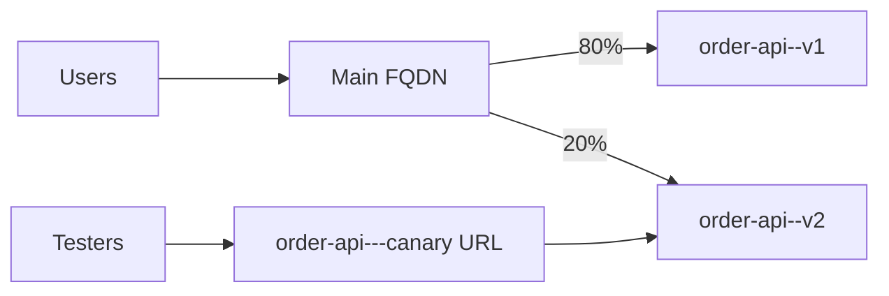

## What this covers

**Revision modes** control how Azure Container Apps rolls out new versions and whether more than one version runs at the same time. The choice affects zero-downtime updates, traffic splitting, canary and blue-green releases, and how replicas (and cost) scale during a rollout.

**Exam weight:** Develop containerized solutions on Azure (20–25%)

**Skills measured**

- "Deploy applications to Azure Container Apps, including environment configuration and revision management"
- "Implement event-driven scaling by using KEDA in Container Apps"

## Key concepts

### Revisions and replicas

A **revision** is an immutable snapshot of the app. Changing the image, scale rules, env vars or other `template` properties creates a **new revision**. You can't edit an existing one, and you roll back by reactivating an older one. **Replicas** are running instances of a specific revision. Each active revision scales on its own rules and its own share of traffic.

| Creates a new revision (revision-scope) | Doesn't (application-scope) |
|---|---|
| Container image | Secrets |
| Scale rules | Ingress settings |
| Environment variables | Traffic splitting weights |
| Other `template` properties (CPU/memory, probes) | Registries, Dapr, identity |

### Single revision mode (default)

Keeps **one active revision**. When you deploy, ACA starts the new revision, waits until it's ready (readiness probes pass and it reaches the previous replica count), moves **all traffic** to it, then **deactivates** the old one. That's zero downtime by default. A broken revision never takes traffic, and the old one keeps serving.

**Use when:** simple replace-style deployments. **Don't use when:** you need canary releases, A/B tests or gradual rollout.

### Multiple revision mode

Several revisions stay **active** at once. Each can receive traffic and scale independently until you deactivate it. This enables canary, blue-green and A/B patterns, at the cost of more operational work: you manage weights, watch each revision, and deactivate old ones.

| State | Receives traffic | Uses compute |
|---|---|---|
| **Active** | Yes (if it has weight or a label) | Yes, scales per its rules |
| **Inactive** | No | No. Kept for rollback (max 100 by default) |

### Traffic splitting

Weights across active revisions must add up to **100**. Routing is **probabilistic** per request, so actual percentages drift slightly. A `latest` weight targets the newest revision automatically, so CI/CD doesn't have to know revision names. Canary pattern: 5–10%, monitor, 50%, 100%, then deactivate the old revision.

### Revision labels

A **label** gives a revision its own stable URL (`<app>---<label>.<env-domain>`). That URL always reaches the labeled revision and **ignores** the traffic split on the main URL. Moving a label is atomic. Use labels for tester-only canary URLs and blue/green staging. Naming rules: start with a letter, lowercase letters, digits and dashes only, no consecutive dashes, max 64 characters.

## How it works



### Scaling with multiple revisions

| Scenario | Effect |
|---|---|
| 50/50 split, `minReplicas: 1` each | At least **2 replicas** in total |
| Each revision sees half the traffic | Each may scale more slowly than one revision at 100% |
| Long-running 50/50 split | Higher cost. Deactivate the old revision when done |

Move through splits quickly (10%, validate, 100%) and watch replica count, errors and CPU **per revision** in Azure Monitor.

## Hands-on

### Azure portal

1. Open **Application > Revisions and replicas > Choose revision mode** and select **Multiple**.
2. Deploy a new revision. In **Revisions**, set **Traffic %** for each active revision (the total must be 100) and save.
3. Add a **Label** to the new revision and share its URL with testers.
4. After cutover, **Deactivate** the old revision.

### Azure CLI

```bash
# Switch to multiple revision mode
az containerapp revision set-mode --name order-api --resource-group rg-ecommerce --mode multiple
# (equivalently: az containerapp update ... --revision-mode multiple)

# Deploy v2 with a readable name
az containerapp update --name order-api --resource-group rg-ecommerce \
  --image myregistry.azurecr.io/order-api:v2 --revision-suffix v2

# Canary 80/20
az containerapp ingress traffic set --name order-api --resource-group rg-ecommerce \
  --revision-weight order-api--v1=80 order-api--v2=20

# Or let new deployments get 20% automatically
az containerapp ingress traffic set --name order-api --resource-group rg-ecommerce \
  --revision-weight order-api--v1=80 latest=20

# Label for direct testing; swap labels for blue/green
az containerapp revision label add --name order-api --resource-group rg-ecommerce \
  --label canary --revision order-api--v2
az containerapp revision label swap --name order-api --resource-group rg-ecommerce \
  --source blue --target green

# Finish: 100% to v2, retire v1
az containerapp ingress traffic set --name order-api --resource-group rg-ecommerce \
  --revision-weight order-api--v2=100
az containerapp revision deactivate --name order-api --resource-group rg-ecommerce \
  --revision order-api--v1
```

### Python

```python
from azure.identity import DefaultAzureCredential
from azure.mgmt.appcontainers import ContainerAppsAPIClient
from azure.mgmt.appcontainers.models import TrafficWeight

client = ContainerAppsAPIClient(DefaultAzureCredential(), "<subscription-id>")
rg, name = "rg-ecommerce", "order-api"
app = client.container_apps.get(rg, name)
app.configuration.active_revisions_mode = "Multiple"
app.configuration.ingress.traffic = [
    TrafficWeight(revision_name="order-api--v1", weight=90),
    TrafficWeight(revision_name="order-api--v2", weight=10, label="canary"),
]
client.container_apps.begin_create_or_update(rg, name, app).result()
```

## Exam traps

| | Single revision | Multiple revision |
|---|---|---|
| Active revisions | 1 | Many |
| Zero-downtime deploy | Automatic | You shift traffic |
| Traffic splitting / canary / A/B | No | Yes |
| Labels | Rarely needed | Very useful |
| Operational effort | Low | Higher |
| Default | Yes | Opt-in |

> [!WARNING]
> **Exam trap:** Traffic weights and secrets are application-scope. Changing them never creates a revision. Changing the image or env vars always does.

> [!WARNING]
> **Exam trap:** A label URL bypasses the traffic split. Testers on the label reach the labeled revision even when its weight is 0%.

> [!TIP]
> Canary = multiple mode + weights. Blue/green = multiple mode + labels (swap). Simple replace = single mode.

> [!NOTE]
> Each active revision has its own `minReplicas`, so leaving old revisions active quietly doubles the baseline cost.

## Quick review

- Single mode is the default: one active revision and an automatic zero-downtime swap.
- Multiple mode: many active revisions, `ingress traffic set --revision-weight`.
- Weights total 100, routing is probabilistic, and `latest` follows the newest revision.
- Labels: a stable per-revision URL, independent of weights, atomic swap.
- Up to 100 inactive revisions are kept for rollback.
- Active revisions scale independently. Deactivate old ones promptly.

## Practice

[Practice: Container Apps deployment questions](/practice/aca-deploy) · [Practice: KEDA scaling questions](/practice/aca-keda)

## Official references

- [Learn unit: Choose and apply revision modes](https://learn.microsoft.com/en-us/training/modules/scale-containers-azure-container-apps/6-revision-modes-traffic-management)
- [Revisions in Azure Container Apps](https://learn.microsoft.com/en-us/azure/container-apps/revisions)
- [Traffic splitting](https://learn.microsoft.com/en-us/azure/container-apps/traffic-splitting)
- [Revision labels](https://learn.microsoft.com/en-us/azure/container-apps/revisions-manage#revision-labels)
- [AI-200 study guide](https://learn.microsoft.com/en-us/credentials/certifications/resources/study-guides/ai-200)
