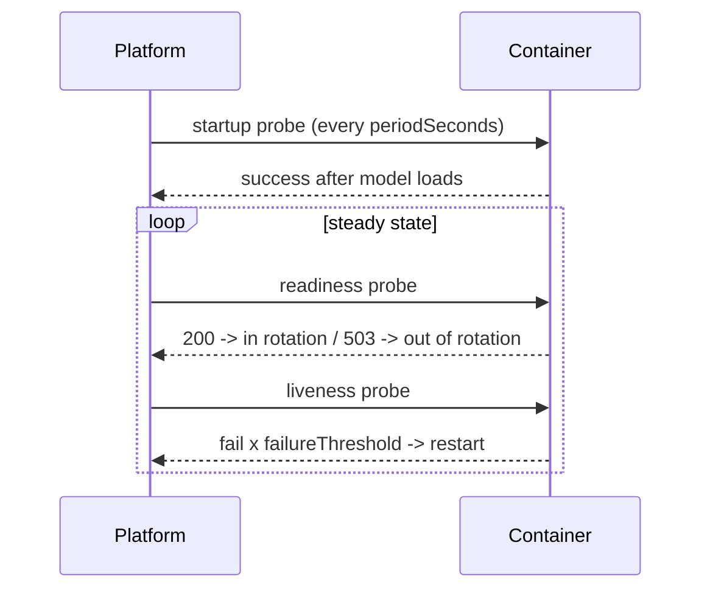

## What this covers

Health probes let the Container Apps runtime decide whether a replica has started, whether it's still alive and whether it can take traffic. They are what makes single revision mode's zero-downtime swap safe. Misconfigured probes are also one of the most common reasons a new revision never becomes healthy. This page covers the three probe types, their settings and defaults, how to configure them, and how to troubleshoot probe failures for AI services that load models slowly.

**Exam weight:** Develop containerized solutions on Azure (20–25%)

**Skills measured**

- "Monitor and troubleshoot solutions on AKS and Container Apps"
- "Deploy applications to Azure Container Apps, including environment configuration and revision management"

## Key concepts

### Probe types

| Probe | Question it answers | On failure |
|---|---|---|
| **Startup** | Has the app finished starting? Liveness and readiness wait until it passes | Container restarted after `failureThreshold` |
| **Liveness** | Is the process still healthy? | Container restarted |
| **Readiness** | Can this replica take traffic now? | Replica removed from load balancing (not restarted) |

For AI APIs, use **startup** or **readiness** to guard model loading and dependency warm-up. Use **liveness** as a safety valve for deadlocks. Keep liveness cheap and don't make it depend on external systems, or an outage in a dependency will restart every replica.

### Protocols and rules

- `httpGet` (path, port, optional `httpHeaders`, `scheme` HTTP or HTTPS) or `tcpSocket` (port). Nothing else.
- HTTP success means a status code from 200 to 399.
- One probe of each type per container. No `exec` probes, no gRPC probes, numeric ports only.
- Settings: `initialDelaySeconds`, `periodSeconds`, `timeoutSeconds`, `failureThreshold`, `successThreshold`.

### Defaults when ingress is enabled

If ingress is on and you don't define a probe type, the platform adds TCP probes on the ingress target port to the main container (not to sidecars, and not on GPU workload profiles):

| Probe | Default |
|---|---|
| Startup | TCP, timeout 3 s, period 1 s, initial delay 1 s, failure threshold 240 |
| Liveness | TCP on target port |
| Readiness | TCP, timeout 5 s, period 5 s, initial delay 3 s, failure threshold 48 |

A TCP probe only proves the port is open, not that the model has loaded. Define an HTTP readiness probe when "listening" isn't the same as "ready".

### Revision health

A revision shows **Unhealthy** if any of its replicas fails readiness. In single revision mode, traffic only moves to the new revision once readiness passes. In multiple revision mode, wait for readiness before you shift traffic weights.

## How it works



Time budget: a probe gives up after roughly `initialDelaySeconds + periodSeconds × failureThreshold`. If the model takes 90 seconds to load, that budget must be larger than 90 seconds.

## Hands-on

### Azure portal

1. Open **Application > Containers > Edit and deploy** and select the container.
2. Open the **Health probes** tab. Enable startup, liveness or readiness and set the transport, path, port, delays and thresholds.
3. Select **Save > Create** to deploy a new revision. Probes are template settings, so this creates a revision.

### Azure CLI

The CLI has no dedicated probe flags, so you apply probes with YAML:

```yaml
properties:
  template:
    containers:
      - name: api
        image: <registry>.azurecr.io/<repo>@sha256:<digest>
        probes:
          - type: Startup
            httpGet: { path: /health/startup, port: 8080 }
            periodSeconds: 5
            failureThreshold: 30        # up to ~150 s to load the model
          - type: Readiness
            httpGet: { path: /health/ready, port: 8080 }
            initialDelaySeconds: 20
            periodSeconds: 10
            timeoutSeconds: 2
            failureThreshold: 3
          - type: Liveness
            httpGet: { path: /health/live, port: 8080 }
            initialDelaySeconds: 60
            periodSeconds: 10
            timeoutSeconds: 2
            failureThreshold: 3
```

```bash
az containerapp update --name <app-name> --resource-group <resource-group> --yaml ./probes.yml

# Diagnose
az containerapp revision list --name <app-name> --resource-group <resource-group> \
  --query "[].{name:name,health:properties.healthState,running:properties.runningState}" -o table
az containerapp logs show --name <app-name> --resource-group <resource-group> --type system --tail 50
az containerapp show --name <app-name> --resource-group <resource-group> \
  --query "properties.template.containers[0].probes"
```

### Python

```python
# FastAPI endpoints that match the probes above
import threading
from fastapi import FastAPI, Response

app = FastAPI()
state = {"model": None}

def load_model():
    state["model"] = object()  # load weights here

threading.Thread(target=load_model, daemon=True).start()

@app.get("/health/live")
def live():
    return {"status": "alive"}  # cheap, no dependency calls

@app.get("/health/startup")
@app.get("/health/ready")
def ready(response: Response):
    if state["model"] is None:
        response.status_code = 503
        return {"status": "loading"}
    return {"status": "ready"}
```

## Exam traps

| Symptom | Likely cause / fix |
|---|---|
| Revision restarts every few seconds after deploy | Liveness too aggressive. Add a startup probe or raise the initial delay |
| Healthy container but never gets traffic | Readiness path or port wrong (404 or connection refused) |
| Probes fail only during dependency outages | Probe endpoint calls the database or model API. Keep liveness local |
| Want to probe over gRPC or a script | Not supported. Use an HTTP or TCP endpoint |

> [!WARNING]
> **Exam trap:** Readiness failure removes the replica from rotation. Liveness failure restarts it. Swapping them up is a classic distractor.

> [!WARNING]
> **Exam trap:** The default TCP probes pass as soon as the port opens, even if the model hasn't loaded yet. That's why first requests can fail on a "healthy" revision.

> [!TIP]
> Startup protects slow boots. Readiness gates traffic. Liveness restarts hung processes.

> [!NOTE]
> Probe changes are template changes, so each one creates a new revision.

## Quick review

- Three probes: startup, liveness, readiness. Each is HTTP(S) or TCP only.
- HTTP success is 200–399. No exec or gRPC probes. One probe of each type per container.
- With ingress and no probes, default TCP probes are added (readiness failure threshold 48, startup 240).
- One failing replica makes the whole revision Unhealthy.
- Budget: initial delay + period × failure threshold must exceed startup time.
- Configure probes via YAML or the portal. There are no CLI flags.

## Practice

[Practice: container troubleshooting questions](/practice/containers-troubleshoot) · [Practice: Container Apps deployment questions](/practice/aca-deploy)

## Official references

- [Learn unit: Configure health probes and troubleshoot failures](https://learn.microsoft.com/en-us/training/modules/manage-containers-azure-container-apps/5-health-probes)
- [Health probes in Azure Container Apps](https://learn.microsoft.com/en-us/azure/container-apps/health-probes)
- [Troubleshoot Container Apps](https://learn.microsoft.com/en-us/azure/container-apps/troubleshooting)
- [AI-200 study guide](https://learn.microsoft.com/en-us/credentials/certifications/resources/study-guides/ai-200)
