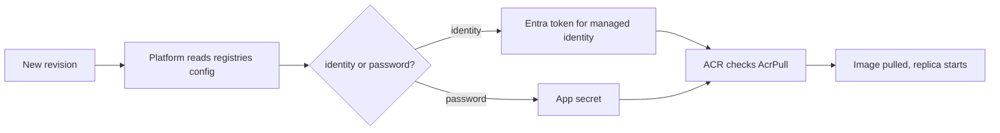

## What this covers

Before Azure Container Apps can start a revision whose image sits in a private registry (usually Azure Container Registry), the app needs credentials or an identity that can pull. You have three options: the ACR admin user, a username and password stored as an app secret, or a managed identity with the `AcrPull` role. Managed identity is the preferred option. This page covers how to set each one up and how pull failures show up.

**Exam weight:** Develop containerized solutions on Azure (20–25%)

**Skills measured**

- "Deploy applications to Azure Container Apps, including environment configuration and revision management"
- "Monitor and troubleshoot solutions on AKS and Container Apps"

## Key concepts

### Registry configuration lives on the app

Registries are listed under `properties.configuration.registries`. Each entry has a `server` plus either `username` + `passwordSecretRef` or `identity`. The `identity` value is `system` for the system-assigned identity, or the resource ID of a user-assigned identity. Don't set a username and password on the same entry when you use an identity. Registry settings are application-scope, but they're used whenever a revision starts.

### Authentication options

| Option | How | When |
|---|---|---|
| Managed identity (preferred) | `registry set --identity system` or a user-assigned ID, plus `AcrPull` on the registry | Production on ACR. No secret to rotate |
| Username/password | `registry set --username --password`. The password is stored as an app secret | Non-ACR registries (Docker Hub, GHCR with a PAT that has `read:packages`) or quick tests |
| ACR admin user | Enable admin on ACR, then use its credentials | Dev only. One shared, all-powerful credential |

### Image reference

Always use the fully qualified name: `myacr.azurecr.io/ai-api:v1`, or a digest `myacr.azurecr.io/ai-api@sha256:<digest>`. The repository part must be lowercase. A mixed-case path fails to pull and looks like an auth error.

### Least privilege

`AcrPull` only allows pulling. Don't grant `AcrPush` or `Contributor` to a runtime identity.

## How it works



**System identity chicken-and-egg:** a system-assigned identity doesn't exist until the app does, so the first `create` can't pull a private image with it unless the CLI handles the ordering. `az containerapp create --registry-identity system` creates the app, assigns the role and then configures the registry. Alternatively, use a **user-assigned identity** that you create and grant `AcrPull` before creating the app. Microsoft recommends user-assigned identities for image pull where possible.

## Hands-on

### Azure portal

1. On the container app, open **Settings > Identity** and turn on the system-assigned identity, or add a user-assigned one.
2. On the registry, open **Access control (IAM) > Add role assignment**. Pick **AcrPull** and select the app's identity.
3. On the app, open **Settings > Registries** (or the container image section of **Edit and deploy**). Add the ACR server and choose **Managed identity**.
4. Deploy a revision with the private image, then check that the revision is **Running** under **Revisions and replicas**.

### Azure CLI

```bash
# Create ACR and build/push an image (cloud build, no local Docker)
az acr create --resource-group rg-ai200 --name acrailearn --sku Basic
az acr build --registry acrailearn --image ai-api:v1 .

# Option A: one step at create time (CLI handles identity + AcrPull)
az containerapp create --name ai-api --resource-group rg-ai200 \
  --environment cae-ai200 --image acrailearn.azurecr.io/ai-api:v1 \
  --registry-server acrailearn.azurecr.io --registry-identity system \
  --target-port 8000 --ingress external

# Option B: existing app, step by step
az containerapp identity assign --name ai-api --resource-group rg-ai200 --system-assigned
PRINCIPAL_ID=$(az containerapp show --name ai-api --resource-group rg-ai200 \
  --query identity.principalId -o tsv)
az role assignment create --assignee "$PRINCIPAL_ID" --role AcrPull \
  --scope "$(az acr show --name acrailearn --query id -o tsv)"
az containerapp registry set --name ai-api --resource-group rg-ai200 \
  --server acrailearn.azurecr.io --identity system
az containerapp update --name ai-api --resource-group rg-ai200 \
  --image acrailearn.azurecr.io/ai-api:v1

# Option C: username/password (non-ACR registry)
az containerapp registry set --name ai-api --resource-group rg-ai200 \
  --server ghcr.io --username <user> --password <pat>

# Inspect what is configured
az containerapp registry list --name ai-api --resource-group rg-ai200 -o table
az containerapp registry show --name ai-api --resource-group rg-ai200 \
  --server acrailearn.azurecr.io
```

Pushing from CI with a local Docker engine works too:

```bash
docker build -t acrailearn.azurecr.io/ai-api:v1 .
az acr login --name acrailearn
docker push acrailearn.azurecr.io/ai-api:v1
```

### Python

Image pull auth is infrastructure, so the app itself has no code for it. You can still audit the configuration with the management SDK:

```python
# pip install azure-identity azure-mgmt-appcontainers
from azure.identity import DefaultAzureCredential
from azure.mgmt.appcontainers import ContainerAppsAPIClient

client = ContainerAppsAPIClient(DefaultAzureCredential(), "<subscription-id>")
app = client.container_apps.get("<resource-group>", "ai-api")
for reg in app.configuration.registries or []:
    mode = f"identity={reg.identity}" if reg.identity else f"user={reg.username}"
    print(reg.server, mode)
print("image:", app.template.containers[0].image)
```

## Exam traps

| Scenario | Answer |
|---|---|
| Production pull from ACR, no secrets | Managed identity + `AcrPull` + `registry set --identity` |
| Several apps pull from the same ACR | One user-assigned identity with `AcrPull`, shared |
| Pull from Docker Hub or GHCR | Username + password/PAT (stored as a secret) |
| Revision stuck provisioning or failed after an image change | Check registry config, role assignment and image name in system logs |

> [!WARNING]
> **Exam trap:** Assigning an identity and granting `AcrPull` isn't enough on its own. The app's registry entry must also reference that identity (`az containerapp registry set --identity`). Without it, the platform tries an anonymous pull and fails.

> [!WARNING]
> **Exam trap:** The ACR admin user works, but it's a single shared credential with push rights. Exam answers that ask for least privilege or no stored secrets point to managed identity.

> [!TIP]
> "Pull" means `AcrPull`. Runtime identities never need `AcrPush`.

> [!NOTE]
> Docker Hub rate limits can stop replicas from starting. Importing images into ACR (`az acr import`) avoids that.

## Quick review

- Registry settings live in `configuration.registries`: `server` + (`identity` | `username` + `passwordSecretRef`).
- `--identity system` or a user-assigned resource ID. Never mix it with a password.
- Grant `AcrPull` on the registry scope.
- `create --registry-identity system` solves the ordering problem of the system identity.
- Use lowercase, fully qualified image names. Prefer digests in production.
- Pull failures show in **system** logs and leave the revision unhealthy.

## Practice

[Practice: Container Apps deployment questions](/practice/aca-deploy) · [Practice: container troubleshooting questions](/practice/containers-troubleshoot)

## Official references

- [Learn unit: Configure image pull authentication for private registries](https://learn.microsoft.com/en-us/training/modules/deploy-containers-azure-container-apps/5-connect-to-registries)
- [Image pull with managed identity](https://learn.microsoft.com/en-us/azure/container-apps/managed-identity-image-pull)
- [Containers in Azure Container Apps: registries](https://learn.microsoft.com/en-us/azure/container-apps/containers)
- [Azure Container Registry authentication](https://learn.microsoft.com/en-us/azure/container-registry/container-registry-authentication)
- [Container Apps managed identities](https://learn.microsoft.com/en-us/azure/container-apps/managed-identity)
- [AI-200 study guide](https://learn.microsoft.com/en-us/credentials/certifications/resources/study-guides/ai-200)
