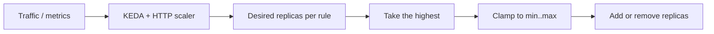

## What this covers

Azure Container Apps scales horizontally by adding and removing replicas based on declarative **scale rules**. This page covers the scale definition (limits, rules, behavior), the built-in HTTP and TCP rules, the CPU and memory rules, the timing parameters behind scaling decisions, and the defaults that catch people out on the exam. Event-driven rules for queues and streams are on [Implement event-driven scaling with KEDA](/study/deploy-and-manage-apps-on-azure-container-apps/implement-event-driven-scaling-with-keda).

**Exam weight:** Develop containerized solutions on Azure (20–25%)

**Skills measured**

- "Implement event-driven scaling by using KEDA in Container Apps"

## Key concepts

### Scale definition = limits + rules + behavior

- **Limits:** `minReplicas` (default 0) and `maxReplicas` (default 10, up to 1,000 per revision).
- **Rules:** the triggers. Each has a name, a type and metadata, plus optional auth.
- **Behavior:** fixed platform timings (below). KEDA powers all of it under the hood.

### Defaults

- With **ingress enabled and no rules**, the app gets an HTTP rule and scales between 0 and 10 replicas.
- With **ingress disabled, no rules and `minReplicas` 0**, the app scales to zero and **never comes back**, because nothing triggers it. Set `minReplicas ≥ 1` or add an event rule.

### Rule types

| Rule | Metric | Default / key setting | Scale to zero? |
|---|---|---|---|
| HTTP | Concurrent requests per replica (requests in the last 15 s ÷ 15) | `concurrentRequests` default **10** | Yes |
| TCP | Concurrent TCP connections per replica | `concurrentConnections` | Yes |
| CPU (custom `cpu`) | Average utilization % | `type: Utilization`, `value: "70"` | **No** |
| Memory (custom `memory`) | Average utilization % | `type: Utilization`, `value` | **No** |
| Custom KEDA (queue, stream, cron...) | External metric | Scaler-specific | Yes |

- HTTP suits synchronous APIs and web apps. Container Apps **jobs** can't use HTTP rules.
- TCP suits WebSockets, gRPC and other long-lived connections.
- CPU and memory suit compute-heavy or memory-heavy work, but they need at least one running replica to measure, so they can't reach zero.

### Behavior timings

| Parameter | Value |
|---|---|
| Polling interval (custom/KEDA, CPU, memory) | 30 s |
| HTTP/TCP calculation window | 15 s |
| Cooldown before scaling to zero | 300 s |
| Scale-up stabilization | 0 s. Steps 1 → 4 → 8 → 16 → 32 ... up to max |
| Scale-down stabilization | 300 s. Excess replicas are removed together |

### Multiple rules

You can define several rules. The app scales out when **any** rule calls for more replicas. The highest computed count wins, capped at `maxReplicas`.

## How it works



Example: HTTP threshold 50 with 400 concurrent requests calls for 8 replicas. CPU rule at 70% calls for 5. The app runs 8, unless `maxReplicas` is lower.

Billing follows replicas. Zero replicas means no compute charge. Running but idle replicas are billed at a reduced idle rate. Active replicas are billed at the full rate.

## Hands-on

### Azure portal

1. Open the app, then **Application > Scale** (or **Scale and replicas**).
2. Set the **Min replicas** and **Max replicas** sliders.
3. Select **Add scale rule** and choose **HTTP scaling**, **TCP scaling** or **Custom** (for `cpu`, `memory` or a KEDA scaler). Enter the metadata and save. This creates a new revision.

### Azure CLI

```bash
# HTTP rule: scale when > 50 concurrent requests per replica
az containerapp create \
  --name order-api \
  --resource-group rg-ecommerce \
  --environment my-environment \
  --image myregistry.azurecr.io/order-api:v1 \
  --target-port 8080 --ingress external \
  --min-replicas 1 \
  --max-replicas 10 \
  --scale-rule-name http-scaling \
  --scale-rule-type http \
  --scale-rule-http-concurrency 50

# TCP rule for a WebSocket service
az containerapp update --name ws-gateway --resource-group rg-ecommerce \
  --scale-rule-name tcp-scaling --scale-rule-type tcp --scale-rule-tcp-concurrency 100

# CPU rule (custom scaler type 'cpu')
az containerapp update --name image-prep --resource-group rg-ecommerce \
  --min-replicas 1 --max-replicas 20 \
  --scale-rule-name cpu-scaling --scale-rule-type cpu \
  --scale-rule-metadata "type=Utilization" "value=70"
```

Combining HTTP and CPU in YAML (the CLI flags define one rule per command; use YAML to manage several at once):

```yaml
scale:
  minReplicas: 1
  maxReplicas: 20
  rules:
    - name: http-scaling
      http:
        metadata:
          concurrentRequests: "100"
    - name: cpu-scaling
      custom:
        type: cpu
        metadata:
          type: Utilization
          value: "70"
```

### Python

```python
from azure.identity import DefaultAzureCredential
from azure.mgmt.appcontainers import ContainerAppsAPIClient
from azure.mgmt.appcontainers.models import Scale, ScaleRule, HttpScaleRule, CustomScaleRule

client = ContainerAppsAPIClient(DefaultAzureCredential(), "<subscription-id>")
app = client.container_apps.get("<resource-group>", "order-api")
app.template.scale = Scale(
    min_replicas=1,
    max_replicas=20,
    rules=[
        ScaleRule(name="http-scaling", http=HttpScaleRule(metadata={"concurrentRequests": "100"})),
        ScaleRule(name="cpu-scaling", custom=CustomScaleRule(type="cpu",
                  metadata={"type": "Utilization", "value": "70"})),
    ],
)
client.container_apps.begin_create_or_update("<resource-group>", "order-api", app).result()
```

## Exam traps

| Workload | Rule |
|---|---|
| REST API, can idle to zero | HTTP |
| WebSockets / gRPC streams | TCP |
| CPU-bound inference, always on | CPU (min ≥ 1) |
| Queue worker | Custom KEDA scaler (Service Bus, Storage Queue...) |
| Container Apps job | Event or schedule. HTTP isn't allowed |

> [!WARNING]
> **Exam trap:** CPU and memory rules **can't scale to zero**. If a question requires scale to zero, the answer is HTTP, TCP or an event-driven rule.

> [!WARNING]
> **Exam trap:** An app with no ingress, no rules and `minReplicas` 0 scales to zero and stays there. Nothing wakes it up.

> [!TIP]
> Numbers to remember: **10** default concurrency, **10** default max replicas, **30 s** polling, **300 s** cooldown, **1,000** replica ceiling.

> [!NOTE]
> Bursty traffic with short idle gaps keeps paying for about 5 minutes after each burst because of the 300 s cooldown.

## Quick review

- Default HTTP concurrency is 10. Default replicas are 0–10. The maximum is 1,000 per revision.
- HTTP and TCP use a 15 s window. KEDA/CPU/memory poll every 30 s.
- 300 s cooldown and scale-down stabilization. Scale-up is immediate and doubles in steps.
- With multiple rules, the highest demand wins, capped by `maxReplicas`.
- CPU/memory rules keep at least one replica.
- No ingress + no rule + min 0 means the app is stuck at zero.

## Practice

[Practice: KEDA scaling questions](/practice/aca-keda)

## Official references

- [Learn unit: Configure scale rules](https://learn.microsoft.com/en-us/training/modules/scale-containers-azure-container-apps/2-configure-scale-rules)
- [Set scaling rules in Azure Container Apps](https://learn.microsoft.com/en-us/azure/container-apps/scale-app)
- [KEDA](https://keda.sh/)
- [AI-200 study guide](https://learn.microsoft.com/en-us/credentials/certifications/resources/study-guides/ai-200)
