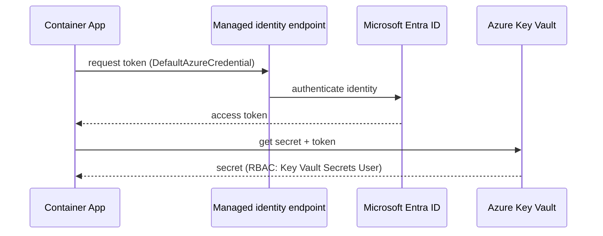

## What this covers

How to deploy a container app and give it runtime configuration without baking anything sensitive into the image. Plain settings go in environment variables. Sensitive values go in Container Apps secrets, which can be stored inline or pulled from Azure Key Vault by the app's managed identity. Your code can also read Key Vault directly with `DefaultAzureCredential`. The goal is an app that holds no passwords, keys or client secrets of its own.

**Exam weight:** Develop containerized solutions on Azure (20–25%)

**Skills measured**

- "Deploy applications to Azure Container Apps, including environment configuration and revision management"

## Key concepts

### Why secrets don't belong in code or images

Apps need database passwords, API keys, JWT signing keys, SMTP passwords and OAuth client secrets. Hard-coding them (`OPENAI_KEY = "sk-..."`), putting them in a committed `.env` file or writing `ENV DB_PASSWORD=...` in a Dockerfile means they end up in Git history and image layers. Anyone with repo or registry access can read them, and rotating them takes a rebuild.

### Environment variables vs secrets

| Non-secret (env vars) | Secret (Container Apps secret or Key Vault) |
|---|---|
| `APP_ENV`, `PORT`, `LOG_LEVEL`, feature flags, endpoint URLs | API keys, passwords, connection strings, JWT secrets |

- `--env-vars` sets variables on `create`. `--set-env-vars` adds or updates variables on `update` and keeps the others. `--remove-env-vars` deletes specific ones, and `--replace-env-vars` replaces the whole list.
- `az containerapp secret set --secrets name=value` stores a secret on the app. Secret names may only contain lowercase letters, numbers and hyphens.
- An env var points to a secret with `secretref:<secret-name>` on the CLI, or `secretRef:` in YAML. YAML then holds only the secret name, never the value.
- A secret can also be a **Key Vault reference** (`keyvaultref:<secret-uri>,identityref:<system|identity-resource-id>`). Key Vault stays the system of record.

### Authentication vs authorization

| Concept | Question | Who answers it for Key Vault |
|---|---|---|
| Authentication | Who are you? | Microsoft Entra ID issues a token |
| Authorization | What may you do? | Azure RBAC (or legacy access policies) on the vault |

### Managed identity

A managed identity is an identity that Azure manages and Entra ID trusts, so there is no password, client secret or certificate for you to rotate.

- **System-assigned:** one identity tied to the app and deleted with it. The right default for most apps.
- **User-assigned:** a standalone resource that you can attach to several apps. Use it when apps share permissions, when the identity must outlive an app, or when it must exist before the app does (for example, for image pulls at create time).

Grant the identity **Key Vault Secrets User**. It can read secret values. Don't grant Key Vault Administrator.

## How it works



There are two ways to consume a secret:

1. **The app reads Key Vault directly** with `SecretClient`. It always gets the latest version and can reload at runtime, which suits long-running services.
2. **Container Apps resolves a Key Vault reference** into an app secret and maps it to an env var. The code just reads `os.environ`. This suits config loaded at startup.

Typical flow: build the image, push to ACR, create the app, assign the identity, grant RBAC, then add secrets and env vars, which creates a new revision.

## Hands-on

### Azure portal

1. Open the container app, then **Settings > Identity**. Turn **System assigned** on and save.
2. In the Key Vault, go to **Access control (IAM)** and assign **Key Vault Secrets User** to the app's identity.
3. In the app, open **Settings > Secrets > Add**. Choose **Key Vault reference**, paste the secret URI and pick the identity.
4. Open **Application > Containers > Edit and deploy**. Edit the container and add an env var with source **Reference a secret**. Click **Create** to deploy a new revision.

### Azure CLI

```bash
az group create --name my-rg --location eastus
az acr create --resource-group my-rg --name myregistry --sku Basic
az keyvault create --resource-group my-rg --name my-demo-kv --location eastus
az containerapp env create --name my-env --resource-group my-rg --location eastus

az containerapp create --name my-api --resource-group my-rg --environment my-env \
  --image myregistry.azurecr.io/api:v1 --target-port 8000 --ingress external \
  --env-vars APP_ENV=prod LOG_LEVEL=info

az keyvault secret set --vault-name my-demo-kv --name DatabasePassword --value '<value>'
az keyvault secret set --vault-name my-demo-kv --name OpenAIKey --value '<value>'

# Identity + least-privilege role
az containerapp identity assign --name my-api --resource-group my-rg --system-assigned
PRINCIPAL_ID=$(az containerapp show --name my-api --resource-group my-rg \
  --query identity.principalId -o tsv)
az role assignment create --assignee "$PRINCIPAL_ID" --role "Key Vault Secrets User" \
  --scope "$(az keyvault show --name my-demo-kv --query id -o tsv)"

# Key Vault reference secret -> env var
az containerapp secret set --name my-api --resource-group my-rg \
  --secrets "db-password=keyvaultref:https://my-demo-kv.vault.azure.net/secrets/DatabasePassword,identityref:system"
az containerapp update --name my-api --resource-group my-rg \
  --set-env-vars DATABASE_PASSWORD=secretref:db-password

# Shared user-assigned identity (optional)
az identity create --resource-group my-rg --name shared-identity
az containerapp identity assign --name my-api --resource-group my-rg \
  --user-assigned "$(az identity show -g my-rg -n shared-identity --query id -o tsv)"
```

The same settings in YAML, applied with `az containerapp update --yaml ./app.yml` (other flags are ignored when `--yaml` is used):

```yaml
properties:
  template:
    containers:
      - name: my-api
        env:
          - name: LOG_LEVEL
            value: info
          - name: DATABASE_PASSWORD
            secretRef: db-password
```

### Python

```python
# pip install azure-identity azure-keyvault-secrets
import os
from azure.identity import DefaultAzureCredential
from azure.keyvault.secrets import SecretClient

# Option 1: read Key Vault directly. No client_id/secret/tenant in code.
client = SecretClient(vault_url="https://my-demo-kv.vault.azure.net/",
                      credential=DefaultAzureCredential())
db_password = client.get_secret("DatabasePassword").value

# Option 2: Container Apps injected it via secretref
db_password_env = os.environ["DATABASE_PASSWORD"]
log_level = os.getenv("LOG_LEVEL", "info")
```

`DefaultAzureCredential` uses your `az login` session locally and the managed identity when deployed, so the same code runs in both places. Avoid `ClientSecretCredential` for Azure-hosted apps: it brings back a secret you have to store and rotate.

## Exam traps

| Need | Use |
|---|---|
| Non-sensitive config (log level, URLs) | Env var (`--env-vars` / `--set-env-vars`) |
| Sensitive value, app reads it as an env var | App secret + `secretref:` |
| Central rotation, single source of truth | Key Vault reference (`keyvaultref:`) or `SecretClient` |
| Several apps sharing the same permissions | User-assigned managed identity |
| Read secret values only | Key Vault Secrets User role |

> [!WARNING]
> **Exam trap:** Changing a secret is an application-scope change. It does **not** create a new revision, so running replicas keep the old value in their env vars until you restart the revision or deploy a new one.

> [!WARNING]
> **Exam trap:** On `update`, `--replace-env-vars` swaps out the entire env list. Use `--set-env-vars` to add or change one variable and keep the rest, and `--remove-env-vars` to drop one.

> [!TIP]
> Authentication comes from Entra ID ("who"). Authorization comes from RBAC ("what"). If the token works but the call returns 403, the role assignment is missing or hasn't propagated yet.

> [!NOTE]
> A Key Vault reference without a version in the URI follows the latest version. Container Apps picks up rotated values periodically, but env vars only change in new or restarted replicas.

## Quick review

- Env vars hold config. Secrets hold credentials. Never use `ENV` in a Dockerfile for secrets.
- `secretref:<name>` (CLI) or `secretRef` (YAML) maps a secret into an env var.
- `keyvaultref:<uri>,identityref:system` makes Key Vault the source of a Container Apps secret.
- Grant **Key Vault Secrets User**, not Administrator.
- System-assigned identity is the per-app default. User-assigned identities are shared and independent of the app.
- `DefaultAzureCredential` works unchanged locally (`az login`) and in Azure (managed identity).
- Secret updates don't create a revision. Restart the revision to pick them up.

## Practice

[Practice: Container Apps deployment questions](/practice/aca-deploy)

## Official references

- [Learn unit: Configure runtime settings with environment variables and secrets](https://learn.microsoft.com/en-us/training/modules/deploy-containers-azure-container-apps/4-configure-runtime)
- [Manage secrets in Container Apps](https://learn.microsoft.com/en-us/azure/container-apps/manage-secrets)
- [Managed identities for Container Apps](https://learn.microsoft.com/en-us/azure/container-apps/managed-identity)
- [Azure Key Vault](https://learn.microsoft.com/en-us/azure/key-vault/)
- [DefaultAzureCredential](https://learn.microsoft.com/en-us/python/api/overview/azure/identity-readme)
- [AI-200 study guide](https://learn.microsoft.com/en-us/credentials/certifications/resources/study-guides/ai-200)
