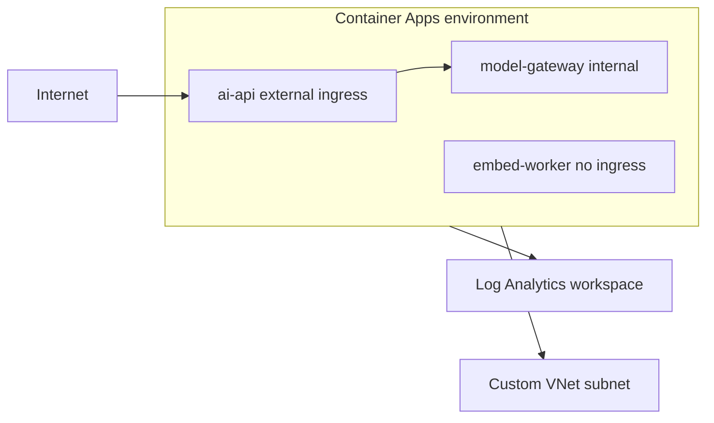

## What this covers

Every container app lives in a **Container Apps environment**. The environment is the boundary that its apps share: networking (VNet, internal DNS), log destination, workload profiles and Dapr. This page covers how to design environments, create and inspect them, choose ingress, and deploy apps with `az containerapp up`, `create`, or a YAML file kept under source control.

**Exam weight:** Develop containerized solutions on Azure (20–25%)

**Skills measured**

- "Deploy applications to Azure Container Apps, including environment configuration and revision management"

## Key concepts

### What the environment provides

- **A secure boundary:** apps in one environment share a virtual network and can call each other by app name (`http://<app-name>`) over internal ingress.
- **Logging integration:** the environment, not each app, sets where logs go: Log Analytics (default), Azure Monitor diagnostic settings, or none.
- **Compute model:** a **workload profiles** environment (the current default) has a Consumption profile plus optional Dedicated profiles. A legacy **Consumption-only** environment is serverless only and caps apps at 2 vCPU / 4 GiB.
- **Networking:** an optional **custom VNet** (a dedicated subnet; for workload profiles a /27 or larger subnet delegated to `Microsoft.App/environments`). Set `--internal-only true` to give the environment a private IP with no public endpoint.

### Ingress per app

| `--ingress` | Reachable from | Use for |
|---|---|---|
| `external` | Internet (or the VNet, if the environment is internal) | Public APIs, web front ends |
| `internal` | Only apps in the same environment (and the VNet) | Back-end services, model gateways |
| (disabled) | Nobody. No FQDN | Queue workers, jobs |

`--target-port` must match the port the container listens on. `--transport` can be `auto`, `http`, `http2` or `tcp`.

### Environment design

- **Separate environments by lifecycle** (dev, test, prod) to limit the blast radius.
- **Co-locate services that talk privately** and use internal ingress between them.
- **Use consistent names** for resource groups, environments and apps so tooling can find them.
- **Decide on observability before production traffic** arrives.

### Deployment methods

| Method | Strength |
|---|---|
| `az containerapp up` | Fastest. Can create the RG, environment and even build from source |
| `az containerapp create` | Explicit flags against an existing environment |
| `az containerapp create/update --yaml` | Reviewable, repeatable. **Other flags are ignored** |
| Bicep/ARM, GitHub Actions, Azure Pipelines | IaC and CI/CD |

## How it works



Prerequisites: an up-to-date CLI with the `containerapp` extension, and the `Microsoft.App` and `Microsoft.OperationalInsights` resource providers registered.

## Hands-on

### Azure portal

1. **Create a resource > Container App**. On **Basics**, choose **Create new** environment.
2. In the environment blade, pick **Workload profiles**, then on **Monitoring** pick the Log Analytics workspace, and on **Networking** pick a VNet and internal or external.
3. On the **Container** tab, set the image. On **Ingress**, choose external or internal and the target port.
4. After creation, the environment's **Overview** shows its static IP and default domain.

### Azure CLI

```bash
az login
az upgrade
az extension add --name containerapp --upgrade
az provider register --namespace Microsoft.App
az provider register --namespace Microsoft.OperationalInsights

# Environment with explicit logging
az group create --name rg-aca-demo --location centralus
az containerapp env create --name aca-env-demo --resource-group rg-aca-demo \
  --location centralus --logs-destination log-analytics \
  --logs-workspace-id <workspace-customer-id> --logs-workspace-key <workspace-key>
az containerapp env show --name aca-env-demo --resource-group rg-aca-demo

# Internal environment on your own subnet
az containerapp env create --name aca-env-private --resource-group rg-aca-demo \
  --location centralus --infrastructure-subnet-resource-id <subnet-id> --internal-only true

# Fastest first deploy (creates what's missing, returns the FQDN)
az containerapp up --name my-container-app --resource-group rg-aca-demo \
  --location centralus --environment aca-env-demo \
  --image mcr.microsoft.com/k8se/quickstart:latest \
  --target-port 80 --ingress external \
  --query properties.configuration.ingress.fqdn

# Explicit create, then YAML as source of truth
az containerapp create --name ai-api --resource-group rg-aca-demo \
  --environment aca-env-demo --image mcr.microsoft.com/k8se/quickstart:latest \
  --ingress external --target-port 80
az containerapp show --name ai-api --resource-group rg-aca-demo -o yaml > containerapp.yml
az containerapp update --name ai-api --resource-group rg-aca-demo --yaml ./containerapp.yml
```

A trimmed YAML definition:

```yaml
properties:
  configuration:
    activeRevisionsMode: Single
    ingress:
      external: true
      targetPort: 8000
  template:
    containers:
      - name: ai-api
        image: myregistry.azurecr.io/ai-api:v1
        resources: { cpu: 0.5, memory: 1Gi }
        env:
          - name: LOG_LEVEL
            value: info
    scale:
      minReplicas: 1
      maxReplicas: 5
```

### Python

```python
from azure.identity import DefaultAzureCredential
from azure.mgmt.appcontainers import ContainerAppsAPIClient

client = ContainerAppsAPIClient(DefaultAzureCredential(), "<subscription-id>")
for env in client.managed_environments.list_by_resource_group("rg-aca-demo"):
    logs = env.app_logs_configuration.destination if env.app_logs_configuration else None
    print(env.name, env.location, env.default_domain, "logs:", logs)
    for wp in env.workload_profiles or []:
        print("  profile:", wp.name, wp.workload_profile_type)
```

## Exam traps

| Requirement | Choose |
|---|---|
| Back-end reachable only by sibling apps | `--ingress internal` in the same environment |
| No public endpoint at all | Custom VNet + `--internal-only true` environment |
| GPU or > 4 vCPU per app | Workload profiles environment + Dedicated profile |
| Isolate prod from dev failures | Separate environments |
| Repeatable, reviewed config | `--yaml` in source control |

> [!WARNING]
> **Exam trap:** With `--yaml`, the CLI ignores the other configuration flags. Put everything in the file.

> [!WARNING]
> **Exam trap:** Log destination and VNet are environment settings, and VNet integration has to be chosen when the environment is created. You can't add a custom VNet later.

> [!TIP]
> Environment = shared network + logs + compute profiles. App = image + ingress + scale + revisions.

> [!NOTE]
> Image repository names must be lowercase. A mixed-case path fails to pull and looks like an auth error.

## Quick review

- An environment groups apps with a shared network, logging and workload profiles.
- Workload profiles environment (default) = Consumption + optional Dedicated profiles.
- `external` vs `internal` ingress per app. Worker apps can have no ingress.
- `az containerapp up` is the fastest path. `create` is explicit. `--yaml` makes config the source of truth.
- Register `Microsoft.App` and `Microsoft.OperationalInsights` first.
- VNet and internal-only are fixed when the environment is created.

## Practice

[Practice: Container Apps deployment questions](/practice/aca-deploy)

## Official references

- [Learn unit: Explore Container Apps environments](https://learn.microsoft.com/en-us/training/modules/deploy-containers-azure-container-apps/2-container-apps-environments)
- [Learn unit: Deploy a container app using the Azure CLI and YAML](https://learn.microsoft.com/en-us/training/modules/deploy-containers-azure-container-apps/3-deploy-container-app)
- [Azure Container Apps environments](https://learn.microsoft.com/en-us/azure/container-apps/environment)
- [Networking in Container Apps](https://learn.microsoft.com/en-us/azure/container-apps/networking)
- [Ingress in Container Apps](https://learn.microsoft.com/en-us/azure/container-apps/ingress-overview)
- [AI-200 study guide](https://learn.microsoft.com/en-us/credentials/certifications/resources/study-guides/ai-200)
