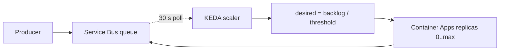

## What this covers

Event-driven scaling lets a container app respond to backlog instead of HTTP traffic. Container Apps runs **KEDA** (Kubernetes Event-driven Autoscaling) for you. You declare a scaler type, its metadata and its auth, and the platform polls the event source and sets the replica count, including down to zero. Typical AI uses are embedding workers, document processors and batch inference queues that idle overnight and burst when work arrives.

**Exam weight:** Develop containerized solutions on Azure (20–25%)

**Skills measured**

- "Implement event-driven scaling by using Kubernetes Event-driven Autoscaling (KEDA) in Container Apps"

## Key concepts

### KEDA on Container Apps

Custom scale rules follow the KEDA **ScaledObject** pattern: `type` + `metadata` + `auth`. The platform polls every **30 seconds** and turns the metric into a desired replica count. You never install KEDA or write a ScaledObject yourself.

Microsoft-maintained (first-party) Azure scalers: **Service Bus, Event Hubs, Storage Queue, Blob Storage, Log Analytics, Azure Monitor**. Community scalers cover non-Azure sources (see [Apply KEDA scalers for custom workloads](/study/deploy-and-manage-apps-on-azure-container-apps/apply-keda-scalers-for-custom-workloads)).

### When to use it

| Use event-driven (KEDA) scaling | Prefer HTTP/TCP/CPU scaling instead |
|---|---|
| Queue processors, embedding workers, batch inference | Public REST APIs with steady traffic |
| Workloads with idle periods (scale to zero) | Low-latency sync APIs where cold start hurts |
| Backlog grows faster than HTTP RPS reflects | Simple service with predictable CPU load |
| Service Bus / Event Hubs / Storage Queue triggers | No external event source to monitor |

### Azure Service Bus (`azure-servicebus`)

Enterprise messaging (queues and topics/subscriptions) with dead-lettering, sessions and scheduled delivery. Metadata: `queueName` **or** `topicName` + `subscriptionName`, plus `namespace` and `messageCount`. **Desired replicas = active messages ÷ `messageCount`**: threshold 5 with 50 messages gives 10 replicas. Each subscription scales on its own backlog.

### Azure Storage Queue (`azure-queue`)

A simple, cheap queue inside a storage account. It has fewer features (no DLQ, no sessions) and lower throughput. Metadata: `queueName`, `accountName`, `queueLength` (messages per replica). Managed identity needs **Storage Queue Data Reader** or a higher role.

### Azure Event Hubs (`azure-eventhub`)

High-throughput, partitioned event streaming. It scales on **unprocessed events (lag)** between the newest event and the consumer group's checkpoint, not on a message count. Metadata: `consumerGroup`, `unprocessedEventThreshold`, `checkpointStrategy` (`blobMetadata` for the current Event Hubs SDK checkpoint store), plus `eventHubName` and `blobContainer`. A storage connection is needed to read checkpoints. **Useful replicas ≤ partition count**, because only one consumer per partition per consumer group is active. With 32 partitions, more than 32 replicas does nothing.

### Authentication

| Method | How | Notes |
|---|---|---|
| Secrets | Store the connection string as an app secret, then `--scale-rule-auth "connection=<secret>"` (YAML `auth: - secretRef / triggerParameter`) | Works everywhere. You rotate it |
| Managed identity (preferred) | `--scale-rule-identity <identity-resource-id>` or `system`, plus an RBAC role on the source | No secrets. For example **Azure Service Bus Data Receiver** (some setups need Data Owner to read entity counts) |

## How it works



Example: an AI embedding worker sits at 0 replicas overnight. When 50 documents land on the queue with `messageCount=5`, it scales to 10 replicas, drains the queue, then returns to zero after the 300 s cooldown.

**Threshold from processing time:** if one message takes 10 s and you need 100 messages per minute, you need 100 × 10 ÷ 60 ≈ **17** concurrent workers. Size `messageCount` × replicas to give that much parallelism.

## Hands-on

### Azure portal

1. Open **Application > Scale**, set **Min replicas 0** and a sensible **Max**.
2. Select **Add > Custom**. Set the type (`azure-servicebus`, `azure-queue` or `azure-eventhub`) and add the metadata key/value pairs.
3. Under **Authentication**, either map a secret to a trigger parameter (for example `connection`) or choose a managed identity. Save to create a revision.
4. Send test messages and watch **Replica count** in **Metrics**.

### Azure CLI

```bash
# Service Bus queue, secret-based auth
az containerapp create \
  --name order-processor \
  --resource-group rg-ecommerce \
  --environment my-environment \
  --image myregistry.azurecr.io/order-processor:v1 \
  --min-replicas 0 \
  --max-replicas 30 \
  --secrets "sb-connection=<SERVICE_BUS_CONNECTION_STRING>" \
  --scale-rule-name servicebus-scaling \
  --scale-rule-type azure-servicebus \
  --scale-rule-metadata "queueName=orders" "namespace=sb-ecommerce" "messageCount=5" \
  --scale-rule-auth "connection=sb-connection"

# Storage Queue, managed identity (no secrets)
az containerapp create \
  --name queue-processor \
  --resource-group rg-ecommerce \
  --environment my-environment \
  --image myregistry.azurecr.io/queue-processor:v1 \
  --user-assigned <MANAGED_IDENTITY_RESOURCE_ID> \
  --min-replicas 0 \
  --max-replicas 20 \
  --scale-rule-name storage-queue-scaling \
  --scale-rule-type azure-queue \
  --scale-rule-metadata "accountName=stecommerce" "queueName=inventory-updates" "queueLength=10" \
  --scale-rule-identity <MANAGED_IDENTITY_RESOURCE_ID>
```

Event Hubs in YAML:

```yaml
scale:
  minReplicas: 0
  maxReplicas: 32          # = partition count
  rules:
    - name: eventhubs-scaling
      custom:
        type: azure-eventhub
        metadata:
          eventHubName: "telemetry"
          consumerGroup: "$Default"
          unprocessedEventThreshold: "64"
          checkpointStrategy: "blobMetadata"
          blobContainer: "checkpoints"
        auth:
          - secretRef: eh-connection
            triggerParameter: connection
          - secretRef: storage-connection
            triggerParameter: storageConnection
```

### Python

The worker that the scaler feeds. It uses managed identity to talk to Service Bus:

```python
# pip install azure-identity azure-servicebus
from azure.identity import DefaultAzureCredential
from azure.servicebus import ServiceBusClient

with ServiceBusClient("sb-ecommerce.servicebus.windows.net", DefaultAzureCredential()) as sb:
    with sb.get_queue_receiver("orders", max_wait_time=30) as receiver:
        for msg in receiver:
            # embed document, write to vector store ...
            receiver.complete_message(msg)
```

## Exam traps

| Source | Scaler type | Threshold key | Scales on |
|---|---|---|---|
| Service Bus queue/topic | `azure-servicebus` | `messageCount` | Active messages |
| Storage Queue | `azure-queue` | `queueLength` | Approximate message count |
| Event Hubs | `azure-eventhub` | `unprocessedEventThreshold` | Partition lag vs checkpoint |

> [!WARNING]
> **Exam trap:** Event Hubs (and Kafka) can't use more replicas than partitions in one consumer group. Raising `maxReplicas` above the partition count only adds idle cost.

> [!WARNING]
> **Exam trap:** For topics, use `topicName` **and** `subscriptionName`, not `queueName`.

> [!TIP]
> Replicas ≈ backlog ÷ threshold. A lower threshold means more replicas sooner.

> [!NOTE]
> Choose Storage Queue for cheap and simple. Choose Service Bus when you need DLQ, sessions, topics or scheduled messages. Choose Event Hubs for streams.

### Pricing and cost

| Component | Billing |
|---|---|
| vCPU & memory | Per second, per replica, while running (lower idle rate) |
| Requests | HTTP requests through ingress |
| Scale to zero | No compute charge when replicas = 0 |

Example: 1,000 docs a day at 2 minutes each, arriving in a 2-hour burst. Always-on replicas run 24 hours. With KEDA and `minReplicas 0`, they run about 2 hours, so roughly 90% of idle compute is saved. Also cap `maxReplicas` to contain poison-message storms, right-size CPU and memory for light handlers, and use Storage Queue when Service Bus features aren't needed.

## Quick review

- KEDA polls every 30 s. Event-driven rules can scale to zero.
- First-party scalers: Service Bus, Event Hubs, Storage Queue, Blob, Log Analytics, Azure Monitor.
- Service Bus: `messageCount`. Storage Queue: `queueLength`. Event Hubs: `unprocessedEventThreshold` + checkpoint.
- Auth: `--scale-rule-auth` (secret) or `--scale-rule-identity` (managed identity + RBAC).
- Event Hubs replicas ≤ partitions.
- Set the threshold from processing time, monitor queue depth against replica count, and cap `maxReplicas`.

## Practice

[Practice: KEDA scaling questions](/practice/aca-keda)

## Official references

- [Learn unit: Implement event-driven scaling with KEDA](https://learn.microsoft.com/en-us/training/modules/scale-containers-azure-container-apps/3-event-driven-scaling-keda)
- [Scale rules in Azure Container Apps](https://learn.microsoft.com/en-us/azure/container-apps/scale-app)
- [KEDA scalers on Container Apps](https://learn.microsoft.com/en-us/azure/container-apps/scale-app#custom)
- [Azure Service Bus](https://learn.microsoft.com/en-us/azure/service-bus-messaging/)
- [Azure Event Hubs](https://learn.microsoft.com/en-us/azure/event-hubs/)
- [Azure Container Apps pricing](https://azure.microsoft.com/pricing/details/container-apps/)
- [AI-200 study guide](https://learn.microsoft.com/en-us/credentials/certifications/resources/study-guides/ai-200)
