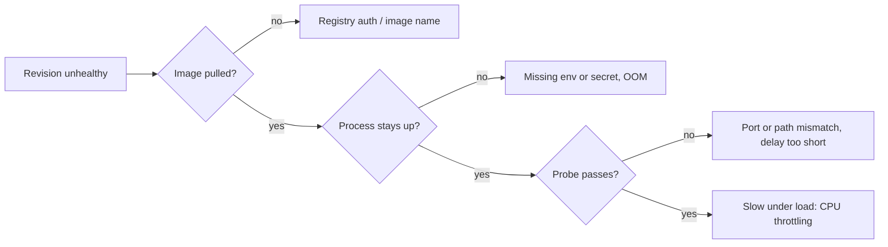

## What this covers

Day-two operations on Azure Container Apps: pausing an app during an upstream outage, restarting after a config change, isolating one bad release, and shutting replicas down cleanly. You need to know which control works at which scope (app, revision or replica) and to have a repeatable checklist for diagnosing a revision that won't become healthy.

**Exam weight:** Develop containerized solutions on Azure (20–25%)

**Skills measured**

- "Deploy applications to Azure Container Apps, including environment configuration and revision management"
- "Monitor and troubleshoot solutions on AKS and Container Apps"

## Key concepts

### Choose the right control

| Action | Scope | Effect | Use when |
|---|---|---|---|
| Scale to zero (`minReplicas 0`) | Revision, automatic | Replicas removed when idle and restarted by triggers | Intermittent or event-driven workloads |
| `az containerapp stop` | Whole app | No replicas run, whatever the triggers say | Guarantee nothing runs during an incident or outage |
| `az containerapp start` | Whole app | Resumes normal scaling | After a stop |
| `revision restart` | One revision | Restarts its replicas | Pick up new secret values, clear a stuck process |
| `revision deactivate` | One revision | Stops traffic and compute, keeps it for rollback | Isolate one bad release |

Stop and start are blunt tools because they affect every revision. When only one release is broken, deactivating that revision is the safer first step.

### Restart with intent

A restart clears transient problems such as deadlocks, a stale connection pool or a dependency that blipped. It also forces new replicas to read updated **secrets**, since secret changes don't create a revision. But a restart isn't a root-cause fix. For AI services that load large models at startup, every restart is another cold start, so always read the logs before and after restarting.

### Graceful shutdown

When a replica is removed (scale-in, deactivation, new revision), the container receives `SIGTERM`. It has `terminationGracePeriodSeconds` to finish (default 30 seconds, configurable on the template up to 600) before it's killed. Queue workers should stop pulling new messages and finish or abandon in-flight ones.

### Replica lifecycle

Replicas are disposable. If a container crashes, the platform restarts it automatically. Restart counts climbing in the replica list or metrics point to a crash loop or an out-of-memory kill.

## How it works



**Failing revision checklist** (common causes, in order):

1. **Image pull failure:** wrong name or tag, uppercase repository, missing `AcrPull` or registry config.
2. **Port mismatch:** the app listens on 8080 but ingress `--target-port` is 80.
3. **Missing configuration:** an env var or secret is misnamed or absent, so the app exits immediately.
4. **Probe failure:** wrong path or port, or too little time for the model to load.
5. **Resource pressure:** an OOM kill (restarts) or CPU throttling (timeouts).

## Hands-on

### Azure portal

1. On the app **Overview**, use **Stop** or **Start** in the command bar for app-wide control.
2. In **Revisions and replicas**, select a revision to **Restart**, **Deactivate** or **Activate** it.
3. Open a replica to see each container's state and restart count. Use **Console** to open a shell in a running container.

### Azure CLI

```bash
# App-wide stop/start
az containerapp stop  --name <app-name> --resource-group <resource-group>
az containerapp start --name <app-name> --resource-group <resource-group>

# Restart one revision (e.g., after rotating a secret)
az containerapp revision restart --name <app-name> --resource-group <resource-group> \
  --revision <revision-name>

# Isolate a bad release
az containerapp revision deactivate --name <app-name> --resource-group <resource-group> \
  --revision <revision-name>

# Status at a glance
az containerapp revision list --name <app-name> --resource-group <resource-group> \
  --query "[].{name:name,active:properties.active,health:properties.healthState}" -o table

# Shell into a running replica to check config from the inside
az containerapp exec --name <app-name> --resource-group <resource-group> --command sh

# Delete the whole app (irreversible)
az containerapp delete --name <app-name> --resource-group <resource-group> --yes
```

### Python

```python
import signal, sys, threading
from azure.identity import DefaultAzureCredential
from azure.mgmt.appcontainers import ContainerAppsAPIClient

# Management: restart a revision after a secret rotation
client = ContainerAppsAPIClient(DefaultAzureCredential(), "<subscription-id>")
client.container_apps_revisions.restart_revision("<resource-group>", "<app-name>", "<revision-name>")

# Runtime: handle SIGTERM so in-flight work finishes inside the grace period
stopping = threading.Event()
signal.signal(signal.SIGTERM, lambda *_: stopping.set())

def worker_loop():
    while not stopping.is_set():
        pass  # receive one message, process, complete
    sys.exit(0)
```

## Exam traps

| Scenario | Best action |
|---|---|
| One new revision is broken, the old one is fine | Deactivate the new revision (or shift traffic away) |
| Upstream outage, must guarantee zero replicas | `az containerapp stop` |
| Rotated a Key Vault or app secret | `revision restart` (or deploy a new revision) |
| Worker loses messages on scale-in | Handle `SIGTERM`, raise `terminationGracePeriodSeconds` |
| App exits instantly after deploy | Console logs: missing env var or secret |

> [!WARNING]
> **Exam trap:** Scale to zero isn't the same as stop. A scaled-to-zero app wakes up on the next HTTP request or queue message. A stopped app doesn't.

> [!WARNING]
> **Exam trap:** Stopping the app to fix one bad revision causes a full outage. Deactivate the revision instead.

> [!TIP]
> Scope ladder: replica (auto-restart), revision (restart/deactivate), app (stop/start/delete). Use the smallest scope that fixes the problem.

> [!NOTE]
> Restarting doesn't change the revision's configuration. To change config, deploy a new revision.

## Quick review

- `stop`/`start` act on the whole app. `revision restart/deactivate/activate` act on one revision.
- Secret changes need a revision restart to reach running replicas.
- SIGTERM, then a grace period (default 30 seconds), then kill.
- Checklist: pull, port, config, probes, resources.
- Deactivated revisions are kept (up to 100 inactive) for rollback.
- `az containerapp exec` opens a shell in a running replica.

## Practice

[Practice: Container Apps deployment questions](/practice/aca-deploy) · [Practice: container troubleshooting questions](/practice/containers-troubleshoot)

## Official references

- [Learn unit: Manage the container app lifecycle](https://learn.microsoft.com/en-us/training/modules/manage-containers-azure-container-apps/3-app-lifecycle-management)
- [Application lifecycle management in Container Apps](https://learn.microsoft.com/en-us/azure/container-apps/application-lifecycle-management)
- [Manage revisions](https://learn.microsoft.com/en-us/azure/container-apps/revisions-manage)
- [Troubleshoot Container Apps](https://learn.microsoft.com/en-us/azure/container-apps/troubleshooting)
- [AI-200 study guide](https://learn.microsoft.com/en-us/credentials/certifications/resources/study-guides/ai-200)
