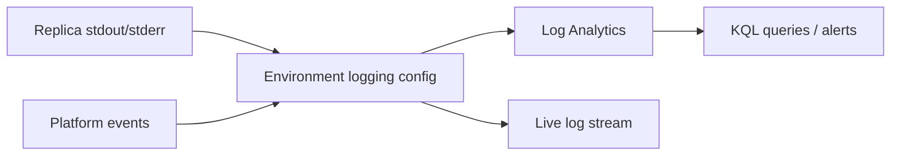

## What this covers

Logs are your main diagnostic signal on a managed container platform where you don't own the nodes. This page covers where Azure Container Apps logs go, live streaming versus querying history, the Log Analytics tables and KQL you'll use, metrics, and an incident workflow for revision-specific failures, including end-to-end connectivity checks.

**Exam weight:** Develop containerized solutions on Azure (20–25%)

**Skills measured**

- "Monitor and troubleshoot solutions on AKS and Container Apps by inspecting logs, events, and end-to-end connectivity"

## Key concepts

### Log destinations

Logging is configured on the **environment**, not on each app:

| Destination | Notes |
|---|---|
| Log Analytics (`log-analytics`) | Default. Tables `ContainerAppConsoleLogs_CL` and `ContainerAppSystemLogs_CL` |
| Azure Monitor (`azure-monitor`) | Routes through diagnostic settings (Log Analytics, storage, Event Hubs). Tables `ContainerAppConsoleLogs` and `ContainerAppSystemLogs` (no `_CL`) |
| None (`none`) | Streaming only, no history |

### Streaming vs querying

- **Log streaming** (`az containerapp logs show --follow`, portal **Log stream**) is real time. It's good for reproducing a crash or watching a new revision start, but it needs a running replica.
- **Log Analytics** keeps history and lets you aggregate across replicas and revisions with KQL.

### Console vs system

Console logs are your app's stdout and stderr. System logs are platform events: image pulls, probe failures, scaling decisions, container terminations and their reasons.

### Logging that helps with AI services

Log identifiers and metadata, not raw prompts or documents. Useful fields: **correlation/request ID**, **revision or build ID** (image digest or version), **model deployment/version**, and a **latency breakdown** (total plus key dependency timings). Structured JSON logs are much easier to query.

### Metrics

The portal **Metrics** blade (Azure Monitor) shows Requests, Replica count, CPU usage, Memory working set, Restart count and Network bytes. You can split them by revision or replica.

## How it works



**Incident workflow:**

1. Confirm which revision is active and which one is failing (`revision list`).
2. Stream logs while you reproduce the problem or while the failing revision starts.
3. Compare configuration between the good and bad revisions (`revision show`): image, env, probes, resources.
4. Apply a targeted fix as a new revision and confirm it becomes healthy.

**End-to-end connectivity:** `curl` the ingress FQDN from outside. Use `az containerapp exec` to test DNS and TCP to dependencies from inside (for example, `nslookup` a private endpoint, or `curl` another app at `http://<app-name>` within the environment). Check that ingress is external or internal as intended and that `--target-port` matches the app.

## Hands-on

### Azure portal

1. **Monitoring > Log stream:** choose the revision, replica and container, then switch between Console and System.
2. **Monitoring > Logs:** run the KQL below against the environment's workspace.
3. **Monitoring > Metrics:** chart Replica count and Restart count, split by revision.
4. **Diagnose and solve problems:** run the built-in detectors for container crashes and pull failures.

### Azure CLI

```bash
# Live streams
az containerapp logs show --name <app-name> --resource-group <resource-group> --follow
az containerapp logs show --name <app-name> --resource-group <resource-group> \
  --type system --tail 50
az containerapp logs show --name <app-name> --resource-group <resource-group> \
  --revision <revision-name> --replica <replica-name> --container <container-name>

# Where do the environment's logs go?
az containerapp env show --name <env-name> --resource-group <resource-group> \
  --query properties.appLogsConfiguration

# Query history from the CLI
WS=$(az containerapp env show -n <env-name> -g <resource-group> \
  --query properties.appLogsConfiguration.logAnalyticsConfiguration.customerId -o tsv)
az monitor log-analytics query --workspace "$WS" \
  --analytics-query "ContainerAppConsoleLogs_CL | where ContainerAppName_s == '<app-name>' | take 20"

# Connectivity from inside a replica
az containerapp exec --name <app-name> --resource-group <resource-group> --command sh
```

```kql
// Errors per revision in the last hour
ContainerAppConsoleLogs_CL
| where TimeGenerated > ago(1h) and ContainerAppName_s == "<app-name>"
| where Log_s has_any ("error", "exception")
| summarize errors = count() by RevisionName_s, bin(TimeGenerated, 5m)
| order by TimeGenerated desc
```

```kql
// Platform events: pull failures, probe failures, restarts
ContainerAppSystemLogs_CL
| where TimeGenerated > ago(1h) and ContainerAppName_s == "<app-name>"
| project TimeGenerated, RevisionName_s, Reason_s, Log_s
| order by TimeGenerated desc
```

### Python

```python
# pip install azure-identity azure-monitor-query
from datetime import timedelta
from azure.identity import DefaultAzureCredential
from azure.monitor.query import LogsQueryClient

client = LogsQueryClient(DefaultAzureCredential())
query = """
ContainerAppSystemLogs_CL
| where ContainerAppName_s == 'ai-api'
| project TimeGenerated, RevisionName_s, Reason_s, Log_s
| take 50
"""
result = client.query_workspace("<workspace-id>", query, timespan=timedelta(hours=1))
for table in result.tables:
    for row in table.rows:
        print(list(row))
```

## Exam traps

| Need | Use |
|---|---|
| Watch a crash as it happens | `logs show --follow` |
| Errors from yesterday across all replicas | KQL on `ContainerAppConsoleLogs_CL` |
| Why the image didn't pull / probe failed | System logs (`--type system`, `ContainerAppSystemLogs_CL`) |
| Is the app restarting? | Restart count metric, replica list |
| Can the app reach its database? | `az containerapp exec`, then nslookup or curl |

> [!WARNING]
> **Exam trap:** Table names depend on the destination. Log Analytics gives `ContainerAppConsoleLogs_CL` (columns end in `_s`). Azure Monitor diagnostic settings give `ContainerAppConsoleLogs`. A query against the wrong table returns nothing.

> [!WARNING]
> **Exam trap:** Log destinations are an **environment** setting. You can't point one app's logs somewhere else via `az containerapp update`.

> [!TIP]
> Console logs answer "what did my code say?" System logs answer "what did the platform do?"

> [!NOTE]
> For distributed tracing across services, add OpenTelemetry. Container Apps can also run a managed OpenTelemetry agent at the environment level.

## Quick review

- The environment chooses the log destination: `log-analytics` (default), `azure-monitor` or `none`.
- `logs show --follow` streams live. `--type system` shows platform events.
- KQL tables: `ContainerAppConsoleLogs_CL`, `ContainerAppSystemLogs_CL`.
- Log the correlation ID, revision/build, model version and latency, never raw prompts.
- Workflow: find the failing revision, stream, diff config, then fix as a new revision.
- `az containerapp exec` tests connectivity from inside.

## Practice

[Practice: container troubleshooting questions](/practice/containers-troubleshoot) · [Practice: Container Apps deployment questions](/practice/aca-deploy)

## Official references

- [Learn unit: Monitor logs and troubleshoot issues](https://learn.microsoft.com/en-us/training/modules/manage-containers-azure-container-apps/4-monitor-logs-troubleshoot)
- [Log storage and monitoring options](https://learn.microsoft.com/en-us/azure/container-apps/log-options)
- [Application logging](https://learn.microsoft.com/en-us/azure/container-apps/logging)
- [Log streaming](https://learn.microsoft.com/en-us/azure/container-apps/log-streaming)
- [Troubleshoot Container Apps](https://learn.microsoft.com/en-us/azure/container-apps/troubleshooting)
- [AI-200 study guide](https://learn.microsoft.com/en-us/credentials/certifications/resources/study-guides/ai-200)
