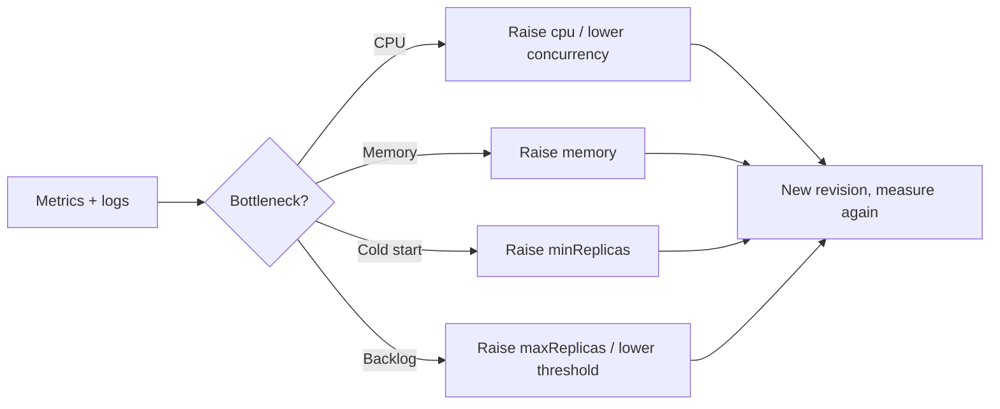

## What this covers

After an app is running, you tune it. You size each replica's CPU and memory for the actual bottleneck and set minimum and maximum replicas for the workload type. You also make sure scaling and probe settings don't fight each other during rollouts. This page is the day-two, metrics-driven loop. For a deeper treatment of allowed sizes, workload profiles and billing, see [Select compute resources for performance and cost](/study/deploy-and-manage-apps-on-azure-container-apps/select-compute-resources-for-performance-and-cost).

**Exam weight:** Develop containerized solutions on Azure (20–25%)

**Skills measured**

- "Implement event-driven scaling by using KEDA in Container Apps"
- "Monitor and troubleshoot solutions on AKS and Container Apps"

## Key concepts

### Sizing and total cost

Cost is roughly **per-replica size × number of replicas × time running**. A bigger replica handles more work but costs more per second. More small replicas give finer-grained scaling but mean more scale events and more cold starts.

### Read the symptom, fix the bottleneck

| Symptom | Metric to confirm | Fix |
|---|---|---|
| Latency rises under load, no restarts | CPU usage near the allocation | More `--cpu`, or a lower concurrency threshold so it scales out earlier |
| Replicas restart, exit reason OOM | Memory working set hits the limit, Restart count rises | More `--memory` (in Consumption, CPU must rise with it to keep the 1:2 ratio) |
| First request slow after idle | Replica count drops to 0 | `--min-replicas 1` for user-facing APIs |
| Backlog grows while replicas sit at max | Replica count = max, queue depth rising | Raise `--max-replicas` or lower the per-replica threshold |
| Idle replicas all day | Low CPU, many replicas | Raise the threshold, lower the minimum |

### API vs background worker

- **Synchronous API:** stable latency matters. Keep `minReplicas ≥ 1`, use an HTTP concurrency rule, and size CPU to support that concurrency.
- **Background worker:** throughput matters. Use `minReplicas 0` with a KEDA queue rule, make sure in-flight work drains safely on `SIGTERM`, and watch memory per message batch.

### Probes and scaling interact

A rollout starts new replicas. If the model takes a long time to warm up and probes are tight, the revision looks failed even though it's just slow. Align startup or readiness budgets with real warm-up time, especially when you raise memory or switch to a bigger model.

### Iterate one variable at a time

Change CPU *or* the threshold *or* the minimum replicas, then measure. Changing everything at once hides the cause. Reassess after every model change, because new model versions often change memory use, startup time and latency.

## How it works



CPU and memory changes are template changes, so each one creates a new revision. That revision has to pass its probes before it serves traffic.

## Hands-on

### Azure portal

1. Open **Monitoring > Metrics**. Chart **CPU Usage**, **Memory Working Set Bytes**, **Replica Count**, **Restart Count** and **Requests**, split by revision.
2. Open **Application > Scale**. Set the min/max replicas and rule thresholds, then save to create a revision.
3. Open **Containers > Edit and deploy**. Adjust CPU and memory, then **Create**.

### Azure CLI

```bash
# Right-size a container (creates a new revision)
az containerapp update --name <app-name> --resource-group <resource-group> \
  --cpu 1.0 --memory 2.0Gi

# Synchronous API: warm baseline + HTTP rule
az containerapp update --name chat-api --resource-group <resource-group> \
  --min-replicas 1 --max-replicas 20 \
  --scale-rule-name http-rule --scale-rule-type http --scale-rule-http-concurrency 30

# Background worker: scale to zero on queue depth
az containerapp update --name embed-worker --resource-group <resource-group> \
  --min-replicas 0 --max-replicas 30

# Pull metrics for the app
APP_ID=$(az containerapp show -n <app-name> -g <resource-group> --query id -o tsv)
az monitor metrics list --resource "$APP_ID" \
  --metric UsageNanoCores WorkingSetBytes RestartCount Replicas \
  --interval PT5M --aggregation Average Maximum -o table
```

```kql
// OOM and termination events
ContainerAppSystemLogs_CL
| where ContainerAppName_s == "<app-name>" and TimeGenerated > ago(24h)
| where Log_s has_any ("OOMKilled", "terminated", "exceeded")
| project TimeGenerated, RevisionName_s, Reason_s, Log_s
```

### Python

```python
# pip install azure-identity azure-monitor-query
from datetime import timedelta
from azure.identity import DefaultAzureCredential
from azure.monitor.query import MetricsQueryClient, MetricAggregationType

client = MetricsQueryClient(DefaultAzureCredential())
resource_id = "/subscriptions/<sub>/resourceGroups/<rg>/providers/Microsoft.App/containerApps/<app-name>"
resp = client.query_resource(
    resource_id,
    metric_names=["WorkingSetBytes", "RestartCount", "Replicas"],
    timespan=timedelta(hours=6),
    granularity=timedelta(minutes=5),
    aggregations=[MetricAggregationType.MAXIMUM],
)
for metric in resp.metrics:
    peak = max((p.maximum or 0) for ts in metric.timeseries for p in ts.data)
    print(metric.name, peak)
```

## Exam traps

| Scenario | Best change |
|---|---|
| Replicas restart under load with OOM | Increase memory (not CPU alone) |
| p95 latency spikes, CPU pegged, no restarts | Increase CPU or scale out earlier |
| Chat API slow on first call each morning | `minReplicas ≥ 1` |
| Nightly batch worker idle 20 hours a day | `minReplicas 0` + queue scale rule |
| New big-model revision "fails" rollout | Lengthen the startup or readiness budget |

> [!WARNING]
> **Exam trap:** Exceeding **memory** kills and restarts the replica. Exceeding **CPU** only throttles it. Restarts point to memory. Slowness points to CPU.

> [!WARNING]
> **Exam trap:** Minimum replicas reduce cold starts but raise the baseline cost permanently. Don't set them on workers that can scale to zero.

> [!TIP]
> Size for the bottleneck, change one thing, measure, repeat.

> [!NOTE]
> Running replicas that do no work are billed at a lower idle rate, but not at zero. Only zero replicas cost nothing for compute.

## Quick review

- Total cost ≈ replica size × replica count × time.
- Throttling means add CPU. OOM restarts mean add memory.
- APIs: `minReplicas ≥ 1` + HTTP rule. Workers: `minReplicas 0` + KEDA rule.
- Resource changes create a new revision that must pass probes.
- Align probe budgets with model warm-up time.
- Re-tune after every model version change.

## Practice

[Practice: KEDA scaling questions](/practice/aca-keda) · [Practice: container troubleshooting questions](/practice/containers-troubleshoot)

## Official references

- [Learn unit: Optimize container resources and scaling](https://learn.microsoft.com/en-us/training/modules/manage-containers-azure-container-apps/6-optimize-container-settings)
- [Set scaling rules](https://learn.microsoft.com/en-us/azure/container-apps/scale-app)
- [Containers in Azure Container Apps](https://learn.microsoft.com/en-us/azure/container-apps/containers)
- [Monitor metrics](https://learn.microsoft.com/en-us/azure/container-apps/metrics)
- [AI-200 study guide](https://learn.microsoft.com/en-us/credentials/certifications/resources/study-guides/ai-200)
