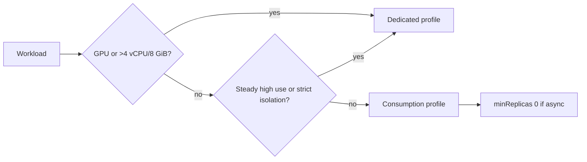

## What this covers

CPU, memory, replica limits and the workload profile together decide how fast an AI workload runs and how much it costs. A chat API, an embedding worker and a GPU inference container each need different choices. This page covers the allowed resource combinations, what happens at the limits, Consumption versus Dedicated profiles, capacity math and billing.

**Exam weight:** Develop containerized solutions on Azure (20–25%)

**Skills measured**

- "Implement event-driven scaling by using KEDA in Container Apps"
- "Deploy applications to Azure Container Apps, including environment configuration and revision management"

## Key concepts

### Resource allocation

You allocate CPU (cores or fractions) and memory (GiB) **per container**. Every replica gets the full allocation. Billing counts **vCPU-seconds** and **GiB-seconds**.

On the **Consumption** plan, the **total across all containers in the app** (main + sidecars) must be one of the fixed pairs where memory is exactly twice the CPU:

| CPU (cores) | Memory |
|---|---|
| 0.25 | 0.5Gi |
| 0.5 | 1.0Gi |
| 1.0 | 2.0Gi |
| 2.0 | 4.0Gi |
| 4.0 | 8.0Gi (Consumption max in a workload profiles environment) |

Steps of 0.25 core / 0.5Gi in between are also valid. Apps in a legacy **Consumption-only** environment top out at **2 cores / 4Gi**. The Learn module teaches a starting point of **0.25 cores / 0.5 GiB** and states the rule as "memory at least 2× CPU". In practice, use the exact 1:2 pairs.

### What happens at the limit

| Limit exceeded | Behavior | Impact |
|---|---|---|
| **Memory** | Container is **killed and restarted** (OOM) | Hard failure. In-flight requests fail |
| **CPU** | Container is **throttled** | Slower responses and timeouts, but no restart |

### Multi-container replicas

| Container | Typical role | Sizing note |
|---|---|---|
| Main app | API or worker | Size for the request work |
| Sidecar | OTel collector, auth proxy | Keep small (0.25 / 0.5Gi) |
| Init | Model download | Runs once per replica start |

Sidecar resources count toward the replica total and the allowed pair.

### Environment types and workload profiles

| Feature | Consumption (serverless) | Dedicated workload profile |
|---|---|---|
| Billing | Per vCPU-s + GiB-s + requests. Idle rate when idle. Zero at 0 replicas | Per node (VM size) for the profile, plus a management charge |
| Max per app | 4 vCPU / 8 GiB | Up to the VM size (D-series, E-series memory-optimized) |
| GPU | Serverless GPU in some regions | NC/A100-class GPU profiles |
| Performance | Shared, some variability, cold starts | Isolated and consistent |
| Best for | Most APIs and async workers | GPU inference, big memory, steady load, compliance |

A **workload profiles environment** can mix the Consumption profile and Dedicated profiles. Each app picks one with `--workload-profile-name`.

### Replica math

```text
Peak capacity = cpu-per-replica × maxReplicas
Required maxReplicas = peak load ÷ throughput per replica
Example: 2000 RPS ÷ 100 RPS/replica = 20 replicas × 0.5 CPU = 10 cores
```

The ceiling is **1,000 replicas per revision**, but cost or downstream limits usually bind first.

## How it works



| Scenario | Per replica | Peak need | Config |
|---|---|---|---|
| Chat API | 100 RPS at 0.5 CPU | 2000 RPS | `--cpu 0.5 --memory 1.0Gi --max-replicas 20` |
| Embedding worker | 10 docs/min at 1 CPU | 500 docs/min | `--cpu 1.0 --memory 2.0Gi --max-replicas 50` |
| GPU inference | 5 req/s | 50 req/s | GPU workload profile, `--max-replicas 10` |

**Bigger vs smaller replicas:** bigger replicas mean fewer scale events but coarser steps, so you may over-provision. Smaller replicas track demand more closely but scale more often, so connections need to drain gracefully.

## Hands-on

### Azure portal

1. When you create the environment, choose **Workload profiles** and add a Dedicated profile (for example D4 or a GPU type) if needed.
2. In **Containers > Edit and deploy**, set **CPU and Memory** from the allowed list, then **Create**.
3. Under **Scale**, set min/max replicas. Check the **Metrics** blade for CPU usage, memory working set and restarts.

### Azure CLI

```bash
az containerapp create \
  --name order-api \
  --resource-group rg-ecommerce \
  --environment my-environment \
  --image myregistry.azurecr.io/order-api:v1 \
  --cpu 0.5 \
  --memory 1.0Gi \
  --min-replicas 2 \
  --max-replicas 20

# Right-size after monitoring (new revision, same image)
az containerapp update --name embedding-worker --resource-group rg-ai200 \
  --cpu 1.0 --memory 2.0Gi --min-replicas 0 --max-replicas 50

# Add a Dedicated profile and pin an app to it
az containerapp env workload-profile add --name my-environment --resource-group rg-ai200 \
  --workload-profile-name d8 --workload-profile-type D8 --min-nodes 1 --max-nodes 3
az containerapp update --name big-model-api --resource-group rg-ai200 \
  --workload-profile-name d8 --cpu 6 --memory 24Gi
```

### Python

```python
from azure.identity import DefaultAzureCredential
from azure.mgmt.appcontainers import ContainerAppsAPIClient
from azure.mgmt.appcontainers.models import ContainerResources

client = ContainerAppsAPIClient(DefaultAzureCredential(), "<subscription-id>")
app = client.container_apps.get("<resource-group>", "embedding-worker")
app.template.containers[0].resources = ContainerResources(cpu=1.0, memory="2Gi")
app.template.scale.min_replicas, app.template.scale.max_replicas = 0, 50
client.container_apps.begin_create_or_update("<resource-group>", "embedding-worker", app).result()
```

## Exam traps

| Requirement | Choose |
|---|---|
| Variable traffic, pay only when used | Consumption + `minReplicas 0` |
| GPU, or > 4 vCPU / 8 GiB per app | Dedicated workload profile |
| Consistent latency, no noisy neighbors | Dedicated profile |
| Sub-200 ms first response | `minReplicas ≥ 1` |
| Cost ceiling | Cap `maxReplicas` (worst case ≈ cpu × memory × max) |

> [!WARNING]
> **Exam trap:** `--cpu 0.5 --memory 2.0Gi` fails on Consumption. The pair must be 0.5/1.0Gi. CPU and memory move together at 1:2.

> [!WARNING]
> **Exam trap:** The Consumption limit applies to the **sum of all containers** in the replica. A sidecar eats into the same 4 vCPU / 8 GiB.

> [!TIP]
> Restarts mean memory. Slowness means CPU. Restarts plus large models suggest a Dedicated profile with more memory.

> [!NOTE]
> Billing summary: active replicas pay the full rate, idle replicas a reduced rate, zero replicas nothing for compute. Dedicated profiles bill per node even when apps scale down.

## Quick review

- Consumption pairs are fixed at 1:2 (0.25/0.5Gi up to 4/8Gi), summed across containers.
- A Consumption-only environment caps apps at 2 vCPU / 4 GiB.
- Over memory means OOM kill and restart. Over CPU means throttling.
- Dedicated profiles: GPU, larger sizes, isolation, per-node billing.
- Capacity = cpu × maxReplicas. Max 1,000 replicas per revision.
- Start small, right-size from metrics, and use `minReplicas 0` for async work.

## Practice

[Practice: KEDA scaling questions](/practice/aca-keda) · [Practice: Container Apps deployment questions](/practice/aca-deploy)

## Official references

- [Learn unit: Select compute resources for performance and cost](https://learn.microsoft.com/en-us/training/modules/scale-containers-azure-container-apps/5-compute-resources-performance-cost)
- [Containers in Azure Container Apps](https://learn.microsoft.com/en-us/azure/container-apps/containers)
- [Workload profiles](https://learn.microsoft.com/en-us/azure/container-apps/workload-profiles-overview)
- [Scale apps in Container Apps](https://learn.microsoft.com/en-us/azure/container-apps/scale-app)
- [Monitor Container Apps](https://learn.microsoft.com/en-us/azure/container-apps/observability)
- [Azure Container Apps pricing](https://azure.microsoft.com/pricing/details/container-apps/)
- [AI-200 study guide](https://learn.microsoft.com/en-us/credentials/certifications/resources/study-guides/ai-200)
