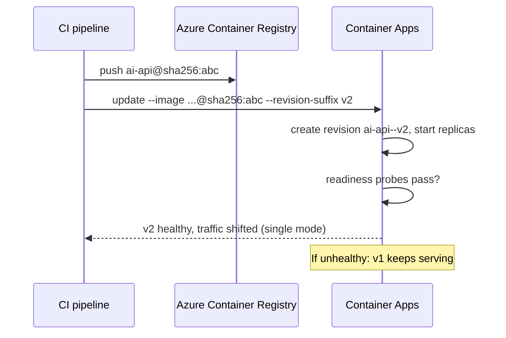

## What this covers

Every new model build, dependency bump or config change you ship to Azure Container Apps ends up as a new **revision**. A safe update workflow ties three things together. Image identity tells you exactly what is running. Revision health tells you whether it works. Revision controls let you stop or roll back quickly. This page covers the commands and the habits that keep image updates low-risk.

**Exam weight:** Develop containerized solutions on Azure (20–25%)

**Skills measured**

- "Deploy applications to Azure Container Apps, including environment configuration and revision management"

## Key concepts

### Tags vs digests

- A **tag** (`ai-api:v2`, `ai-api:staging`) is a movable pointer. Someone can push a different image under the same tag, so a tag doesn't prove what ran.
- A **digest** (`ai-api@sha256:<digest>`) is the content hash and never changes. Use digests, or at least unique tags such as a Git SHA, for production so that incidents can be traced to an exact artifact. Avoid `latest`: it causes caching confusion and makes rollbacks ambiguous.

### What creates a revision

Changes under `properties.template` are **revision-scope** and create a new revision: image, env vars, CPU/memory, probes, scale rules. Changes under `properties.configuration` are **application-scope** and don't create one: secrets, ingress, traffic weights, registries.

### Revision names and suffixes

A revision is named `<app>--<suffix>`. The platform generates a random suffix unless you pass `--revision-suffix v2`, which makes it `ai-api--v2`. Suffixes must be unique per app. Readable suffixes make traffic rules and runbooks clearer.

### Active vs inactive

**Active** revisions can receive traffic and run replicas. **Inactive** revisions use no compute but are kept for rollback. The platform keeps up to **100** inactive revisions by default and purges the oldest beyond that. `--max-inactive-revisions` changes the threshold.

### Revision mode matters

In **single** revision mode (the default), a healthy new revision automatically replaces the old one. In **multiple** revision mode, the new revision starts but you control the traffic. See [Choose and apply revision modes](/study/deploy-and-manage-apps-on-azure-container-apps/choose-and-apply-revision-modes).

## How it works



In single revision mode, the old revision keeps serving until the new one is ready, so a broken image doesn't take the app down. It just never becomes the active revision.

## Hands-on

### Azure portal

1. Open **Application > Containers > Edit and deploy**. Set the new image (tag or digest), optionally set a **revision suffix**, then select **Create**.
2. Watch **Revisions and replicas** until the new revision shows **Running** and **Healthy**.
3. To roll back in multiple mode, set the traffic weight back to the old revision and **Deactivate** the bad one. In single mode, **Activate** the old revision, or redeploy its image.

### Azure CLI

```bash
# Deploy an immutable image as a named revision
az containerapp update --name <app-name> --resource-group <resource-group> \
  --image <registry>.azurecr.io/<repo>@sha256:<digest> --revision-suffix v2

# Confirm what the platform recorded
az containerapp show --name <app-name> --resource-group <resource-group> \
  --query properties.template.containers

# Inspect revisions
az containerapp revision list --name <app-name> --resource-group <resource-group> -o table
az containerapp revision show --name <app-name> --resource-group <resource-group> \
  --revision <app-name>--v2

# Stop a bad revision from serving, keep it for evidence
az containerapp revision deactivate --name <app-name> --resource-group <resource-group> \
  --revision <app-name>--v2
# Bring back a known-good one
az containerapp revision activate --name <app-name> --resource-group <resource-group> \
  --revision <app-name>--v1

# Clone an existing revision as the base for a new one
az containerapp revision copy --name <app-name> --resource-group <resource-group> \
  --from-revision <app-name>--v1 --image <registry>.azurecr.io/<repo>:v3

# Retention
az containerapp update --name <app-name> --resource-group <resource-group> \
  --max-inactive-revisions 20
```

### Python

```python
from azure.identity import DefaultAzureCredential
from azure.mgmt.appcontainers import ContainerAppsAPIClient

client = ContainerAppsAPIClient(DefaultAzureCredential(), "<subscription-id>")
rg, app = "<resource-group>", "<app-name>"

revisions = list(client.container_apps_revisions.list_revisions(rg, app))
for r in revisions:
    print(r.name, r.active, r.health_state, r.template.containers[0].image)

# Deactivate unhealthy active revisions (keeps them for diagnosis)
for r in revisions:
    if r.active and r.health_state == "Unhealthy":
        client.container_apps_revisions.deactivate_revision(rg, app, r.name)
```

## Exam traps

| Need | Action |
|---|---|
| Prove which build served a request | Deploy by digest and log the digest/version |
| Stop a bad release fast, keep evidence | `revision deactivate` |
| Return to the previous version | `revision activate` the old one (plus traffic weights in multiple mode) |
| Predictable revision names in pipelines | `--revision-suffix` |
| Keep fewer old revisions | `--max-inactive-revisions` |

> [!WARNING]
> **Exam trap:** Re-pushing the same tag and running `update` with an unchanged image string may not produce a new revision, because the template didn't change. Use a new tag or a digest, or force a new revision with a new `--revision-suffix`.

> [!WARNING]
> **Exam trap:** Updating a secret or traffic split doesn't create a revision. Only `template` changes do.

> [!TIP]
> Deactivate first, investigate second. Deactivation is reversible. Purged revisions are gone.

> [!NOTE]
> A revision's configuration can't be edited. To fix one, deploy a new revision.

## Quick review

- Tags move. Digests don't. Use digests or unique tags in production.
- `update --image` (a template change) creates a new revision named `<app>--<suffix>`.
- `--revision-suffix` gives readable, unique revision names.
- `revision activate/deactivate/restart/copy` manage individual revisions.
- Up to 100 inactive revisions are kept. Tune it with `--max-inactive-revisions`.
- Single mode only shifts traffic after the new revision is healthy.

## Practice

[Practice: Container Apps deployment questions](/practice/aca-deploy)

## Official references

- [Learn unit: Update images and manage revisions safely](https://learn.microsoft.com/en-us/training/modules/manage-containers-azure-container-apps/2-update-images-manage-revisions)
- [Revisions in Azure Container Apps](https://learn.microsoft.com/en-us/azure/container-apps/revisions)
- [Manage revisions](https://learn.microsoft.com/en-us/azure/container-apps/revisions-manage)
- [AI-200 study guide](https://learn.microsoft.com/en-us/credentials/certifications/resources/study-guides/ai-200)
