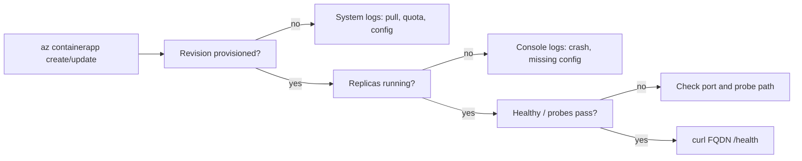

## What this covers

A successful `az containerapp create` only means Azure accepted the configuration. It doesn't mean the app is serving traffic. This page covers how to confirm that a deployment actually worked: check the app and revision state, list replicas, read console and system logs, and smoke-test the ingress endpoint. For an AI API, that means the image pulled, the process started, it bound the target port and it answers its health endpoint.

**Exam weight:** Develop containerized solutions on Azure (20–25%)

**Skills measured**

- "Deploy applications to Azure Container Apps, including environment configuration and revision management"
- "Monitor and troubleshoot solutions on AKS and Container Apps"

## Key concepts

### Revision

A revision is an immutable snapshot of the app's `template` (image, env vars, scale rules, probes). Every revision-scope change creates a new one, named `<app>--<suffix>`.

### States to read

| Field | Where | Meaning |
|---|---|---|
| `provisioningState` | App and revision | Whether ARM finished applying config: `Provisioning`, `Provisioned`/`Succeeded`, `Failed` |
| `runningState` | Revision | Runtime status, for example `Running`, `Processing`, `Activating`, `Degraded`, `Failed` |
| `healthState` | Revision | `Healthy`, `Unhealthy` or `None`. Unhealthy if any replica fails readiness |
| `active` | Revision | Whether it can receive traffic |
| `replicas` | Revision | Current replica count. `0` can be normal with scale to zero |

### Two kinds of logs

- **Console logs:** your container's stdout and stderr (app exceptions, missing env vars, port binding messages).
- **System logs:** platform events (image pull errors, probe failures, scaling, revision provisioning).

Pick the type that matches the symptom. "Container never started" usually shows up in system logs. "Container started then crashed" usually shows up in console logs.

### Ingress URL

When ingress is enabled, the FQDN is `properties.configuration.ingress.fqdn`. External ingress is public. Internal ingress is reachable only inside the environment.

## How it works



Work top-down: app state, then revision state, then replicas, then logs, then an end-to-end request. Health probes (see [Configure health probes and troubleshoot failures](/study/deploy-and-manage-apps-on-azure-container-apps/configure-health-probes-and-troubleshoot-failures)) prevent false failures when a model takes a long time to load.

## Hands-on

### Azure portal

1. Open the app's **Overview**. Check **Status**, the **Application Url** and the latest revision.
2. Open **Application > Revisions and replicas**. Check active state, health, running status and replica count, and open a replica to see container status and restart count.
3. Open **Monitoring > Log stream**. Switch between **Console** and **System**.
4. Open **Monitoring > Logs** to query Log Analytics history.

### Azure CLI

```bash
# App + revision status
az containerapp show --name ai-api --resource-group rg-ai200 \
  --query "{fqdn:properties.configuration.ingress.fqdn,latestRevision:properties.latestRevisionName,provisioningState:properties.provisioningState,runningStatus:properties.runningStatus}"

az containerapp revision list --name ai-api --resource-group rg-ai200 \
  --query "[].{name:name,active:properties.active,health:properties.healthState,running:properties.runningState,replicas:properties.replicas}" -o table
az containerapp revision list --name ai-api --resource-group rg-ai200 --all -o table   # include inactive

# Replicas (latest revision, or a specific one)
az containerapp replica list --name ai-api --resource-group rg-ai200 -o table
az containerapp replica list --name ai-api --resource-group rg-ai200 --revision ai-api--v2

# Logs: console (default) and platform/system
az containerapp logs show --name ai-api --resource-group rg-ai200 --follow --tail 30
az containerapp logs show --name ai-api --resource-group rg-ai200 --type system

# Smoke test the ingress
FQDN=$(az containerapp show --name ai-api --resource-group rg-ai200 \
  --query properties.configuration.ingress.fqdn -o tsv)
curl -s "https://$FQDN/health"
```

For history beyond the live stream, query Log Analytics. With the default Log Analytics destination, the tables are `ContainerAppConsoleLogs_CL` and `ContainerAppSystemLogs_CL`:

```kql
ContainerAppSystemLogs_CL
| where ContainerAppName_s == "ai-api"
| where TimeGenerated > ago(30m)
| project TimeGenerated, RevisionName_s, Reason_s, Log_s
| order by TimeGenerated desc
```

### Python

```python
import urllib.request
from azure.identity import DefaultAzureCredential
from azure.mgmt.appcontainers import ContainerAppsAPIClient

client = ContainerAppsAPIClient(DefaultAzureCredential(), "<subscription-id>")
for rev in client.container_apps_revisions.list_revisions("<resource-group>", "ai-api"):
    print(rev.name, rev.active, rev.health_state, rev.running_state, rev.replicas)

# Quick verification helper after deploy
def check_health(base_url: str) -> None:
    with urllib.request.urlopen(f"{base_url.rstrip('/')}/health", timeout=10) as resp:
        print(resp.status, resp.read().decode())

# check_health("https://ai-api.<region>.azurecontainerapps.io")
```

## Exam traps

| Symptom | First check |
|---|---|
| Revision `Failed` right after an image change | System logs: image pull or registry auth |
| Replica restarts repeatedly | Console logs: crash or missing env var/secret |
| Running but 502/503 at the URL | `--target-port` vs the port the app listens on, readiness probe |
| URL unreachable from the internet | Ingress is `internal`, or ingress is disabled |
| 0 replicas, no errors | Scale to zero is working. Send a request or check `minReplicas` |

> [!WARNING]
> **Exam trap:** `az containerapp logs show` returns **console** logs by default. Image pull and probe failures are platform events, so add `--type system`.

> [!WARNING]
> **Exam trap:** `revision list` hides inactive revisions unless you pass `--all`.

> [!TIP]
> Order of checks: state, then revisions, then replicas, then logs, then curl. Use `--query` to pull out exactly the fields you validate in scripts.

> [!NOTE]
> Log streaming needs a running replica. If the app has scaled to zero, there's nothing to stream, so use Log Analytics instead.

## Quick review

- `az containerapp show --query properties.configuration.ingress.fqdn` gets the URL.
- `revision list` (`--all` for inactive) shows `active`, `healthState`, `runningState` and `replicas`.
- `replica list [--revision]` shows the running instances.
- Console logs are app output. System logs (`--type system`) are platform events.
- Log Analytics tables: `ContainerAppConsoleLogs_CL`, `ContainerAppSystemLogs_CL`.
- A revision is unhealthy if any replica fails readiness.

## Practice

[Practice: Container Apps deployment questions](/practice/aca-deploy) · [Practice: container troubleshooting questions](/practice/containers-troubleshoot)

## Official references

- [Learn unit: Verify deployments with logs and status](https://learn.microsoft.com/en-us/training/modules/deploy-containers-azure-container-apps/6-verify-deployment)
- [Monitor Azure Container Apps](https://learn.microsoft.com/en-us/azure/container-apps/observe-overview)
- [Application logs in Container Apps](https://learn.microsoft.com/en-us/azure/container-apps/logging)
- [Log streaming](https://learn.microsoft.com/en-us/azure/container-apps/log-streaming)
- [AI-200 study guide](https://learn.microsoft.com/en-us/credentials/certifications/resources/study-guides/ai-200)
