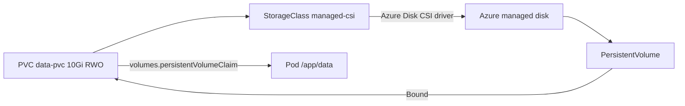

## What this covers

Container filesystems are ephemeral: anything written inside a container disappears when the Pod restarts or moves to another node. AI services often need durable data such as cached model artifacts, embeddings, or conversation state. Kubernetes solves this with PersistentVolumes (PVs) and PersistentVolumeClaims (PVCs); on AKS, CSI drivers create the Azure Disk, Azure Files or Blob resource behind the claim automatically. This page covers choosing a storage class, writing the claim, mounting it, and the access-mode mistakes the exam likes to test.

**Exam weight:** Develop containerized solutions on Azure (20–25%)

**Skills measured**

- "Deploy and manage applications to Azure Kubernetes Service (AKS) by using manifest files"

## Key concepts

### PV, PVC and StorageClass

- A **PersistentVolumeClaim** is the app's request: size, access mode and `storageClassName`.
- A **StorageClass** describes how to provision: CSI driver, SKU, reclaim policy, binding mode, expansion.
- A **PersistentVolume** is the actual piece of storage. With dynamic provisioning, the CSI driver creates it (and the Azure resource) when the claim is made; the claim then shows `Bound`.

### Access modes

| Mode | Short | Meaning |
|---|---|---|
| `ReadWriteOnce` | RWO | Read-write by Pods on **one node** |
| `ReadOnlyMany` | ROX | Read-only from many nodes |
| `ReadWriteMany` | RWX | Read-write from many nodes |
| `ReadWriteOncePod` | RWOP | Read-write by exactly one Pod |

Azure Disk is block storage attached to one VM, so it supports RWO only. Azure Files (SMB or NFS) mounts on many nodes at once, so it supports RWX.

### Built-in AKS storage classes

| Storage class | Backing storage | Access mode | Use case |
|---|---|---|---|
| `default` / `managed-csi` | Azure Disk, Standard SSD | RWO | Cost-efficient single-Pod state, small databases |
| `managed-csi-premium` | Azure Disk, Premium SSD | RWO | Low-latency, I/O-heavy single-Pod workloads |
| `azurefile-csi` | Azure Files, Standard | RWX | Shared config, logs, content across Pods |
| `azurefile-csi-premium` | Azure Files, Premium | RWX | Shared access needing low latency |

The class named `default` is the cluster default (Azure Disk, Standard SSD), so a PVC without `storageClassName` gets an Azure Disk. Built-in classes use `reclaimPolicy: Delete` (deleting the PVC deletes the Azure disk or share) and allow volume expansion. Disk classes use `WaitForFirstConsumer`, so the disk is created in the zone where the Pod lands. Blob classes (`azureblob-fuse-premium`, `azureblob-nfs-premium`) suit large unstructured datasets.

### Azure Container Storage

Beyond CSI drivers, **Azure Container Storage** is a managed, container-native storage service using NVMe-oF for fast attach and detach, which shortens Pod failover for I/O-intensive stateful workloads. Choose it for performance-critical stateful apps; choose CSI classes for general-purpose needs.

## How it works



The claim:

```yaml
apiVersion: v1
kind: PersistentVolumeClaim
metadata:
  name: data-pvc
spec:
  accessModes:
  - ReadWriteOnce
  resources:
    requests:
      storage: 10Gi
  storageClassName: default
```

Mounting it in a Deployment:

```yaml
apiVersion: apps/v1
kind: Deployment
metadata:
  name: web-api
spec:
  replicas: 1                 # RWO disk: keep to one Pod (see Exam traps)
  strategy:
    type: Recreate            # release the disk before the new Pod starts
  selector:
    matchLabels:
      app: web-api
  template:
    metadata:
      labels:
        app: web-api
    spec:
      volumes:
      - name: data-volume
        persistentVolumeClaim:
          claimName: data-pvc
      containers:
      - name: api
        image: myregistry.azurecr.io/web-api:v1
        volumeMounts:
        - name: data-volume
          mountPath: /app/data
```

The Learn unit's example uses `replicas: 2` with this RWO claim. That works only while both Pods land on the same node; a Pod scheduled elsewhere fails with a `Multi-Attach error`. For several replicas, use `azurefile-csi` (RWX) or a StatefulSet with `volumeClaimTemplates` so each replica gets its own disk.

## Hands-on

### Azure portal

1. Open the cluster > **Kubernetes resources** > **Storage** to see storage classes, PVCs and PVs.
2. Select **Create** > **Apply a YAML**, paste `pvc.yaml`, and select **Add**.
3. Apply the Deployment in **Workloads**.
4. Return to **Storage** > **Persistent volume claims** and confirm the status is **Bound**.

### Azure CLI

```bash
kubectl get storageclass
kubectl apply -f pvc.yaml
kubectl apply -f deployment.yaml
kubectl describe pvc data-pvc            # Status: Bound, Volume: pvc-...
kubectl describe pod -l app=web-api      # Volumes / mount events
kubectl get pv

# Test persistence: write, delete the Pod, read again
POD=$(kubectl get pod -l app=web-api -o jsonpath='{.items[0].metadata.name}')
kubectl exec $POD -- sh -c 'echo hello > /app/data/test.txt'
kubectl delete pod $POD
kubectl wait --for=condition=Ready pod -l app=web-api --timeout=120s
POD=$(kubectl get pod -l app=web-api -o jsonpath='{.items[0].metadata.name}')
kubectl exec $POD -- cat /app/data/test.txt

# Grow the volume (class must allow expansion)
kubectl patch pvc data-pvc -p '{"spec":{"resources":{"requests":{"storage":"20Gi"}}}}'
```

### Python

```python
# pip install kubernetes
from kubernetes import client, config

config.load_kube_config()
v1 = client.CoreV1Api()

pvc = client.V1PersistentVolumeClaim(
    metadata=client.V1ObjectMeta(name="shared-pvc"),
    spec=client.V1PersistentVolumeClaimSpec(
        access_modes=["ReadWriteMany"],
        storage_class_name="azurefile-csi",
        resources=client.V1VolumeResourceRequirements(requests={"storage": "100Gi"}),
    ),
)
v1.create_namespaced_persistent_volume_claim("default", pvc)
print(v1.read_namespaced_persistent_volume_claim("shared-pvc", "default").status.phase)
```

## Exam traps

| Requirement | Choose |
|---|---|
| One Pod, low latency, database-style I/O | `managed-csi-premium` (Azure Disk, RWO) |
| Many Pods on different nodes share files | `azurefile-csi` (Azure Files, RWX) |
| Each replica needs its own disk | StatefulSet + `volumeClaimTemplates` |
| Huge unstructured datasets | Azure Blob CSI classes |
| Fastest failover for stateful workloads | Azure Container Storage |
| Keep the disk after the PVC is deleted | Custom StorageClass with `reclaimPolicy: Retain` |

> [!WARNING]
> **Exam trap:** Azure Disk is RWO. Requesting `ReadWriteMany` from a disk class leaves the PVC `Pending`, and multiple replicas on different nodes hit `Multi-Attach error`.

> [!WARNING]
> **Exam trap:** With the built-in classes, deleting the PVC deletes the underlying Azure disk or file share (`reclaimPolicy: Delete`).

> [!TIP]
> **D**isk = **D**edicated to one node. **F**iles = **F**an out to many.

> [!NOTE]
> A Pod stuck in `Pending` with "unbound immediate PersistentVolumeClaims" points to a storage problem, not CPU or memory.

## Quick review

- Container filesystems are ephemeral; PVCs survive Pod restarts and rescheduling.
- PVC = request; StorageClass = how; PV = the actual volume.
- `default`/`managed-csi` = Standard SSD disk; `-premium` = Premium SSD.
- Azure Disk → RWO; Azure Files → RWX.
- Built-in classes reclaim with `Delete` and allow expansion.
- `kubectl describe pvc` should show `Bound`.
- Mount via `volumes[].persistentVolumeClaim.claimName` + `volumeMounts[].mountPath`.

## Practice

[Practice: AKS manifest questions](/practice/aks-manifests)

## Official references

- [Attach persistent storage to an app (unit)](https://learn.microsoft.com/training/modules/configure-apps-azure-kubernetes-service/4-persistent-storage)
- [Exercise: Configure apps on AKS (unit)](https://learn.microsoft.com/training/modules/configure-apps-azure-kubernetes-service/5-exercise-configure-apps)
- [CSI storage drivers on AKS](https://learn.microsoft.com/azure/aks/csi-storage-drivers)
- [Use the Azure Disk CSI driver](https://learn.microsoft.com/azure/aks/azure-disk-csi)
- [Use the Azure Files CSI driver](https://learn.microsoft.com/azure/aks/azure-files-csi)
- [What is Azure Container Storage?](https://learn.microsoft.com/azure/storage/container-storage/container-storage-introduction)
- [AI-200 study guide](https://learn.microsoft.com/credentials/certifications/resources/study-guides/ai-200)
- [Microsoft Learn](https://learn.microsoft.com/)
