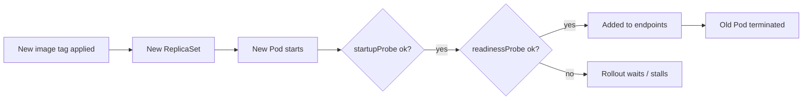

## What this covers

Deploying is only half of "deploy and manage". After the first release you need Kubernetes to know when a Pod is actually healthy, to roll out new image versions without downtime, to roll back a bad release, and to scale. All of that is configured in the Deployment manifest. The module's exercise has you add health probes to an inference API, and the troubleshooting exercise has you fix a broken readiness probe path, so probe semantics are fair game on the exam.

**Exam weight:** Develop containerized solutions on Azure (20–25%)

**Skills measured**

- "Deploy and manage applications to Azure Kubernetes Service (AKS) by using manifest files"
- "Monitor and troubleshoot solutions on AKS and Container Apps by inspecting logs, events, and end-to-end connectivity"

## Key concepts

### Three probe types

| Probe | Question it answers | On failure |
|---|---|---|
| `livenessProbe` | Is the process stuck or dead? | kubelet **restarts** the container |
| `readinessProbe` | Can it take traffic right now? | Pod is **removed from Service endpoints**; not restarted |
| `startupProbe` | Has slow start-up finished? | Liveness/readiness are held off until it succeeds; if it never does, the container is restarted |

AI inference containers often load a large model at start-up. Without a startup probe (or a generous delay), the liveness probe can kill the container before the model finishes loading, creating a `CrashLoopBackOff` that has nothing to do with the code.

### Probe mechanisms and defaults

A probe can be `httpGet` (2xx or 3xx is success), `tcpSocket`, `exec` (exit code 0), or `grpc`. The defaults are `initialDelaySeconds: 0`, `periodSeconds: 10`, `timeoutSeconds: 1`, `successThreshold: 1` and `failureThreshold: 3`. A startup probe's time budget is `failureThreshold × periodSeconds`.

### Rolling update strategy

The default Deployment strategy is `RollingUpdate` with `maxSurge: 25%` and `maxUnavailable: 25%`. Kubernetes creates a new ReplicaSet and swaps Pods gradually, waiting for new Pods to be **Ready** before removing old ones. That's why a readiness probe matters: without one, a Pod counts as ready the moment its container starts. Set `maxUnavailable: 0` for zero-capacity-loss rollouts. The alternative `Recreate` strategy kills all old Pods first (downtime, but no mixed versions). `revisionHistoryLimit` (default 10) controls how many old ReplicaSets are kept for rollback, and `progressDeadlineSeconds` (default 600) marks a stuck rollout as failed.

### Scaling

Manual: `kubectl scale` or change `replicas` and re-apply. Automatic: a HorizontalPodAutoscaler (`autoscaling/v2`) adjusts replicas from CPU or memory utilization, computed against the container's **requests**, so requests must be set. Node capacity is handled separately by the cluster autoscaler (`az aks update --enable-cluster-autoscaler --min-count --max-count`).

## How it works



```yaml
apiVersion: apps/v1
kind: Deployment
metadata:
  name: ai-inference-api
spec:
  replicas: 3
  revisionHistoryLimit: 10
  strategy:
    type: RollingUpdate
    rollingUpdate:
      maxSurge: 1
      maxUnavailable: 0
  selector:
    matchLabels:
      app: inference-api
  template:
    metadata:
      labels:
        app: inference-api
    spec:
      containers:
      - name: api
        image: myregistry.azurecr.io/inference-api:v1.1
        ports:
        - name: http
          containerPort: 8080
        startupProbe:
          httpGet: { path: /health, port: http }
          periodSeconds: 10
          failureThreshold: 30        # up to 300 s to load the model
        livenessProbe:
          httpGet: { path: /health, port: http }
          periodSeconds: 10
          failureThreshold: 3
        readinessProbe:
          httpGet: { path: /ready, port: http }
          periodSeconds: 5
        resources:
          requests: { cpu: "1000m", memory: "2Gi" }
          limits: { cpu: "2000m", memory: "4Gi" }
---
apiVersion: autoscaling/v2
kind: HorizontalPodAutoscaler
metadata:
  name: ai-inference-api
spec:
  scaleTargetRef:
    apiVersion: apps/v1
    kind: Deployment
    name: ai-inference-api
  minReplicas: 3
  maxReplicas: 10
  metrics:
  - type: Resource
    resource:
      name: cpu
      target: { type: Utilization, averageUtilization: 70 }
```

## Hands-on

### Azure portal

1. Open the cluster > **Kubernetes resources** > **Workloads** > **Deployments** and select the Deployment.
2. Select **YAML**, edit the image tag or probe settings, and select **Review + save**.
3. Watch the **Pods** list as new Pods appear and old ones terminate.
4. Check the Deployment **Events** for `Readiness probe failed` messages if the rollout stalls.

### Azure CLI

```bash
kubectl apply -f deployment.yaml

# Roll out a new image and watch it
kubectl set image deployment/ai-inference-api api=myregistry.azurecr.io/inference-api:v1.2
kubectl rollout status deployment/ai-inference-api --timeout=5m

# Inspect and roll back
kubectl rollout history deployment/ai-inference-api
kubectl rollout undo deployment/ai-inference-api
kubectl rollout undo deployment/ai-inference-api --to-revision=2

# Restart Pods (e.g. to pick up a changed Secret) without changing the spec
kubectl rollout restart deployment/ai-inference-api

# Scale
kubectl scale deployment/ai-inference-api --replicas=5
kubectl autoscale deployment ai-inference-api --cpu-percent=70 --min=3 --max=10
kubectl get hpa

# Node-level autoscaling
az aks update --resource-group <resource-group> --name <aks-name> \
  --enable-cluster-autoscaler --min-count 2 --max-count 5
```

### Python

```python
# pip install kubernetes
from kubernetes import client, config

config.load_kube_config()
apps = client.AppsV1Api()

# Equivalent of `kubectl set image`
patch = {"spec": {"template": {"spec": {"containers": [
    {"name": "api", "image": "myregistry.azurecr.io/inference-api:v1.2"}]}}}}
apps.patch_namespaced_deployment("ai-inference-api", "default", patch)

# Equivalent of `kubectl scale`
apps.patch_namespaced_deployment_scale(
    "ai-inference-api", "default", {"spec": {"replicas": 5}})
```

## Exam traps

| Need | Use |
|---|---|
| Restart a hung process automatically | `livenessProbe` |
| Keep traffic away while warming up or overloaded | `readinessProbe` |
| Model takes minutes to load | `startupProbe` with a high `failureThreshold` |
| No capacity loss during rollout | `maxUnavailable: 0`, `maxSurge: 1` |
| Never run two versions at once | `strategy.type: Recreate` |
| Revert a bad release | `kubectl rollout undo` |
| Scale Pods on CPU | HPA (`kubectl autoscale`) with requests set |

> [!WARNING]
> **Exam trap:** A failing **readiness** probe never restarts the container; the Pod shows `0/1 READY` and disappears from the Service endpoints. A failing **liveness** probe restarts it and raises the restart count.

> [!WARNING]
> **Exam trap:** A liveness probe that checks a downstream dependency (database, model endpoint) restarts every replica when that dependency blips. Liveness should check only the process itself.

> [!TIP]
> Liveness = "alive?" → restart. Readiness = "ready?" → route. Startup = "started?" → wait.

> [!NOTE]
> `kubectl rollout restart` works by stamping a timestamp annotation on the Pod template, so it triggers a normal rolling update.

## Quick review

- Probe defaults: period 10 s, timeout 1 s, failureThreshold 3.
- Readiness failure removes the Pod from endpoints; liveness failure restarts it.
- Startup probe protects slow-loading model containers from liveness kills.
- Default strategy: RollingUpdate, maxSurge 25%, maxUnavailable 25%.
- `kubectl rollout undo --to-revision=N` rolls back; history depth = `revisionHistoryLimit` (10).
- HPA utilization is measured against requests.
- Cluster autoscaler adds nodes; HPA adds Pods.

## Practice

[Practice: AKS manifest questions](/practice/aks-manifests) · [Practice: container troubleshooting questions](/practice/containers-troubleshoot)

## Official references

- [Exercise: Deploy an AI inference API to AKS (unit)](https://learn.microsoft.com/training/modules/deploy-apps-azure-kubernetes-service/5-exercise-deploy-ai-api)
- [Exercise: Troubleshoot apps on AKS (unit)](https://learn.microsoft.com/training/modules/monitor-apps-azure-kubernetes-service/5-exercise-troubleshoot-apps)
- [Scaling options for applications in AKS](https://learn.microsoft.com/azure/aks/concepts-scale)
- [Use the cluster autoscaler in AKS](https://learn.microsoft.com/azure/aks/cluster-autoscaler)
- [Kubernetes docs: configure liveness, readiness and startup probes](https://kubernetes.io/docs/tasks/configure-pod-container/configure-liveness-readiness-startup-probes/)
- [AI-200 study guide](https://learn.microsoft.com/credentials/certifications/resources/study-guides/ai-200)
