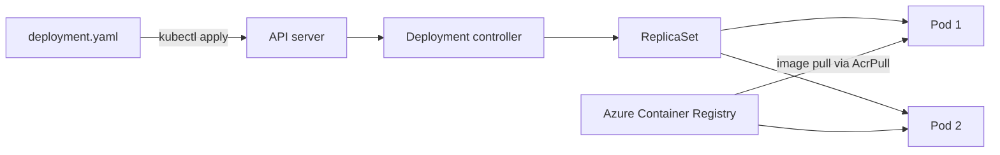

## What this covers

A Deployment manifest is the YAML file that tells Azure Kubernetes Service (AKS) what to run: which container image, how many copies, how much CPU and memory each copy gets, and which settings it receives. You declare the desired state, apply it, and the Deployment controller keeps reality matching it, replacing Pods that crash or disappear. This page walks through every field the exam expects you to read or fix.

**Exam weight:** Develop containerized solutions on Azure (20–25%)

**Skills measured**

- "Deploy and manage applications to Azure Kubernetes Service (AKS) by using manifest files"

## Key concepts

### Manifest anatomy

Every Kubernetes object has four top-level fields: `apiVersion`, `kind`, `metadata` and `spec`. For a Deployment, `apiVersion` is `apps/v1` (not `v1`, which is for Pods, Services, ConfigMaps and Secrets). Inside `spec` you find `replicas`, a `selector`, and a Pod `template`.

### Labels and selectors

`spec.selector.matchLabels` tells the Deployment which Pods it owns. `spec.template.metadata.labels` stamps those labels onto every Pod it creates. The two **must match**, or the API server rejects the manifest. In `apps/v1` the selector is also immutable after creation: changing it means deleting and recreating the Deployment. The same Pod labels are what a Service selector targets later.

### Container image

The image reference has the form `<registry>.azurecr.io/<repository>:<tag>`, for example `myregistry.azurecr.io/inference-api:v1.0`. The image must already be pushed, and the cluster must be allowed to pull it. On AKS you normally grant that with `az aks update --attach-acr`, which gives the kubelet managed identity the `AcrPull` role. Pin explicit tags (or digests) rather than `latest`: with `latest` the default `imagePullPolicy` becomes `Always` and rollbacks become ambiguous.

### Replicas

`replicas` sets how many identical Pods run. One replica means any crash is an outage until the Pod restarts. Rough guidance from the module:

| Replicas | When |
|---|---|
| 2 | Basic resilience; dev and non-critical services |
| 3 | Recommended for production APIs serving external users |
| 4+ | Only when traffic needs load distribution; each copy costs resources |

### Requests and limits

- **Requests** are what the scheduler reserves. A Pod requesting 2 GiB stays `Pending` if no node has 2 GiB unreserved.
- **Limits** are the ceiling. Exceeding the **memory limit** gets the container killed (`OOMKilled`, exit code 137) and restarted. Exceeding the **CPU limit** does not kill anything; the container is throttled, which shows up as higher latency.

CPU uses millicores (`1000m` = 1 vCPU); memory uses binary units (`Gi`, `Mi`). For inference Pods, size memory from the model's documented footprint plus roughly 20% headroom, start with 1–2 vCPU, and tune from observed usage.

### Environment variables and Secrets

Plain settings go in `env` with `value`. Sensitive values use `valueFrom.secretKeyRef` so the key never appears in the manifest or in source control. Larger sets of settings belong in ConfigMaps (see [Define ConfigMaps for application settings](/study/deploy-and-monitor-applications-on-azure-kubernetes-service/define-configmaps-for-application-settings)).

## How it works



The Deployment creates a ReplicaSet for each Pod template version. The ReplicaSet keeps the replica count; the scheduler places each Pod on a node whose free allocatable capacity covers the Pod's requests; the kubelet pulls the image and starts the container. Changing the Pod template (for example a new image tag) creates a new ReplicaSet and triggers a rolling update.

A complete manifest:

```yaml
apiVersion: apps/v1
kind: Deployment
metadata:
  name: ai-inference-api
  namespace: default
spec:
  replicas: 2
  selector:
    matchLabels:
      app: inference-api          # Deployment manages Pods with this label
  template:
    metadata:
      labels:
        app: inference-api        # must match the selector above
    spec:
      containers:
      - name: api
        image: myregistry.azurecr.io/inference-api:v1.0
        ports:
        - containerPort: 8080     # port the app listens on
        resources:
          requests:
            memory: "2Gi"
            cpu: "1000m"          # 1 vCPU
          limits:
            memory: "4Gi"
            cpu: "2000m"
        env:
        - name: MODEL_NAME
          value: "gpt-4"
        - name: API_ENDPOINT
          value: "https://api.example.com"
        - name: API_KEY
          valueFrom:
            secretKeyRef:
              name: api-secrets   # Secret object name
              key: api-key        # key inside the Secret
```

## Hands-on

### Azure portal

1. Open your AKS cluster and select **Kubernetes resources** > **Workloads**.
2. Select **Create** > **Apply a YAML**.
3. Paste the Deployment manifest and select **Add**.
4. On the **Deployments** tab, open `ai-inference-api` and confirm **Ready** shows `2/2`.

### Azure CLI

```bash
# Allow the cluster to pull from ACR (grants AcrPull to the kubelet identity)
az aks update --resource-group <resource-group> --name <aks-name> --attach-acr <acr-name>
az aks get-credentials --resource-group <resource-group> --name <aks-name>

# Create the Secret the manifest references (never commit the literal value)
kubectl create secret generic api-secrets --from-literal=api-key=<your-secret-key>

# Validate, preview and apply
kubectl apply -f deployment.yaml --dry-run=server
kubectl diff -f deployment.yaml
kubectl apply -f deployment.yaml

# Generate a starter manifest instead of typing it
kubectl create deployment ai-inference-api \
  --image=myregistry.azurecr.io/inference-api:v1.0 --replicas=2 \
  --dry-run=client -o yaml > deployment.yaml
```

### Python

```python
# pip install kubernetes  (run `az aks get-credentials` first)
from kubernetes import client, config, utils

config.load_kube_config()
api = client.ApiClient()

# Apply the same YAML file the CLI uses
utils.create_from_yaml(api, "deployment.yaml", namespace="default")

apps = client.AppsV1Api()
dep = apps.read_namespaced_deployment("ai-inference-api", "default")
print(dep.status.ready_replicas, "/", dep.spec.replicas)
```

## Exam traps

| Need | Field / option |
|---|---|
| Decide which Pods the Deployment owns | `spec.selector.matchLabels` (must equal template labels) |
| Guarantee scheduling capacity | `resources.requests` |
| Stop one Pod starving a node | `resources.limits` |
| Pass an API key | `env[].valueFrom.secretKeyRef` |
| Pass many plain settings | ConfigMap via `envFrom.configMapRef` |
| Pull from private ACR | `az aks update --attach-acr` (AcrPull) |

> [!WARNING]
> **Exam trap:** `OOMKilled` is caused by the memory **limit**, not by a low request. A low request causes over-packing of nodes; a request larger than any node's free capacity causes `Pending`.

> [!WARNING]
> **Exam trap:** Deployments use `apiVersion: apps/v1`. A manifest with `apiVersion: v1` and `kind: Deployment` fails validation.

> [!TIP]
> Requests = **R**eserved for scheduling. Limits = **L**ine you cannot cross.

> [!NOTE]
> If you set only a limit, Kubernetes copies it into the request. Setting requests equal to limits for every container gives the Pod the `Guaranteed` QoS class, the last to be evicted under node pressure.

## Quick review

- Deployments are `apps/v1`; selector labels must match Pod template labels.
- Image format: `<registry>.azurecr.io/<repo>:<tag>`; pin tags, avoid `latest`.
- `--attach-acr` grants the kubelet identity `AcrPull` on the registry.
- Requests drive scheduling; requests too large for any node = `Pending`.
- Memory over limit = `OOMKilled` (exit 137); CPU over limit = throttling.
- 2 replicas for basic resilience, 3 for production APIs.
- Secrets are referenced with `secretKeyRef`, never hard-coded.

## Practice

[Practice: AKS manifest questions](/practice/aks-manifests)

## Official references

- [Deploy applications to Azure Kubernetes Service (module)](https://learn.microsoft.com/training/modules/deploy-apps-azure-kubernetes-service/)
- [Create Kubernetes deployment manifests (unit)](https://learn.microsoft.com/training/modules/deploy-apps-azure-kubernetes-service/2-create-deployment-manifests)
- [Authenticate with ACR from AKS](https://learn.microsoft.com/azure/aks/cluster-container-registry-integration)
- [Resource management best practices for AKS](https://learn.microsoft.com/azure/aks/developer-best-practices-resource-management)
- [AI-200 study guide](https://learn.microsoft.com/credentials/certifications/resources/study-guides/ai-200)
- [Microsoft Learn](https://learn.microsoft.com/)
