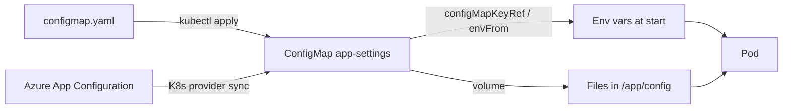

## What this covers

AI services need different settings per environment: feature flags, model names, upstream endpoints, timeouts. Baking them into the image means a rebuild for every change. A ConfigMap holds **non-sensitive** configuration as key-value pairs outside the image, and you inject it into Pods as environment variables or as files. This page covers defining ConfigMaps, the three ways to consume them, what happens when you change one, and how Azure App Configuration can generate them for you.

**Exam weight:** Develop containerized solutions on Azure (20–25%)

**Skills measured**

- "Deploy and manage applications to Azure Kubernetes Service (AKS) by using manifest files"

## Key concepts

### Structure and limits

A ConfigMap is a `v1` object with a `data` map of string values and an optional `binaryData` map of base64-encoded bytes. Keys may contain only alphanumerics, `-`, `_` and `.`. The whole object is capped at **1 MiB**; larger files or model artifacts belong on a persistent volume or in Blob Storage. All values are strings, so quote YAML values such as `"true"` and `"30"`. A ConfigMap must exist in the **same namespace** as the Pods that use it.

### Three ways to consume

| Method | YAML | Result |
|---|---|---|
| Single key as env var | `env[].valueFrom.configMapKeyRef` | One variable, any name you choose |
| All keys as env vars | `envFrom[].configMapRef` | One variable per key (optional `prefix`) |
| Volume | `volumes[].configMap` + `volumeMounts` | Each key becomes a file under `mountPath` |

Choose env vars when the app reads its process environment; choose a volume when it expects a config file on disk. Use `items` on the volume to mount only selected keys or rename the file.

### Update behavior

- **Volume mounts** refresh automatically after the ConfigMap changes, typically within a minute or so (kubelet sync period plus cache TTL). The app must re-read the file.
- **Environment variables** are read once at container start. Changes need a Pod restart, e.g. `kubectl rollout restart`.
- **`subPath` mounts** never refresh.

### Immutable ConfigMaps

Setting `immutable: true` blocks any change to the data, and the flag itself can't be reverted. To change settings you create a new ConfigMap (for example `app-settings-v2`) and point the Deployment at it, which also gives you a clean rollout and rollback. Immutable objects reduce API server load because the kubelet stops watching them, which matters in large clusters.

### Azure App Configuration integration

The **Azure App Configuration Kubernetes Provider** runs in the cluster, reads key-values and feature flags from an App Configuration store, and writes them into standard ConfigMaps (and Key Vault references into Secrets). It refreshes on a schedule, so you manage settings centrally across many clusters while apps keep consuming ordinary ConfigMaps.

## How it works



Define the ConfigMap:

```yaml
apiVersion: v1
kind: ConfigMap
metadata:
  name: app-settings
data:
  FEATURE_X_ENABLED: "true"
  SERVICE_ENDPOINT: "https://api.example.com"
  # File-like configuration can use multi-line values
  app.config: |
    log_level=info
    timeout_seconds=30
```

Consume it as environment variables:

```yaml
apiVersion: apps/v1
kind: Deployment
metadata:
  name: web-api
spec:
  replicas: 2
  selector:
    matchLabels:
      app: web-api
  template:
    metadata:
      labels:
        app: web-api
    spec:
      containers:
      - name: api
        image: myregistry.azurecr.io/web-api:v1
        env:
        - name: FEATURE_X_ENABLED
          valueFrom:
            configMapKeyRef:
              name: app-settings
              key: FEATURE_X_ENABLED
        - name: SERVICE_ENDPOINT
          valueFrom:
            configMapKeyRef:
              name: app-settings
              key: SERVICE_ENDPOINT
        # Alternative: load all keys as environment variables
        # envFrom:
        # - configMapRef:
        #     name: app-settings
```

Mount it as files (fragment inside the Pod spec):

```yaml
volumes:
- name: config-volume
  configMap:
    name: app-settings
    # Optional: select specific keys to mount as files
    # items:
    # - key: app.config
    #   path: application.conf
containers:
- name: api
  volumeMounts:
  - name: config-volume
    mountPath: /app/config
    readOnly: true
```

Immutable version:

```yaml
apiVersion: v1
kind: ConfigMap
metadata:
  name: app-settings-v2
data:
  FEATURE_X_ENABLED: "true"
  SERVICE_ENDPOINT: "https://api.example.com"
immutable: true
```

## Hands-on

### Azure portal

1. Open the cluster > **Kubernetes resources** > **Configuration** > **Config maps**.
2. Select **Create** > **Apply a YAML**, paste `configmap.yaml`, and select **Add**.
3. Open the ConfigMap to review its keys and values.
4. In **Workloads**, open a Pod and check its environment or use **Console** to `cat /app/config/app.config`.

### Azure CLI

```bash
kubectl apply -f configmap.yaml
kubectl apply -f deployment.yaml
kubectl describe configmap app-settings
kubectl describe deployment web-api

# Imperative creation from literals or a file
kubectl create configmap app-settings \
  --from-literal=FEATURE_X_ENABLED=true --from-file=app.config

# Check if Pod received configuration as environment variables
kubectl exec <pod-name> -- printenv | grep FEATURE

# Env-var consumers need a restart after edits
kubectl rollout restart deployment/web-api

# App Configuration Kubernetes Provider (Helm)
helm install azureappconfiguration.kubernetesprovider \
  oci://mcr.microsoft.com/azure-app-configuration/helmchart/kubernetes-provider \
  --namespace azappconfig-system --create-namespace
```

### Python

```python
# pip install kubernetes
from kubernetes import client, config

config.load_kube_config()
v1 = client.CoreV1Api()

cm = client.V1ConfigMap(
    metadata=client.V1ObjectMeta(name="app-settings"),
    data={"FEATURE_X_ENABLED": "true", "SERVICE_ENDPOINT": "https://api.example.com"},
)
v1.create_namespaced_config_map("default", cm)

# Inside the container, the app just reads its environment
import os
endpoint = os.environ["SERVICE_ENDPOINT"]
```

## Exam traps

| Requirement | Choose |
|---|---|
| Non-sensitive settings outside the image | ConfigMap |
| Passwords, keys, connection strings | Secret or Key Vault, not ConfigMap |
| Settings picked up without restarting | Volume mount (not `subPath`, not env) |
| Load dozens of keys in one line | `envFrom.configMapRef` |
| Prevent accidental edits in production | `immutable: true` |
| Central config across many clusters | App Configuration + Kubernetes Provider |
| Config larger than 1 MiB | Persistent volume or Blob Storage |

> [!WARNING]
> **Exam trap:** Editing a ConfigMap doesn't change environment variables in running Pods. Restart the Pods (`kubectl rollout restart`) or mount the ConfigMap as a volume.

> [!WARNING]
> **Exam trap:** If a Pod references a ConfigMap or key that doesn't exist, the container fails with `CreateContainerConfigError` (unless the reference is marked `optional: true`).

> [!TIP]
> ConfigMap = **C**leartext settings. Secret = **S**ensitive settings.

> [!NOTE]
> An immutable ConfigMap can still be deleted; Pods that already mounted it keep the mount until they restart.

## Quick review

- ConfigMaps hold non-sensitive string data; `binaryData` holds base64 bytes.
- Size limit is 1 MiB per ConfigMap; same namespace as the Pod.
- `configMapKeyRef` = one key; `envFrom` = all keys; volume = files.
- Volume mounts auto-refresh; env vars and `subPath` don't.
- `immutable: true` can't be undone; create a new versioned ConfigMap instead.
- Missing ConfigMap reference → `CreateContainerConfigError`.
- App Configuration Kubernetes Provider generates ConfigMaps from a central store.

## Practice

[Practice: AKS manifest questions](/practice/aks-manifests)

## Official references

- [Configure applications on Azure Kubernetes Service (module)](https://learn.microsoft.com/training/modules/configure-apps-azure-kubernetes-service/)
- [Define ConfigMaps for application settings (unit)](https://learn.microsoft.com/training/modules/configure-apps-azure-kubernetes-service/2-define-configmaps)
- [Azure App Configuration Kubernetes Provider quickstart](https://learn.microsoft.com/azure/azure-app-configuration/quickstart-azure-kubernetes-service)
- [Kubernetes docs: ConfigMaps](https://kubernetes.io/docs/concepts/configuration/configmap/)
- [AI-200 study guide](https://learn.microsoft.com/credentials/certifications/resources/study-guides/ai-200)
- [Microsoft Learn](https://learn.microsoft.com/)
