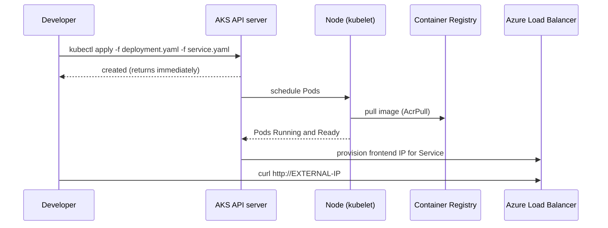

## What this covers

Once the Deployment and Service manifests exist, you send them to the cluster with `kubectl apply`, then verify that Pods are running, the Service has an address, and the API answers. This page covers the end-to-end flow from an empty resource group to a reachable AKS endpoint, plus the four failure patterns the module teaches you to diagnose right after a deploy.

**Exam weight:** Develop containerized solutions on Azure (20–25%)

**Skills measured**

- "Deploy and manage applications to Azure Kubernetes Service (AKS) by using manifest files"
- "Monitor and troubleshoot solutions on AKS and Container Apps by inspecting logs, events, and end-to-end connectivity"

## Key concepts

### Declarative apply

`kubectl apply -f` creates objects that don't exist and patches those that do, recording the last-applied configuration so later applies compute a three-way merge. You can pass a file, several `-f` flags, a directory (`-f .`), or a URL. Applying is **asynchronous**: the command returns as soon as the API server accepts the objects, while image pulls and Pod start-up continue in the background. Use `kubectl rollout status` when a script must wait.

### Cluster access

`az aks get-credentials` merges the cluster's kubeconfig context into `~/.kube/config`. For clusters with Microsoft Entra ID integration, kubectl authenticates through the `kubelogin` plugin (`az aks install-cli` installs both). For private clusters without network line of sight, `az aks command invoke` runs kubectl inside the cluster for you.

### Registry access

AKS pulls images using the kubelet managed identity. `--attach-acr` on `az aks create` or `az aks update` assigns it `AcrPull` on the registry; `az aks check-acr` tests the path end to end. Without this, Pods fail with `ErrImagePull` then `ImagePullBackOff`.

### Reading status columns

| Command | Column | Healthy value |
|---|---|---|
| `kubectl get pods` | READY / STATUS | `1/1`, `Running` |
| `kubectl get deployment` | READY / UP-TO-DATE / AVAILABLE | `2/2`, `2`, `2` |
| `kubectl get svc` | EXTERNAL-IP | An IP, not `<pending>` |

## How it works



Kubernetes pulls the image, schedules Pods onto nodes with enough capacity, starts the containers, and creates the Service networking. The LoadBalancer IP usually appears within a minute or two.

## Hands-on

### Azure portal

1. Create the cluster: **Kubernetes services** > **Create** > **Kubernetes cluster**; on the **Integrations** tab pick your container registry.
2. Open the cluster, select **Kubernetes resources** > **Workloads** > **Create** > **Apply a YAML**, and paste `deployment.yaml`.
3. Repeat in **Services and ingresses** for `service.yaml`.
4. In **Workloads** > **Pods**, confirm status `Running`; in **Services and ingresses**, copy the external IP.

### Azure CLI

```bash
# Replace with resource group and names for your environment
az group create --name rg-ai200 --location eastus

az aks create --resource-group rg-ai200 --name <aks-name> \
  --node-count 2 --attach-acr <acr-name> --generate-ssh-keys
az aks get-credentials --resource-group rg-ai200 --name <aks-name>

# Deploy
kubectl apply -f deployment.yaml
kubectl apply -f service.yaml
# or both / or the whole folder
kubectl apply -f deployment.yaml -f service.yaml
kubectl apply -f .

# Verify
kubectl rollout status deployment/ai-inference-api
kubectl get pods
kubectl get deployment
kubectl get svc
kubectl logs inference-api-7d8b4f9c6-abc12 --since=10m
kubectl logs -l app=inference-api

# Test inside the cluster (ClusterIP)
kubectl run -it --rm debug --image=alpine:latest --restart=Never -- sh
# then inside the Pod:  wget -qO- http://inference-api-service:80

# Test from outside (LoadBalancer)
curl http://40.89.123.45
curl http://40.89.123.45/predict -X POST -d '{"input": "test"}'
```

Troubleshooting commands for the four common failures:

```bash
# ImagePullBackOff: wrong path/tag or no pull permission
kubectl describe pod <pod-name>          # Events: Failed to pull image ...
az acr repository list --name <acr-name>
az acr repository show-tags --name <acr-name> --repository inference-api
az aks check-acr --resource-group rg-ai200 --name <aks-name> --acr <acr-name>.azurecr.io

# CrashLoopBackOff: app exits on start
kubectl logs <pod-name> --previous
kubectl describe pod <pod-name>

# Pending: nothing can fit the requests
kubectl describe pod <pod-name>          # Events: 0/2 nodes available: Insufficient memory
kubectl top nodes
az aks scale --resource-group rg-ai200 --name <aks-name> --node-count 3

# Service has no endpoints: labels don't match
kubectl get pods --show-labels
kubectl describe svc inference-api-service   # Selector / Endpoints
```

### Python

```python
# pip install azure-identity azure-mgmt-containerservice
# Look up cluster details with managed identity / developer login.
from azure.identity import DefaultAzureCredential
from azure.mgmt.containerservice import ContainerServiceClient

aks = ContainerServiceClient(DefaultAzureCredential(), "<subscription-id>")
cluster = aks.managed_clusters.get("<resource-group>", "<aks-name>")
print(cluster.provisioning_state, cluster.kubernetes_version, cluster.fqdn)

# Then deploy with the kubernetes client after `az aks get-credentials`
from kubernetes import config, utils, client
config.load_kube_config()
utils.create_from_yaml(client.ApiClient(), "deployment.yaml")
```

## Exam traps

| Symptom | Likely cause | First command |
|---|---|---|
| `ImagePullBackOff` / `ErrImagePull` | Wrong image name/tag, or no `AcrPull` | `kubectl describe pod` |
| `CrashLoopBackOff` | App exits: missing env var, bad config, code error | `kubectl logs --previous` |
| `Pending` | Requests exceed free node capacity, taints, unbound PVC | `kubectl describe pod` (Events) |
| `CreateContainerConfigError` | Referenced Secret/ConfigMap or key doesn't exist | `kubectl describe pod` |
| Service `Endpoints: <none>` | Selector doesn't match Ready Pods | `kubectl get pods --show-labels` |
| EXTERNAL-IP `<pending>` | LB still provisioning (or IP/permission issue) | `kubectl describe svc` |

> [!WARNING]
> **Exam trap:** For `CrashLoopBackOff`, plain `kubectl logs` may show the new, just-started container. Use `--previous` to see why the last one died.

> [!WARNING]
> **Exam trap:** `kubectl apply` succeeding does **not** mean the app is running. Check `kubectl rollout status` or `kubectl get pods`.

> [!TIP]
> Pull errors: think **registry**. Crash loops: think **logs**. Pending: think **capacity**. No endpoints: think **labels**.

> [!NOTE]
> `kubectl top` relies on metrics-server, which AKS installs by default.

## Quick review

- `az aks get-credentials` writes the kubeconfig context kubectl uses.
- `kubectl apply -f` accepts files, multiple `-f` flags or a directory; it's asynchronous.
- `--attach-acr` grants the kubelet identity `AcrPull`; verify with `az aks check-acr`.
- `kubectl logs --previous` shows the crashed container's output.
- `Pending` + "Insufficient cpu/memory" means scale nodes or lower requests.
- `az aks scale --node-count` adds nodes to a node pool.
- Endpoints `<none>` means a selector/label mismatch.

## Practice

[Practice: AKS manifest questions](/practice/aks-manifests) · [Practice: container troubleshooting questions](/practice/containers-troubleshoot)

## Official references

- [Deploy applications to Azure Kubernetes Services (unit)](https://learn.microsoft.com/training/modules/deploy-apps-azure-kubernetes-service/4-deploy-verify-results)
- [Exercise: Deploy an AI inference API to AKS (unit)](https://learn.microsoft.com/training/modules/deploy-apps-azure-kubernetes-service/5-exercise-deploy-ai-api)
- [Quickstart: deploy an AKS cluster with Azure CLI](https://learn.microsoft.com/azure/aks/learn/quick-kubernetes-deploy-cli)
- [Authenticate with ACR from AKS](https://learn.microsoft.com/azure/aks/cluster-container-registry-integration)
- [AI-200 study guide](https://learn.microsoft.com/credentials/certifications/resources/study-guides/ai-200)
- [Microsoft Learn](https://learn.microsoft.com/)
