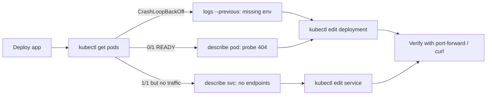

## What this covers

This hands-on exercise from the Microsoft Learn module has you deploy a containerized API to AKS (images in Azure Container Registry) and then diagnose three deliberate faults with `kubectl`: a **Service selector mismatch**, a **missing environment variable**, and an **invalid readiness probe path**. You fix each one with `kubectl edit`, then clean up. This page explains what each fault looks like, how to find it, and the manifest fix, so you can reproduce the lab or answer scenario questions without it. It takes about 30 minutes and needs a paid Azure subscription (ACR Tasks runs are paused on free credits), VS Code, Python 3.12+, the Azure CLI and kubectl.

**Exam weight:** Develop containerized solutions on Azure (20–25%)

**Skills measured**

- "Monitor and troubleshoot solutions on AKS and Container Apps by inspecting logs, events, and end-to-end connectivity"

## Key concepts

### Lab tasks

1. Download the project starter files.
2. Deploy Azure resources: Azure Container Registry and an AKS cluster.
3. Diagnose and resolve the common issues.
4. Clean up Azure resources.

### The three faults and their fingerprints

| Fault | What you see | Where it shows up |
|---|---|---|
| Service selector doesn't match Pod labels | Pods `Running 1/1`, but requests to the Service fail | `kubectl describe svc`: endpoints empty |
| Required env var missing | Pod in `CrashLoopBackOff`, restart count climbing | `kubectl logs --previous`: KeyError / config error |
| Readiness probe path wrong (e.g. `/healthz` vs `/health`) | Pod `Running` but `0/1` READY, never restarts | `kubectl describe pod` Events: `Readiness probe failed: HTTP probe failed with statuscode: 404` |

Each fault breaks a different link: the Service→Pod link, the container start-up, and the Pod's admission to endpoints.

### kubectl edit vs re-apply

`kubectl edit` opens the live object in an editor and saves changes straight to the cluster, which is quick for a lab. In real projects, fix the YAML in source control and `kubectl apply` it, otherwise the next deploy reintroduces the bug. Editing a Deployment's Pod template triggers a rolling update; editing a Service takes effect immediately.

## How it works



Fixed manifest fragments (resource, variable and path names are illustrative; the lab's starter files use their own):

```yaml
# Deployment: add the missing variable and correct the probe path
spec:
  template:
    metadata:
      labels:
        app: api                     # the label the Service must select
    spec:
      containers:
      - name: api
        env:
        - name: MODEL_ENDPOINT        # was missing -> CrashLoopBackOff
          valueFrom:
            configMapKeyRef:
              name: app-settings
              key: MODEL_ENDPOINT
        readinessProbe:
          httpGet:
            path: /health             # was a path the app doesn't serve
            port: 8080
---
# Service: selector must equal the Pod label
apiVersion: v1
kind: Service
metadata:
  name: api-service
spec:
  selector:
    app: api                          # was a different value -> no endpoints
  ports:
  - port: 80
    targetPort: 8080
```

## Hands-on

### Azure portal

1. Open the AKS cluster > **Kubernetes resources** > **Workloads** and find Pods with restarts or `0/1` ready.
2. Open a Pod > **Events** to read probe failures; use **Live Logs** to see the missing-variable error.
3. In **Services and ingresses**, open the Service and note that **Endpoints** is empty.
4. Use **YAML** on the Deployment or Service to correct the value and **Review + save**.

### Azure CLI

```bash
az group create --name rg-ai200 --location eastus
az acr create --resource-group rg-ai200 --name <acr-name> --sku Basic
az acr build --registry <acr-name> --image api:v1 .
az aks create --resource-group rg-ai200 --name <aks-name> \
  --node-count 2 --attach-acr <acr-name> --generate-ssh-keys
az aks get-credentials --resource-group rg-ai200 --name <aks-name>
kubectl apply -f k8s/

# Diagnose
kubectl get pods
kubectl logs <pod-name> --previous            # missing env var
kubectl describe pod <pod-name>               # readiness probe 404
kubectl describe svc api-service              # Endpoints: <none>
kubectl get pods --show-labels
kubectl get events --sort-by=.metadata.creationTimestamp

# Fix
kubectl edit deployment api                   # add env var, fix probe path
kubectl edit service api-service              # fix selector
kubectl rollout status deployment/api

# Verify
kubectl get endpointslices -l kubernetes.io/service-name=api-service
kubectl port-forward service/api-service 8080:80
curl http://localhost:8080/health

# Clean up
az group delete --name rg-ai200 --yes --no-wait
```

### Python

```python
# The lab's client pattern: call health, readiness and inference endpoints.
# pip install requests
import requests

BASE = "http://localhost:8080"   # via port-forward, or the LoadBalancer IP
checks = {"health": "/health", "ready": "/ready"}
for name, path in checks.items():
    try:
        print(name, requests.get(BASE + path, timeout=5).status_code)
    except requests.RequestException as exc:
        print(name, "FAILED", exc)
```

## Exam traps

| Clue in the question | Fault | Fix |
|---|---|---|
| "Pods are running but the Service returns no response" | Selector/label mismatch | Align `spec.selector` with Pod labels |
| "Restart count keeps increasing" + KeyError in logs | Missing env var / ConfigMap key | Add the `env` entry or ConfigMap key |
| "Pod is Running, READY 0/1, no restarts" | Readiness probe path/port wrong | Correct `readinessProbe.httpGet` |
| "Restarts every ~30 s after start-up" | Liveness probe too aggressive | Add `startupProbe` or fix liveness path |

> [!WARNING]
> **Exam trap:** `kubectl edit` changes only the live object. If the YAML in your repo still has the bug, the next `kubectl apply` puts it back.

> [!WARNING]
> **Exam trap:** A wrong **readiness** path never causes `CrashLoopBackOff`; a wrong **liveness** path does, because liveness failures restart the container.

> [!TIP]
> Restarts → logs. Not ready → describe. No traffic → endpoints.

> [!NOTE]
> Delete the resource group at the end; an idle AKS cluster still bills for its node VMs and load balancer.

## Quick review

- The lab plants three faults: selector mismatch, missing env var, bad readiness path.
- Selector mismatch = Pods healthy, Service endpoints empty.
- Missing env var = `CrashLoopBackOff`; read `kubectl logs --previous`.
- Bad readiness path = `0/1` READY, probe 404 in Events, no restarts.
- `kubectl edit` applies live; persist fixes in YAML.
- Verify with EndpointSlices and `kubectl port-forward` + `curl`.
- Clean up with `az group delete`.

## Practice

[Practice: container troubleshooting questions](/practice/containers-troubleshoot)

## Official references

- [Exercise - Troubleshoot apps on Azure Kubernetes Service (unit)](https://learn.microsoft.com/training/modules/monitor-apps-azure-kubernetes-service/5-exercise-troubleshoot-apps)
- [Launch the exercise instructions](https://go.microsoft.com/fwlink/?linkid=2346293)
- [Monitor and troubleshoot applications on AKS (module)](https://learn.microsoft.com/training/modules/monitor-apps-azure-kubernetes-service/)
- [AKS troubleshooting documentation](https://learn.microsoft.com/troubleshoot/azure/azure-kubernetes/welcome-azure-kubernetes)
- [AI-200 study guide](https://learn.microsoft.com/credentials/certifications/resources/study-guides/ai-200)
- [Microsoft Learn](https://learn.microsoft.com/)
