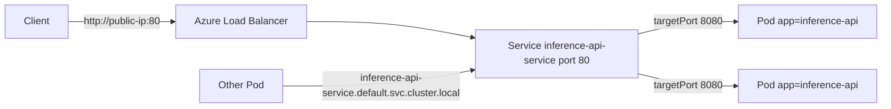

## What this covers

Pods get new IP addresses every time they are recreated, so clients can't call them directly. A Kubernetes Service gives a set of Pods one stable virtual IP and DNS name and load-balances across them, using a label selector to find its Pods. This page covers choosing a Service type on AKS, writing the manifest, mapping ports, and reaching the Service from inside and outside the cluster.

**Exam weight:** Develop containerized solutions on Azure (20–25%)

**Skills measured**

- "Deploy and manage applications to Azure Kubernetes Service (AKS) by using manifest files"

## Key concepts

### Service types

| Type | Reachable from | How on AKS | Typical AI use |
|---|---|---|---|
| `ClusterIP` (default) | Inside the cluster only | Virtual IP + cluster DNS name | Vector search or embedding service called by other Pods |
| `NodePort` | `<node-ip>:<nodePort>` | Opens the same port (30000–32767) on every node | Quick dev/test access, external LB integration |
| `LoadBalancer` | Internet (or VNet if internal) | AKS provisions a frontend IP on the Azure Load Balancer | Public inference API |
| `ExternalName` | Inside the cluster | Returns a DNS CNAME to an outside host; no proxying or load balancing | Give an external endpoint an in-cluster name |

A `LoadBalancer` Service also gets a ClusterIP and a NodePort under the hood, which is why `kubectl get svc` shows ports like `80:30523/TCP`.

### Ports

- `port`: the port clients use on the Service (80 for HTTP, 443 for HTTPS).
- `targetPort`: the port the container listens on (for example 8080). It can be a number or the **name** of a `containerPort`.
- `nodePort`: only for NodePort/LoadBalancer; auto-assigned unless you set it.

If `targetPort` is omitted it defaults to the value of `port`, a common cause of "connection refused".

### Selectors

The Service's `spec.selector` must match labels on the Pods (the Deployment's `template.metadata.labels`). If nothing matches, the Service has no endpoints and silently drops traffic. Note a Service uses a plain `selector` map, not `matchLabels`.

### DNS names

Inside the cluster, CoreDNS resolves `<service>.<namespace>.svc.cluster.local`. From the same namespace the short name `<service>` works. You call the Service on its `port`, not the container's `targetPort`.

### Azure-specific options

- **Internal load balancer:** annotate with `service.beta.kubernetes.io/azure-load-balancer-internal: "true"` to get a private IP from the cluster VNet.
- **Static public IP:** create a Standard SKU public IP and reference it with the `service.beta.kubernetes.io/azure-load-balancer-ipv4` annotation (`spec.loadBalancerIP` is deprecated). If the IP is outside the node resource group, add `service.beta.kubernetes.io/azure-load-balancer-resource-group`.
- **DNS label:** `service.beta.kubernetes.io/azure-dns-label-name` gives `<label>.<region>.cloudapp.azure.com`.
- **HTTP routing, TLS, many apps on one IP:** use an Ingress, for example the managed NGINX **application routing add-on** (`az aks approuting enable`, ingress class `webapprouting.kubernetes.azure.com`) or Application Gateway for Containers.

## How it works



The endpoint controller watches for Pods whose labels match the selector **and** that are Ready, and writes their IPs into EndpointSlices. kube-proxy (or the Azure CNI powered by Cilium dataplane) programs each node to forward Service traffic to those IPs. When a Pod restarts with a new IP, the EndpointSlice updates and clients never notice.

```yaml
apiVersion: v1
kind: Service
metadata:
  name: inference-api-service
spec:
  type: LoadBalancer            # external Azure Load Balancer with public IP
  selector:
    app: inference-api          # routes to Pods with this label
  ports:
  - protocol: TCP
    port: 80                    # what clients connect to
    targetPort: 8080            # what the container listens on
```

Internal-only variant:

```yaml
apiVersion: v1
kind: Service
metadata:
  name: inference-api-internal
  annotations:
    service.beta.kubernetes.io/azure-load-balancer-internal: "true"
spec:
  type: LoadBalancer
  selector:
    app: inference-api
  ports:
  - port: 80
    targetPort: 8080
```

## Hands-on

### Azure portal

1. Open the AKS cluster and select **Kubernetes resources** > **Services and ingresses**.
2. Select **Create** > **Apply a YAML**, paste the Service manifest, and select **Add**.
3. Wait for the **External IP** column to change from pending to an address.
4. Open the Service and check that **Endpoints** lists your Pod IPs.

### Azure CLI

```bash
kubectl apply -f service.yaml

# Watch until EXTERNAL-IP stops showing <pending>
kubectl get svc inference-api-service --watch
# NAME                    TYPE           CLUSTER-IP   EXTERNAL-IP    PORT(S)
# inference-api-service   LoadBalancer   10.0.12.45   40.89.123.45   80:30523/TCP

# Confirm the selector found Pods
kubectl get endpointslices -l kubernetes.io/service-name=inference-api-service

# Imperative alternative to the YAML
kubectl expose deployment ai-inference-api --type=LoadBalancer \
  --name=inference-api-service --port=80 --target-port=8080

# Managed NGINX ingress for HTTP routing
az aks approuting enable --resource-group <resource-group> --name <aks-name>
```

### Python

```python
# pip install kubernetes requests
import requests
from kubernetes import client, config

config.load_kube_config()
svc = client.CoreV1Api().read_namespaced_service("inference-api-service", "default")

ingress = svc.status.load_balancer.ingress
if ingress:
    ip = ingress[0].ip
    print(requests.get(f"http://{ip}/health", timeout=5).status_code)
else:
    print("External IP still pending")
```

## Exam traps

| Requirement | Choose |
|---|---|
| Only other Pods call it | `ClusterIP` |
| Public HTTPS API with one IP | `LoadBalancer` |
| Private IP reachable from the VNet or peered networks | `LoadBalancer` + internal annotation |
| Host/path routing and TLS for many services | Ingress (application routing add-on) |
| In-cluster alias for an external DNS name | `ExternalName` |
| Quick dev access without an Azure LB | `NodePort` or `kubectl port-forward` |

> [!WARNING]
> **Exam trap:** `port` is what clients call; `targetPort` is what the container listens on. Swapping them, or omitting `targetPort` when the app listens on 8080, leaves the Service unreachable even though Pods are healthy.

> [!WARNING]
> **Exam trap:** A Service with a selector that matches no Ready Pods has **no endpoints**. Pods failing their readiness probe are also excluded.

> [!TIP]
> Read `80:30523/TCP` as "Service port 80, NodePort 30523".

> [!NOTE]
> `ExternalName` works purely at DNS level, so it can't remap ports and doesn't proxy traffic.

## Quick review

- `ClusterIP` is the default Service type and is internal-only.
- `LoadBalancer` on AKS provisions an Azure Load Balancer frontend IP; `<pending>` means it's still provisioning.
- NodePort range is 30000–32767 on every node.
- Service DNS: `<service>.<namespace>.svc.cluster.local`.
- Service `selector` must match Pod template labels.
- Internal LB annotation: `service.beta.kubernetes.io/azure-load-balancer-internal: "true"`.
- Use Ingress for L7 routing and TLS; Services are L4.

## Practice

[Practice: AKS manifest questions](/practice/aks-manifests)

## Official references

- [Expose applications in Azure Kubernetes Services (unit)](https://learn.microsoft.com/training/modules/deploy-apps-azure-kubernetes-service/3-expose-applications)
- [Network concepts for applications in AKS](https://learn.microsoft.com/azure/aks/concepts-network-services)
- [Use a public Standard Load Balancer in AKS](https://learn.microsoft.com/azure/aks/load-balancer-standard)
- [Use an internal load balancer with AKS](https://learn.microsoft.com/azure/aks/internal-lb)
- [Managed NGINX ingress with the application routing add-on](https://learn.microsoft.com/azure/aks/app-routing)
- [AI-200 study guide](https://learn.microsoft.com/credentials/certifications/resources/study-guides/ai-200)
- [Microsoft Learn](https://learn.microsoft.com/)
