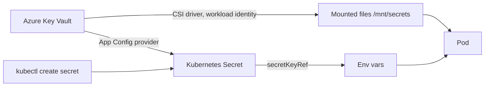

## What this covers

AI services authenticate to model endpoints, databases and caches with keys and connection strings. Those values must stay out of images and source control. Kubernetes Secrets are the built-in way to store them and inject them into Pods; on Azure, production workloads usually go further and keep the values in Azure Key Vault, mounting them with the Secrets Store CSI Driver or avoiding secrets altogether with workload identity. This page covers all three options and when each is right.

**Exam weight:** Develop containerized solutions on Azure (20–25%)

**Skills measured**

- "Deploy and manage applications to Azure Kubernetes Service (AKS) by using manifest files"

## Key concepts

### Secret types

| Type | Use | Created with |
|---|---|---|
| `Opaque` | API keys, passwords, connection strings | `kubectl create secret generic` |
| `kubernetes.io/dockerconfigjson` | Private registry credentials (`imagePullSecrets`) | `kubectl create secret docker-registry` |
| `kubernetes.io/tls` | TLS cert and key (`tls.crt`, `tls.key`) for Ingress | `kubectl create secret tls` |

### Base64 is not encryption

Values in a Secret's `data` field are base64-**encoded**, which anyone can decode. Use `stringData` in manifests to write plain text that the API server encodes for you. Protection comes from elsewhere: Kubernetes RBAC on `secrets`, AKS encrypting etcd at rest (optionally with your own key through **KMS etcd encryption** backed by Key Vault), and keeping Secret manifests with real values out of Git. Secrets mounted as volumes live on an in-memory `tmpfs`, not on the node disk. A Secret is limited to 1 MiB.

### Consuming Secrets

Same patterns as ConfigMaps: `env[].valueFrom.secretKeyRef` for one key, `envFrom[].secretRef` for all keys, or a `secret` volume. As with ConfigMaps, env vars don't change until the Pod restarts, while volume mounts refresh.

### Azure Key Vault provider for Secrets Store CSI Driver

The AKS add-on `azure-keyvault-secrets-provider` mounts Key Vault secrets, keys and certificates into Pods as files through a `SecretProviderClass`. Values stay in Key Vault, with its audit logs, private endpoints and rotation. Enable **auto-rotation** (`--enable-secret-rotation`, default poll interval 2 minutes) so mounted files refresh. You can also mirror values into a native Kubernetes Secret with `secretObjects`, but that Secret exists only while a Pod mounts the volume.

### Workload identity

Microsoft Entra Workload ID lets a Pod's service account federate with a user-assigned managed identity. The SDK's `DefaultAzureCredential` then gets tokens without any stored secret, which is the preferred way to call Key Vault, Cosmos DB or Azure OpenAI from AKS. The CSI driver uses the same identity to read Key Vault.

### App Configuration with Key Vault references

The App Configuration Kubernetes Provider resolves Key Vault references stored in App Configuration and writes them into native Secrets. Choose it to manage centrally *which* secrets each app gets; choose direct Key Vault CSI for per-access audit and secrets that never become Kubernetes objects.

## How it works



Create and reference a native Secret:

```bash
kubectl create secret generic app-secrets \
  --from-literal=DB_CONNECTION="Host=db;User=app;Password=secure" \
  --from-literal=API_KEY="your-api-key"
```

```yaml
apiVersion: apps/v1
kind: Deployment
metadata:
  name: web-api
spec:
  replicas: 2
  selector:
    matchLabels:
      app: web-api
  template:
    metadata:
      labels:
        app: web-api
    spec:
      containers:
      - name: api
        image: myregistry.azurecr.io/web-api:v1
        env:
        - name: DB_CONNECTION
          valueFrom:
            secretKeyRef:
              name: app-secrets
              key: DB_CONNECTION
        - name: API_KEY
          valueFrom:
            secretKeyRef:
              name: app-secrets
              key: API_KEY
```

Key Vault through the CSI driver with workload identity:

```yaml
apiVersion: secrets-store.csi.x-k8s.io/v1
kind: SecretProviderClass
metadata:
  name: kv-secrets
spec:
  provider: azure
  parameters:
    clientID: "<managed-identity-client-id>"   # workload identity
    keyvaultName: "<key-vault-name>"
    tenantId: "<tenant-id>"
    objects: |
      array:
        - |
          objectName: api-key
          objectType: secret
---
# Pod spec fragment
serviceAccountName: workload-sa         # annotated with azure.workload.identity/client-id
volumes:
- name: secrets-store
  csi:
    driver: secrets-store.csi.k8s.io
    readOnly: true
    volumeAttributes:
      secretProviderClass: kv-secrets
containers:
- name: api
  volumeMounts:
  - name: secrets-store
    mountPath: /mnt/secrets
    readOnly: true
```

The Pod template also needs the label `azure.workload.identity/use: "true"`.

## Hands-on

### Azure portal

1. Open the cluster > **Kubernetes resources** > **Configuration** > **Secrets**; select **Create** > **Apply a YAML**.
2. Use `stringData` in the YAML so you can type plain values; select **Add**.
3. For Key Vault: on the cluster, open **Settings** > **Extensions + applications** or **Security configuration** and enable the **Secret store CSI driver**.
4. Grant the managed identity the **Key Vault Secrets User** role on the vault (**Access control (IAM)**).

### Azure CLI

```bash
kubectl get secrets
kubectl describe secret app-secrets      # shows keys and sizes, not values
kubectl describe deployment web-api      # look for secretKeyRef entries

# Key Vault CSI add-on with auto-rotation
az aks enable-addons --addons azure-keyvault-secrets-provider \
  --resource-group <resource-group> --name <aks-name>
az aks update --resource-group <resource-group> --name <aks-name> \
  --enable-secret-rotation --rotation-poll-interval 2m

# Workload identity
az aks update --resource-group <resource-group> --name <aks-name> \
  --enable-oidc-issuer --enable-workload-identity
ISSUER=$(az aks show -g <resource-group> -n <aks-name> \
  --query oidcIssuerProfile.issuerUrl -o tsv)
az identity federated-credential create --name aks-fic \
  --identity-name <identity-name> --resource-group <resource-group> \
  --issuer "$ISSUER" --subject system:serviceaccount:default:workload-sa \
  --audience api://AzureADTokenExchange

# After rotating a native Secret, restart env-var consumers
kubectl rollout restart deployment/web-api
```

### Python

```python
# Runs inside the Pod with workload identity: no stored secret needed.
# pip install azure-identity azure-keyvault-secrets
from azure.identity import DefaultAzureCredential
from azure.keyvault.secrets import SecretClient

client = SecretClient("https://<key-vault-name>.vault.azure.net",
                      DefaultAzureCredential())
api_key = client.get_secret("api-key").value

# Or read the CSI-mounted file
with open("/mnt/secrets/api-key") as f:
    api_key = f.read()
```

## Exam traps

| Requirement | Choose |
|---|---|
| Simple key for dev/test | Native `Opaque` Secret + `secretKeyRef` |
| Audit, rotation, values never in etcd | Key Vault + Secrets Store CSI Driver |
| No secret at all for Azure services | Workload identity + `DefaultAzureCredential` |
| Pull from a non-ACR private registry | `docker-registry` Secret + `imagePullSecrets` |
| TLS for an Ingress | `kubernetes.io/tls` Secret |
| Central mapping of secrets per app | App Configuration Key Vault references |

> [!WARNING]
> **Exam trap:** Base64 in a Secret is encoding, not encryption. Anyone with `get secrets` RBAC can read the values.

> [!WARNING]
> **Exam trap:** CSI auto-rotation updates the **mounted files**. Env vars and synced Kubernetes Secrets consumed as env vars still need a Pod restart.

> [!TIP]
> "Never store a secret" beats "store it well": prefer workload identity to keys where the Azure service supports Entra ID auth.

> [!NOTE]
> `kubectl describe secret` deliberately masks values; `kubectl get secret -o yaml` doesn't, which is why RBAC matters.

## Quick review

- Secret types: `Opaque`, `kubernetes.io/dockerconfigjson`, `kubernetes.io/tls`.
- `data` is base64; `stringData` accepts plain text.
- Reference with `secretKeyRef` / `envFrom.secretRef` / secret volume.
- Never commit Secret manifests with real values.
- Key Vault CSI add-on: `azure-keyvault-secrets-provider`; enable rotation (2-minute default poll).
- Workload identity needs OIDC issuer, federated credential and the Pod label `azure.workload.identity/use`.
- Rotate, then `kubectl rollout restart` for env-var consumers.

## Practice

[Practice: AKS manifest questions](/practice/aks-manifests)

## Official references

- [Implement secrets for sensitive data (unit)](https://learn.microsoft.com/training/modules/configure-apps-azure-kubernetes-service/3-implement-secrets)
- [Use the Azure Key Vault provider for Secrets Store CSI Driver](https://learn.microsoft.com/azure/aks/csi-secrets-store-driver)
- [Use Microsoft Entra Workload ID with AKS](https://learn.microsoft.com/azure/aks/workload-identity-overview)
- [Add KMS etcd encryption to an AKS cluster](https://learn.microsoft.com/azure/aks/use-kms-etcd-encryption)
- [AI-200 study guide](https://learn.microsoft.com/credentials/certifications/resources/study-guides/ai-200)
- [Microsoft Learn](https://learn.microsoft.com/)
