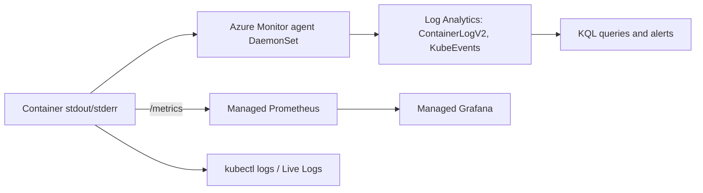

## What this covers

Inference APIs and background workers need predictable latency and error rates. Logs and metrics tell you whether a workload is within its targets and, when it isn't, whether to scale, investigate or roll back. AKS gives you three layers: `kubectl` for instant, targeted checks; Azure portal views such as Live Logs and the Monitoring tab; and Azure Monitor (Container insights, Managed Prometheus, Log Analytics) for history and cross-Pod analysis.

**Exam weight:** Develop containerized solutions on Azure (20–25%)

**Skills measured**

- "Monitor and troubleshoot solutions on AKS and Container Apps by inspecting logs, events, and end-to-end connectivity"

## Key concepts

### Signals that matter for AI workloads

- Response latency and throughput of inference endpoints
- Error rates: HTTP 5xx and timeouts
- Pod restart counts and container exit codes (137 = killed, often `OOMKilled`)
- CPU and memory use compared with configured requests and limits
- Worker-specific signals such as queue depth or batch duration

### kubectl logs and top

`kubectl logs` reads a container's stdout and stderr from the node. Useful flags: `-f` (stream), `-c` (container in a multi-container Pod), `--previous` (last crashed instance), `--since`, `--tail`, `-l` (label selector), `--all-containers`. Logs are lost when the Pod is deleted, which is why central collection matters.

`kubectl top nodes|pods` shows current CPU and memory from metrics-server (installed by default on AKS). A Pod sitting at its CPU **limit** is throttled, which shows up as higher inference latency; a Pod approaching its memory limit risks being OOM-killed.

### Namespaces vs labels

Namespaces separate environments or teams and scope access and quotas, so `-n ai-workloads` targets that namespace (omit it for `default` or your current context). Labels select specific Pods inside a namespace, as with `-l app=inference-api`.

### Azure Monitor for AKS

| Feature | What it gives you | Enable with |
|---|---|---|
| **Container insights** | Logs (`ContainerLogV2`), inventory (`KubePodInventory`), events (`KubeEvents`) in Log Analytics; Nodes/Controllers/Containers views | `az aks enable-addons -a monitoring` |
| **Managed Prometheus** | Prometheus metrics in an Azure Monitor workspace | `az aks update --enable-azure-monitor-metrics` |
| **Azure Managed Grafana** | Dashboards over Prometheus | `--grafana-resource-id` on the same command |
| **Platform metrics** | Node CPU/memory, Pod counts on the Monitoring tab | On by default |

Portal entry points: **Kubernetes resources** > **Workloads** > **Live Logs** (real-time stdout/stderr, pause and search), the **Monitoring** tab on **Overview**, and **Monitoring** > **Insights** with **Live Metrics** for a single Pod.

## How it works



The Azure Monitor agent runs on every node, collects container logs and Kubernetes inventory, and sends them to a Log Analytics workspace, where they persist after the Pod is gone. A typical workflow: spot a CPU spike on the Monitoring tab, drill into Container insights to find the Pod, then use `kubectl logs` to see what the app was doing.

## Hands-on

### Azure portal

1. Open the AKS cluster > **Kubernetes resources** > **Workloads**, select a Pod, and select **Live Logs**.
2. On **Overview**, select the **Monitoring** tab to view CPU and memory per node pool; open a chart in metrics explorer.
3. Select **Monitoring** > **Insights**, then the **Nodes**, **Controllers** or **Containers** tab to find constrained Pods.
4. Select a Pod and choose **Live Metrics**, or **Monitoring** > **Logs** to run KQL.

### Azure CLI

```bash
kubectl get pods -n ai-workloads
kubectl logs <pod-name> -n ai-workloads
kubectl logs -f <pod-name> -n ai-workloads
kubectl logs <pod-name> -c inference-api -n ai-workloads
kubectl logs -l app=inference-api -n ai-workloads --since=15m --tail=200
kubectl top nodes
kubectl top pods -n ai-workloads --containers

# Container insights and Managed Prometheus
az aks enable-addons -a monitoring --resource-group <resource-group> --name <aks-name> \
  --workspace-resource-id <log-analytics-workspace-id>
az aks update --resource-group <resource-group> --name <aks-name> \
  --enable-azure-monitor-metrics
```

Example KQL in the Log Analytics workspace:

```kql
ContainerLogV2
| where TimeGenerated > ago(1h)
| where PodNamespace == "ai-workloads" and ContainerName == "inference-api"
| where LogMessage has_any ("error", "timeout")
| project TimeGenerated, PodName, LogMessage
| order by TimeGenerated desc
```

```kql
KubePodInventory
| where Namespace == "ai-workloads"
| summarize Restarts = max(ContainerRestartCount) by Name
| where Restarts > 0
```

### Python

```python
# pip install azure-identity azure-monitor-query
from datetime import timedelta
from azure.identity import DefaultAzureCredential
from azure.monitor.query import LogsQueryClient

client = LogsQueryClient(DefaultAzureCredential())
query = """
ContainerLogV2
| where PodNamespace == 'ai-workloads'
| summarize errors = countif(LogMessage has 'error') by bin(TimeGenerated, 5m)
"""
result = client.query_workspace("<workspace-id>", query, timespan=timedelta(hours=1))
for row in result.tables[0].rows:
    print(row)
```

## Exam traps

| Need | Use |
|---|---|
| Watch one Pod's output right now | `kubectl logs -f` or portal Live Logs |
| Logs from a container that just crashed | `kubectl logs --previous` |
| Logs after the Pod was deleted, or across Pods | Container insights + KQL on `ContainerLogV2` |
| Current CPU/memory snapshot | `kubectl top` |
| Historical trends and heat maps | Container insights |
| Custom app metrics and Grafana dashboards | Managed Prometheus + Managed Grafana |

> [!WARNING]
> **Exam trap:** `kubectl logs` reads from the node; once the Pod is deleted, those logs are gone. Persisted history requires Container insights (Log Analytics).

> [!WARNING]
> **Exam trap:** Hitting a CPU limit throttles (higher latency) and doesn't restart the container. Hitting a memory limit kills it (`OOMKilled`).

> [!TIP]
> Portal for the overview, `kubectl` for the drill-down, KQL for history.

> [!NOTE]
> Emit structured (JSON) logs with request IDs, model name and version so KQL can filter and trace individual inference calls.

## Quick review

- Key signals: latency, error rate, restarts/exit codes, CPU and memory vs requests/limits.
- `kubectl logs -c` picks a container; `--previous` shows the crashed instance.
- `kubectl top` needs metrics-server, installed by default on AKS.
- Container insights = `az aks enable-addons -a monitoring`; data goes to Log Analytics.
- Container log table: `ContainerLogV2`; events: `KubeEvents`; Pods: `KubePodInventory`.
- Managed Prometheus = `--enable-azure-monitor-metrics`.
- Live Logs streams stdout/stderr in the portal without kubectl.

## Practice

[Practice: container troubleshooting questions](/practice/containers-troubleshoot)

## Official references

- [Monitor and troubleshoot applications on AKS (module)](https://learn.microsoft.com/training/modules/monitor-apps-azure-kubernetes-service/)
- [Monitor application logs and metrics (unit)](https://learn.microsoft.com/training/modules/monitor-apps-azure-kubernetes-service/2-monitor-logs-metrics)
- [Monitor AKS](https://learn.microsoft.com/azure/aks/monitor-aks)
- [Enable monitoring for Kubernetes clusters](https://learn.microsoft.com/azure/azure-monitor/containers/kubernetes-monitoring-enable)
- [View container logs in real time (Live Logs)](https://learn.microsoft.com/azure/azure-monitor/containers/container-insights-livedata-overview)
- [AI-200 study guide](https://learn.microsoft.com/credentials/certifications/resources/study-guides/ai-200)
- [Microsoft Learn](https://learn.microsoft.com/)
