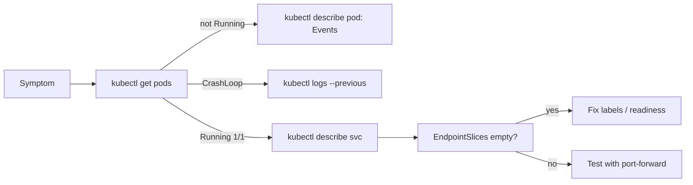

## What this covers

When an AI API on AKS misbehaves, you need to get from a symptom ("the endpoint times out") to a root cause ("the readiness probe path is wrong") quickly. AI workloads depend on images, configuration, Secrets and external services, and a mistake in any of them can stop containers starting, fail probes, or leave a Service with nothing to route to. This page gives a structured workflow using `kubectl` and the Azure portal, covering Pods first and Services second.

**Exam weight:** Develop containerized solutions on Azure (20–25%)

**Skills measured**

- "Monitor and troubleshoot solutions on AKS and Container Apps by inspecting logs, events, and end-to-end connectivity"

## Key concepts

### Pod states and what they mean

| STATUS / reason | Meaning | Typical cause |
|---|---|---|
| `Pending` | Not scheduled | Requests too large, taints, unbound PVC |
| `ErrImagePull` / `ImagePullBackOff` | Image can't be pulled | Wrong name/tag, missing `AcrPull` |
| `CreateContainerConfigError` | Container spec can't be built | Missing ConfigMap/Secret or key |
| `CrashLoopBackOff` | Container starts and exits repeatedly | App error, missing env var, liveness killing slow start |
| `OOMKilled` (last state, exit 137) | Memory limit exceeded | Limit too low, memory leak |
| `Running` but `0/1` READY | Readiness probe failing | Wrong probe path/port, dependency down |

`CrashLoopBackOff` waits grow exponentially between restarts (10 s, 20 s, 40 s… up to 5 minutes), so a crash-looping Pod can look idle.

### kubectl describe and events

`kubectl describe pod` shows the Pod's conditions, container state and last state (with exit code and reason), probe definitions, env sources, mounts, and the **Events** list: scheduling failures, pull errors, probe failures, OOM kills. `kubectl get events` shows events across the namespace; sort them by time. Events are kept for about one hour by default, so check them early.

### Looking inside the container

`kubectl exec -it <pod> -- /bin/sh` opens a shell to list config files, check env vars, or `curl http://localhost:8080/health`. Minimal or distroless images may have no shell; `kubectl debug -it <pod> --image=busybox --target=<container>` adds an ephemeral debug container that shares the target container's process namespace. Treat these as read-only investigation: fix the manifest, not the running container.

### Service checks

A healthy Pod can still be unreachable. Check three things in `kubectl describe service`:

1. **Selector** matches Pod labels.
2. **targetPort** equals the container's listening port.
3. **Endpoints/EndpointSlices** list Pod IPs. Empty means a selector mismatch or no Ready Pods.

### Portal tools

**Kubernetes resources** > **Workloads** shows status and restart counts; a Pod's **Live Logs** and **Console** tabs give log streaming and a browser shell. **Services and ingresses** shows selectors and endpoints. **Diagnose and solve problems** runs automated checks for node health, connectivity and configuration and suggests fixes.

## How it works



Work in order: status → events → logs → in-container checks → Service → endpoints → connectivity (see [Verify service connectivity and endpoints](/study/deploy-and-monitor-applications-on-azure-kubernetes-service/verify-service-connectivity-and-endpoints)).

## Hands-on

### Azure portal

1. Open the cluster > **Kubernetes resources** > **Workloads**; filter by namespace and look for error states or high restart counts.
2. Select the Pod > **Events** and **Live Logs**; use the **Console** tab for a shell.
3. Select **Services and ingresses**, open the Service, and compare its selector with the Pod labels.
4. Run **Diagnose and solve problems** from the cluster menu for automated checks.

### Azure CLI

```bash
kubectl get pods -n ai-workloads -o wide
kubectl describe pod <pod-name> -n ai-workloads
kubectl get events -n ai-workloads --sort-by=.metadata.creationTimestamp
kubectl get events -n ai-workloads --field-selector involvedObject.name=<pod-name>
kubectl logs <pod-name> -n ai-workloads --previous

# Why did the last container die?
kubectl get pod <pod-name> -n ai-workloads \
  -o jsonpath='{.status.containerStatuses[0].lastState.terminated.reason}'

# Inside the container
kubectl exec -it <pod-name> -n ai-workloads -- /bin/sh
#   printenv | grep MODEL ; ls /app/config ; curl http://localhost:8080/health
kubectl debug -it <pod-name> -n ai-workloads --image=busybox:1.36 --target=api

# Services
kubectl get service -n ai-workloads
kubectl describe service <service-name> -n ai-workloads
kubectl get endpointslices -l kubernetes.io/service-name=<service-name> -n ai-workloads
kubectl get pods -n ai-workloads --show-labels
```

### Python

```python
# pip install kubernetes
from kubernetes import client, config

config.load_kube_config()
v1 = client.CoreV1Api()

for pod in v1.list_namespaced_pod("ai-workloads").items:
    for cs in pod.status.container_statuses or []:
        waiting = cs.state.waiting.reason if cs.state.waiting else None
        last = cs.last_state.terminated.reason if cs.last_state.terminated else None
        print(pod.metadata.name, cs.ready, cs.restart_count, waiting, last)

for e in v1.list_namespaced_event("ai-workloads").items[-10:]:
    print(e.type, e.reason, e.involved_object.name, e.message)
```

## Exam traps

| Situation | Best first step |
|---|---|
| Pod `Pending` | `kubectl describe pod` → Events |
| `CrashLoopBackOff` | `kubectl logs --previous` |
| Exit code 137, reason `OOMKilled` | Raise memory limit or fix the leak |
| `Running` but `0/1` READY | Check readiness probe path/port in describe |
| Connection refused through the Service | Compare `targetPort` with `containerPort` |
| Service has no endpoints | Compare selector with `--show-labels` |
| No shell in image | `kubectl debug` ephemeral container |
| Guided cluster-level diagnosis | Portal **Diagnose and solve problems** |

> [!WARNING]
> **Exam trap:** A failing readiness probe does **not** cause restarts. The Pod stays `Running` with `0/1` READY and is silently dropped from the Service endpoints.

> [!WARNING]
> **Exam trap:** Fixing something with `kubectl exec` is temporary; the next Pod starts from the image and manifest again. Make the fix in the manifest.

> [!TIP]
> Status tells you *where* to look: Pending → scheduler, ImagePull → registry, CrashLoop → logs, not Ready → probes, no endpoints → labels.

> [!NOTE]
> You need RBAC permission to read Pods, events and Services in the namespace; on Entra-integrated clusters that can come from Azure RBAC roles such as **Azure Kubernetes Service RBAC Reader**.

## Quick review

- `kubectl describe pod` Events is the first stop for Pending, pull and probe failures.
- `kubectl logs --previous` explains crash loops.
- Exit code 137 + `OOMKilled` = memory limit hit.
- Missing ConfigMap/Secret → `CreateContainerConfigError`.
- Readiness failure → removed from endpoints, no restart.
- EndpointSlices are found by label `kubernetes.io/service-name=<svc>`.
- `kubectl debug` adds an ephemeral container when the image has no shell.

## Practice

[Practice: container troubleshooting questions](/practice/containers-troubleshoot)

## Official references

- [Troubleshoot pods and services (unit)](https://learn.microsoft.com/training/modules/monitor-apps-azure-kubernetes-service/3-troubleshoot-pods-services)
- [AKS troubleshooting documentation](https://learn.microsoft.com/troubleshoot/azure/azure-kubernetes/welcome-azure-kubernetes)
- [Diagnose and solve problems for AKS](https://learn.microsoft.com/azure/aks/aks-diagnostics)
- [Kubernetes docs: debug running Pods](https://kubernetes.io/docs/tasks/debug/debug-application/debug-running-pod/)
- [AI-200 study guide](https://learn.microsoft.com/credentials/certifications/resources/study-guides/ai-200)
- [Microsoft Learn](https://learn.microsoft.com/)
