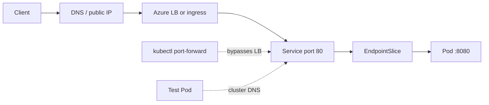

## What this covers

Clients reach an AI endpoint through a chain: DNS or public IP → Azure Load Balancer or ingress controller → Service → EndpointSlice → Pod → container port. A break anywhere looks the same to the caller: a timeout or an error. This page shows how to test each hop in turn, from inside the Pod outward, using `kubectl`, an HTTP client and the portal's **Services and ingresses** view.

**Exam weight:** Develop containerized solutions on Azure (20–25%)

**Skills measured**

- "Monitor and troubleshoot solutions on AKS and Container Apps by inspecting logs, events, and end-to-end connectivity"

## Key concepts

### The exposure path

| Exposure | Client reaches | What to verify |
|---|---|---|
| `ClusterIP` | `<svc>.<ns>.svc.cluster.local:<port>` from Pods | DNS resolves, endpoints exist |
| `NodePort` | `<node-ip>:<nodePort>` | Node reachable, NSG allows the port |
| `LoadBalancer` | EXTERNAL-IP on the Azure Load Balancer | IP assigned, health probe passes, NSG allows |
| Ingress | Hostname/path on the ingress controller's IP | `ADDRESS` set, host/path rules point at the right Service and port |

Public AI APIs typically use a `LoadBalancer` Service or an ingress controller such as the application routing add-on; internal back ends use `ClusterIP`.

### EndpointSlices

The control plane writes the IPs of matching, **Ready** Pods into EndpointSlices labeled `kubernetes.io/service-name=<service>`. If they're empty, nothing downstream can work, however healthy the load balancer looks. The older `Endpoints` API still appears in `kubectl describe svc` but is deprecated in favor of EndpointSlices (Kubernetes 1.33+).

### Cluster DNS

CoreDNS (in `kube-system`) answers `<service>.<namespace>.svc.cluster.local`. Short names only resolve inside the same namespace, which is a frequent cause of "works in one namespace, fails in another".

### port-forward

`kubectl port-forward service/<svc> 8080:80` tunnels a local port through the API server to one of the Service's Pods. It bypasses the load balancer, ingress and NSGs, so a success proves the Pod and the port mapping work and narrows the fault to the outer layers. It's also the safe way to test before exposing an endpoint publicly. Note that it picks a single Pod and doesn't load-balance.

## How it works



Test from the inside out: (1) `curl localhost` inside the container, (2) port-forward to the Service, (3) call the Service DNS name from a test Pod, (4) call the external IP or ingress host. The first hop that fails is where the problem lives.

## Hands-on

### Azure portal

1. Open the cluster > **Kubernetes resources** > **Services and ingresses**.
2. Select the Service; check type, cluster IP, external IP, port mappings and the **Endpoints** list.
3. For LoadBalancer Services, copy the **External IP**; for Ingresses, check the **Address** column and host/path rules.
4. If endpoints are empty, compare the Service selector with Pod labels in **Workloads**.

### Azure CLI

```bash
# Hop 1: Service and its endpoints
kubectl get service -n ai-workloads
kubectl describe service inference-api -n ai-workloads
kubectl get endpointslices -l kubernetes.io/service-name=inference-api -n ai-workloads

# Hop 2: bypass external networking
kubectl port-forward service/inference-api 8080:80 -n ai-workloads
# in another terminal:
curl http://localhost:8080/api/inference

# Hop 3: DNS and Service from inside the cluster
kubectl run -it --rm net-test --image=busybox:1.36 --restart=Never -n ai-workloads -- sh
#   nslookup inference-api.ai-workloads.svc.cluster.local
#   wget -qO- http://inference-api.ai-workloads.svc.cluster.local/health

# Hop 4: external path
kubectl get service inference-api -n ai-workloads   # EXTERNAL-IP
kubectl get ingress -n ai-workloads                 # ADDRESS, HOSTS
curl -i http://<external-ip>/health
curl -i -H "Host: api.contoso.com" http://<ingress-ip>/api/inference

# CoreDNS health if names don't resolve
kubectl get pods -n kube-system -l k8s-app=kube-dns
```

### Python

```python
# A small smoke test to run after port-forward or against the external IP.
# pip install requests
import requests

BASE = "http://localhost:8080"     # or http://<external-ip>
for path in ("/health", "/ready"):
    r = requests.get(BASE + path, timeout=5)
    print(path, r.status_code)

r = requests.post(BASE + "/api/inference", json={"input": "test"}, timeout=30)
print(r.status_code, r.elapsed.total_seconds(), "s")
```

## Exam traps

| Symptom | Most likely broken hop |
|---|---|
| port-forward works, external IP times out | Load balancer, NSG, or `<pending>` IP |
| port-forward fails with connection refused | `targetPort` wrong or app not listening |
| EndpointSlices empty | Selector mismatch or readiness failing |
| Name resolves in one namespace only | Short name used; need `<svc>.<ns>` |
| Ingress returns 404 | Host/path rule or `ingressClassName` wrong |
| Ingress returns 502/503 | Backend Service has no Ready endpoints or wrong port |

> [!WARNING]
> **Exam trap:** A successful `kubectl port-forward` does not prove external access. It skips the Azure Load Balancer, ingress and network security groups.

> [!WARNING]
> **Exam trap:** Calling the Service on the container's `targetPort` (8080) instead of its `port` (80) fails. Clients always use the Service `port`.

> [!TIP]
> Inside-out: container → Service (port-forward) → DNS (test Pod) → public IP/ingress.

> [!NOTE]
> Use consistent labels such as `app` and `version` across Deployments, Services and Ingresses; most connectivity bugs are label bugs.

## Quick review

- EndpointSlices hold the IPs of Ready Pods behind a Service.
- Find them with `-l kubernetes.io/service-name=<svc>`.
- Service DNS: `<svc>.<ns>.svc.cluster.local`, resolved by CoreDNS.
- `kubectl port-forward service/<svc> <local>:<port>` tests without exposing anything.
- `kubectl get ingress` shows ADDRESS and HOSTS.
- 502/503 from ingress usually means no healthy backends.
- Test before exposing: port-forward first, public IP last.

## Practice

[Practice: container troubleshooting questions](/practice/containers-troubleshoot)

## Official references

- [Verify service connectivity and endpoints (unit)](https://learn.microsoft.com/training/modules/monitor-apps-azure-kubernetes-service/4-verify-connectivity)
- [Network concepts for applications in AKS](https://learn.microsoft.com/azure/aks/concepts-network-services)
- [Managed NGINX ingress with the application routing add-on](https://learn.microsoft.com/azure/aks/app-routing)
- [Kubernetes docs: debug Services](https://kubernetes.io/docs/tasks/debug/debug-application/debug-service/)
- [AI-200 study guide](https://learn.microsoft.com/credentials/certifications/resources/study-guides/ai-200)
- [Microsoft Learn](https://learn.microsoft.com/)
