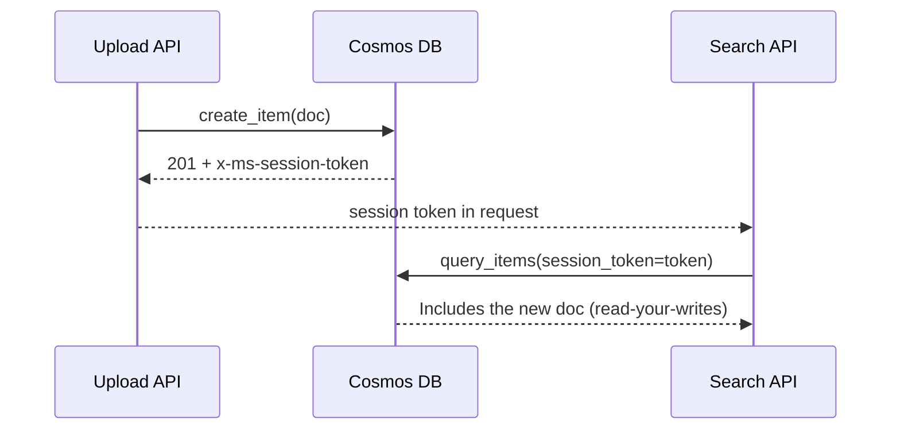

## What this covers

Consistency levels decide how fresh a read is relative to recent writes, and they change read RU cost, latency and availability. This page covers the five levels and their guarantees, how they affect RUs, Session consistency and session tokens, overriding the account default from code, multi-region rules, and using the PBS metric to check whether a weaker level is good enough.

**Exam weight:** Develop AI solutions by using Azure data management services (30–35%)

**Skills measured**

- "Optimize query performance and Request Units (RUs) consumption by using indexing policies and consistency levels"

## Key concepts

### The five levels, strongest to weakest

| Level | Guarantee | Typical use |
| --- | --- | --- |
| **Strong** | Linearizable: every read returns the latest committed write, in any region | Financial or regulatory data |
| **Bounded staleness** | Reads lag writes by at most *K* versions or *T* time, whichever comes first | Single-write-region global apps needing near-strong reads |
| **Session** (default for new accounts) | Read-your-writes and write-follows-reads within a session | Most user-facing and AI apps |
| **Consistent prefix** | Never out of order; transactional batches appear together | Event or audit sequences |
| **Eventual** | No ordering; replicas converge over time | Counters, analytics, background jobs |

Read consistency applies within a single logical partition.

### RU impact

| Level | Read quorum | Read RU | Write quorum |
| --- | --- | --- | --- |
| Strong | Two replicas (local minority) | 2× | Global majority |
| Bounded staleness | Two replicas | 2× | Local majority |
| Session | One replica (with token) | 1× | Local majority |
| Consistent prefix | One replica | 1× | Local majority |
| Eventual | One replica | 1× | Local majority |

Write RU charges are the same at every level; Strong only adds write **latency** in multi-region accounts because every region must commit. Moving a read-heavy app from Strong to Session roughly halves read RUs.

### Session tokens

After each write the server returns `x-ms-session-token`. One `CosmosClient` tracks tokens automatically. When a different service or client instance must see that write (an upload API followed by a separate search API), pass the token along with the request. Tokens are partition-bound and shouldn't be modified. A client that hasn't written to a partition, or was recreated, reads that partition with eventual-like behaviour until it has a token.

### Overriding the default

The account default applies to every database and container. Clients and requests can override it for **reads only**, and only to a **weaker** level: an account set to Strong can have Session or Eventual clients, but a client can't ask for Strong on a Session account. The training module's pattern of separate clients per level (for example an Eventual client for analytics) works within that rule. After changing the account default, restart apps so new clients pick it up.

### Vector search and consistency

Similarity search usually tolerates eventual reads; a few-second-old index rarely changes the answer. Use Session when a user expects their just-uploaded document to appear in their own search immediately.

### Multi-region rules

- Strong isn't available with multiple write regions, and accounts spanning more than 5,000 miles (8,000 km) need support to enable it.
- Bounded staleness suits single-write-region accounts; it's an anti-pattern with multi-region writes. Minimum bounds: *K* = 10 and *T* = 5 s for one region; *K* = 100,000 and *T* = 300 s for multiple regions.
- Session and weaker commit locally and replicate asynchronously.

### PBS metric

**Probabilistically Bounded Staleness**, in **Metrics** under the consistency category, shows how often weaker reads actually return the latest data. If eventual reads are current more than 99% of the time, more workloads may safely drop to a weaker level.

## How it works



## Hands-on

### Azure portal

1. Account > **Default consistency** (under **Settings**).
2. Select the level; for Bounded staleness set maximum lag in operations and seconds.
3. **Save**, then restart client applications.

### Azure CLI

```bash
az cosmosdb update \
  --name <account-name> --resource-group <resource-group> \
  --default-consistency-level Session

az cosmosdb update \
  --name <account-name> --resource-group <resource-group> \
  --default-consistency-level BoundedStaleness \
  --max-staleness-prefix 100000 --max-interval 300
```

### Python

```python
from azure.cosmos import CosmosClient, ConsistencyLevel
from azure.identity import DefaultAzureCredential

endpoint, cred = "https://<account-name>.documents.azure.com:443/", DefaultAzureCredential()

client = CosmosClient(endpoint, credential=cred, consistency_level=ConsistencyLevel.Session)
container = client.get_database_client("documents-db").get_container_client("documents")

session = {}
container.create_item(
    body={"id": "doc-123", "title": "Project Proposal", "category": "proposals"},
    response_hook=lambda headers, _: session.update(token=headers.get("x-ms-session-token")),
)

# Another service, another client: pass the token to read its own write
results = container.query_items(
    query="SELECT * FROM c WHERE c.category = @category",
    parameters=[{"name": "@category", "value": "proposals"}],
    partition_key="proposals",
    session_token=session["token"],
)

# Cheaper reads for analytics (must be weaker than the account default)
analytics = CosmosClient(endpoint, credential=cred, consistency_level=ConsistencyLevel.Eventual)
```

## Exam traps

| Requirement | Level |
| --- | --- |
| User must see their own upload immediately | Session |
| Global latest value, single write region, cost no object | Strong |
| Readers in other regions may lag at most 5 minutes | Bounded staleness |
| Ordered event history, freshness optional | Consistent prefix |
| Cheapest, fastest reads for dashboards | Eventual |

> [!WARNING]
> **Exam trap:** Strong and Bounded staleness **reads** cost about twice the RUs; writes cost the same at every level.

> [!WARNING]
> **Exam trap:** You can't override a Session account to Strong from the SDK. Overrides only relax consistency.

> [!WARNING]
> **Exam trap:** Strong consistency with multiple write regions isn't supported.

> [!TIP]
> Mnemonic, strongest first: **S**trong **B**ounded **S**ession **C**onsistent-prefix **E**ventual.

> [!NOTE]
> Session tokens act as a minimum version barrier; an old token still returns the newest data available.

## Quick review

- Five levels: Strong, Bounded staleness, Session, Consistent prefix, Eventual.
- Session is the default and the usual answer.
- Strong and Bounded staleness reads use two replicas and double read RUs.
- Pass `x-ms-session-token` between services for read-your-writes.
- Client and request overrides can only weaken consistency.
- Strong is incompatible with multi-region writes.
- Bounded staleness minimums: 10 ops/5 s single region, 100,000 ops/300 s multi-region.
- PBS shows how often weaker reads are actually current.

## Practice

[Practice: Cosmos DB RU and indexing questions](/practice/cosmos-ru-indexing)

## Official references

- [Unit: Choose consistency levels for optimal performance](https://learn.microsoft.com/en-us/training/modules/optimize-query-performance-azure-cosmos-db/6-choose-consistency-levels-performance)
- [Consistency levels in Azure Cosmos DB](https://learn.microsoft.com/en-us/azure/cosmos-db/consistency-levels)
- [Manage consistency levels](https://learn.microsoft.com/en-us/azure/cosmos-db/nosql/how-to-manage-consistency)
- [AI-200 study guide](https://learn.microsoft.com/en-us/credentials/certifications/resources/study-guides/ai-200)
