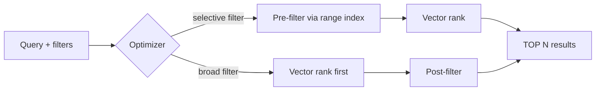

## What this covers

Pure semantic search rarely ships alone. Users want results limited to a category, a date range, their own tenant or the documents they're allowed to see, and sometimes they type exact codes that keyword search handles better than embeddings. This page covers mixing `WHERE` filters with `VectorDistance`, how the optimizer filters, partition-targeted vector queries, and hybrid search that fuses vector and full-text ranking with RRF.

**Exam weight:** Develop AI solutions by using Azure data management services (30–35%)

**Skills measured**

- "Store and retrieve embeddings and execute vector similarity search for semantic retrieval"

## Key concepts

### Filters in the same query

Any normal predicate can sit beside the vector ranking:

```sql
SELECT TOP 10 c.id, c.title, VectorDistance(c.embedding, @queryVector) AS score
FROM c
WHERE c.category = @category AND c.createdDate > @startDate AND c.status = 'published'
ORDER BY VectorDistance(c.embedding, @queryVector)
```

Common AI patterns:

- document type: `c.documentType = 'troubleshooting-guide'`
- date window: `c.createdDate >= '2024-01-01' AND c.createdDate < '2025-01-01'`
- product list: `c.productId IN ('router-x100', 'router-x200')`
- security trimming: `ARRAY_CONTAINS(c.accessGroups, @userGroup)`
- lifecycle: `c.status = 'published'`

### Pre-filtering and post-filtering

- **Pre-filtering** narrows candidates first, then ranks only those vectors. Efficient when the filter is selective (1,000 of 100,000 items).
- **Post-filtering** ranks first, then drops non-matching items. Ranking quality is preserved, but you may get **fewer than N** results if many top matches fail the filter.

The query optimizer picks the strategy from estimated selectivity. Make sure every filtered property is range-indexed; an unindexed filter forces a scan and multiplies RU cost.

### Partition-targeted vector search

If the partition key (say `/category`) is in the filter, also pass `partition_key="networking"` to `query_items`. The query runs on one partition instead of fanning out, which cuts both RUs and latency. Choose partition keys that match the filters users apply most.

### Hybrid search

Some terms (error codes, SKUs, names) need exact keyword matching. Hybrid search ranks with both `VectorDistance` and `FullTextScore` (BM25) and fuses them with **Reciprocal Rank Fusion**:

```sql
SELECT TOP 10 * FROM c
ORDER BY RANK RRF(
  VectorDistance(c.embedding, @queryVector),
  FullTextScore(c.content, @term1, @term2),
  [2, 1])
```

Requirements:

- a **full-text policy** on the container, such as `{"defaultLanguage": "en-US", "fullTextPaths": [{"path": "/content", "language": "en-US"}]}`;
- a **full-text index** in the indexing policy (`"fullTextIndexes": [{"path": "/content"}]`) alongside `vectorIndexes`;
- vector search enabled on the account (the hybrid search guide lists it as the first step).

The optional weights array follows the order of the scoring functions: `[2, 1]` makes the vector rank count twice as much as the keyword rank. Raise vector weight for natural-language questions, raise full-text weight for code or name lookups, start equal when unsure. `FullTextContains`, `FullTextContainsAll` and `FullTextContainsAny` work as keyword **filters** in `WHERE`.

### Multi-vector search

RRF can also combine two vector fields, for example `VectorDistance(c.titleEmbedding, @v)` and `VectorDistance(c.contentEmbedding, @v)`, so items matching in both spaces rise to the top.

### Cost

Filters that remove most items help; filters that match nearly everything add overhead. Hybrid queries evaluate two scorers and cost more than plain vector search, so use them where keyword precision matters. Test with production-sized data, because plans change between thousands and millions of items.

## How it works



## Hands-on

### Azure portal

1. **Features** > enable **Vector Search for NoSQL API**.
2. In **Data Explorer** > container **Settings**, add a full-text policy path `/content` and a full-text index.
3. Run a `RANK RRF` query and compare its RU charge with the vector-only query.

### Azure CLI

```bash
az cosmosdb update --resource-group <resource-group> --name <account-name> \
  --capabilities EnableNoSQLVectorSearch
```

### Python

```python
from azure.cosmos import CosmosClient
from azure.identity import DefaultAzureCredential

container = (CosmosClient("https://<account-name>.documents.azure.com:443/", DefaultAzureCredential())
             .get_database_client("support-db").get_container_client("knowledge-base"))

query = """
SELECT TOP 10 c.id, c.title, VectorDistance(c.embedding, @queryVector) AS score
FROM c
WHERE c.category = @category AND ARRAY_CONTAINS(c.accessGroups, @group)
ORDER BY VectorDistance(c.embedding, @queryVector)
"""
results = container.query_items(
    query=query,
    parameters=[
        {"name": "@queryVector", "value": query_embedding},
        {"name": "@category", "value": "networking"},
        {"name": "@group", "value": "support-tier2"},
    ],
    partition_key="networking",   # single-partition vector search
)

hybrid = container.query_items(
    query="""SELECT TOP 10 c.id, c.title FROM c
             ORDER BY RANK RRF(VectorDistance(c.embedding, @v), FullTextScore(c.content, @t1, @t2), [1, 2])""",
    parameters=[{"name": "@v", "value": query_embedding},
                {"name": "@t1", "value": "0x80070005"}, {"name": "@t2", "value": "denied"}],
    enable_cross_partition_query=True,
)
```

## Exam traps

| Requirement | Technique |
| --- | --- |
| Only documents the user may see | `ARRAY_CONTAINS(c.accessGroups, @group)` filter |
| Search within one category cheaply | Partition key = category, pass `partition_key=` |
| Error codes plus natural language | Hybrid `RANK RRF(VectorDistance, FullTextScore)` |
| Favour semantic over keyword | Weights `[2, 1]` |
| Title and body embeddings | Multi-vector RRF |

> [!WARNING]
> **Exam trap:** Asking for `TOP 10` with a filter can return fewer than 10 items when post-filtering removes top matches. That's expected behaviour, not a bug.

> [!WARNING]
> **Exam trap:** `FullTextScore` without a full-text policy and full-text index on that path fails. Vector index alone isn't enough for hybrid search.

> [!TIP]
> RRF ranks by position, not raw scores, so cosine values and BM25 scores never need normalizing.

> [!NOTE]
> Index design for filters is covered in [range and composite indexes](/study/develop-ai-solutions-with-azure-cosmos-db-for-nosql/configure-range-and-composite-indexes).

## Quick review

- `WHERE` filters and `VectorDistance` ranking live in one query.
- The optimizer chooses pre- or post-filtering by selectivity.
- Index every filtered property.
- Partition key in the filter plus `partition_key=` keeps vector queries single-partition.
- Hybrid search = `ORDER BY RANK RRF(...)` with full-text policy and index.
- RRF weights follow the order of scoring functions.
- Hybrid costs more RUs than vector-only queries.

## Practice

[Practice: Cosmos DB vector search questions](/practice/cosmos-vector-search)

## Official references

- [Unit: Combine vector similarity results with metadata filtering](https://learn.microsoft.com/en-us/training/modules/implement-vector-search-azure-cosmos-db/4-combine-vector-metadata-filtering)
- [Hybrid search in Azure Cosmos DB for NoSQL](https://learn.microsoft.com/en-us/azure/cosmos-db/gen-ai/hybrid-search)
- [Integrated vector store in Azure Cosmos DB](https://learn.microsoft.com/en-us/azure/cosmos-db/vector-search)
- [AI-200 study guide](https://learn.microsoft.com/en-us/credentials/certifications/resources/study-guides/ai-200)
