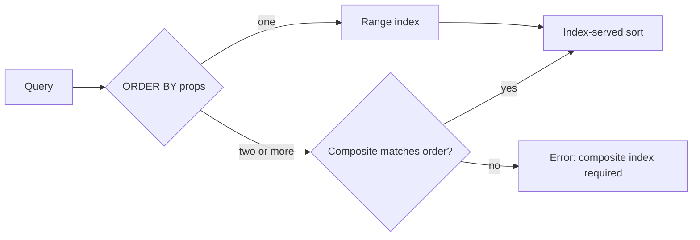

## What this covers

AI retrieval queries filter by type and date, sort by relevance and recency, and dig into chunk arrays. Each pattern needs the right index or it scans partitions and burns RUs. This page covers range indexes for filters, composite indexes for multi-property sorts and filters, tuple indexes for array elements, the read/write trade-off, and how policy changes roll out.

**Exam weight:** Develop AI solutions by using Azure data management services (30–35%)

**Skills measured**

- "Optimize query performance and Request Units (RUs) consumption by using indexing policies and consistency levels"

## Key concepts

### Range indexes for filters

`WHERE c.documentType = 'pdf' AND c.uploadDate > '2024-01-01'` uses the range index on each property. Without them, RU cost tracks **data size**; with them it tracks **result size**. String functions (`CONTAINS`, `STARTSWITH`, `ENDSWITH`) use the range index when the indexed property is the first argument.

### Composite indexes for multi-property ORDER BY

`ORDER BY c.relevanceScore DESC, c.uploadDate DESC` **fails** unless a composite index matches the exact property order and directions:

```json
{ "compositeIndexes": [[
  { "path": "/relevanceScore", "order": "descending" },
  { "path": "/uploadDate", "order": "descending" }
]] }
```

Rules:

- Property sequence must match the `ORDER BY` sequence.
- The index also serves the **fully reversed** order (`ASC, ASC`).
- Mixed reversal (`DESC, ASC`) needs a separate composite index.

### Filter on one property, sort by another

`WHERE c.documentType = 'pdf' ORDER BY c.uploadDate DESC` can be rewritten as `ORDER BY c.documentType, c.uploadDate DESC` so a composite index `(documentType ASC, uploadDate DESC)` serves both the filter and the sort in one pass, cutting RUs.

### Composite indexes for multiple filters

- Put **equality** properties first.
- At most **one range** property per composite index, and it must be **last**.

`WHERE c.category = 'reports' AND c.department = 'finance' AND c.createdDate > '2024-06-01'` → `(category ASC, department ASC, createdDate ASC)`. Two range filters (`age > 18` and `timestamp > x`) with an equality on `name` need two composites: `(name, age)` and `(name, timestamp)`.

### Tuple indexes

For filters on several fields of the **same** array element (chunks with `position` and `tokens`), add `{"path": "/chunks/[]/{position, tokens}/?"}` to `includedPaths`. Queries use `JOIN chunk IN c.chunks WHERE chunk.position < 3 AND chunk.tokens > 100`.

### Balancing reads and writes

Every index is updated on every write. Include only properties that appear in `WHERE` or `ORDER BY`, build composites for frequent queries (not one-offs), and measure write RUs before and after. Write-heavy ingestion favours fewer indexes; read-heavy search favours more.

### Index transformation

Changing the policy starts an **asynchronous** transformation; the container stays available.

- Added indexes help only **after** the transformation completes.
- Removed indexes stop being used **immediately**.
- To replace an index: add the new one, wait for completion, then remove the old one.

Large containers can take hours; schedule changes for quiet periods and track progress in the portal or via the index transformation progress header.

## How it works



## Hands-on

### Azure portal

1. **Data Explorer** > container > **Settings** > **Indexing Policy**.
2. Add a `compositeIndexes` array with the paths and orders above.
3. Save, then re-run the query and compare the RU charge once the transformation finishes.

### Azure CLI

```bash
cat > policy.json <<'EOF'
{
  "indexingMode": "consistent",
  "includedPaths": [ { "path": "/*" } ],
  "excludedPaths": [ { "path": "/\"_etag\"/?" }, { "path": "/embedding/*" } ],
  "compositeIndexes": [
    [ { "path": "/documentType", "order": "ascending" },
      { "path": "/uploadDate",   "order": "descending" } ],
    [ { "path": "/category", "order": "ascending" },
      { "path": "/relevanceScore", "order": "descending" } ]
  ]
}
EOF
az cosmosdb sql container update --account-name <account-name> \
  --resource-group <resource-group> --database-name <database> \
  --name documents --idx @policy.json
```

### Python

```python
from azure.cosmos import CosmosClient, PartitionKey
from azure.identity import DefaultAzureCredential

client = CosmosClient("https://<account-name>.documents.azure.com:443/", DefaultAzureCredential())
db = client.get_database_client("documents-db")
container = db.get_container_client("documents")

policy = container.read()["indexingPolicy"]
policy["compositeIndexes"] = [[
    {"path": "/category", "order": "ascending"},
    {"path": "/department", "order": "ascending"},
    {"path": "/createdDate", "order": "ascending"},   # the single range filter goes last
]]
db.replace_container(container, partition_key=PartitionKey(path="/category"), indexing_policy=policy)

# Check transformation progress
container.read(populate_quota_info=True)
print(container.client_connection.last_response_headers.get(
    "x-ms-documentdb-collection-index-transformation-progress"))
```

## Exam traps

| Query | Index needed |
| --- | --- |
| `ORDER BY a DESC, b DESC` | Composite `(a desc, b desc)` |
| `ORDER BY a ASC, b ASC` with index `(a desc, b desc)` | Already served (fully reversed) |
| `ORDER BY a DESC, b ASC` with index `(a desc, b desc)` | New composite |
| `WHERE x = 1 AND y = 2 AND z > 3` | Composite `(x, y, z)` with range last |
| Filter on two fields in one array element | Tuple index |

> [!WARNING]
> **Exam trap:** A multi-property `ORDER BY` without a matching composite index returns an error, not just a slow query.

> [!WARNING]
> **Exam trap:** Removing an old index before the new one finishes building leaves queries scanning in the gap.

> [!TIP]
> Composite rule of thumb: **equality first, one range last, directions must match or fully flip**.

> [!NOTE]
> Range index basics and path syntax are in [Understand indexes in Azure Cosmos DB](/study/develop-ai-solutions-with-azure-cosmos-db-for-nosql/understand-indexes-in-azure-cosmos-db).

## Quick review

- Range indexes make filter cost scale with results, not data.
- Multi-property `ORDER BY` requires a composite index.
- A composite serves its exact order and the full reverse.
- Equality properties first; at most one range property, last.
- Add the filter property to `ORDER BY` to reuse one composite.
- Tuple indexes cover multi-field filters within array elements.
- Policy changes are asynchronous: add new, wait, remove old.

## Practice

[Practice: Cosmos DB RU and indexing questions](/practice/cosmos-ru-indexing)

## Official references

- [Unit: Configure range and composite indexes](https://learn.microsoft.com/en-us/training/modules/optimize-query-performance-azure-cosmos-db/3-configure-range-composite-indexes)
- [Indexing policies: composite indexes](https://learn.microsoft.com/en-us/azure/cosmos-db/index-policy#composite-indexes)
- [AI-200 study guide](https://learn.microsoft.com/en-us/credentials/certifications/resources/study-guides/ai-200)
