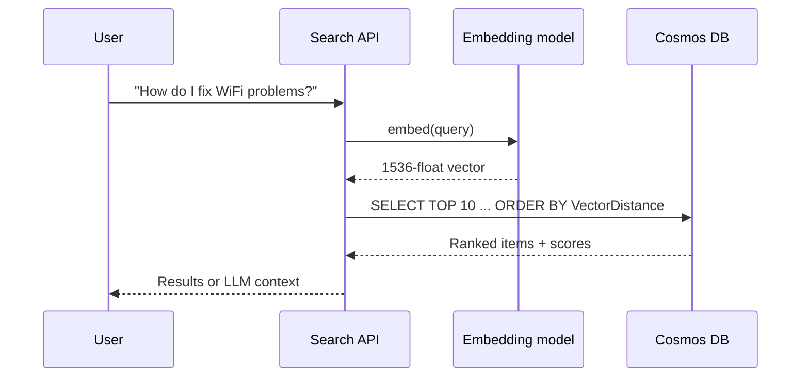

## What this covers

Once items carry embeddings, `VectorDistance` turns a plain query into semantic search: the user's question is embedded, and Azure Cosmos DB returns the items whose vectors sit closest to it. This page covers the function's arguments, the canonical query shape, how to read scores, when to force exact search, and how to keep vector queries cheap.

**Exam weight:** Develop AI solutions by using Azure data management services (30–35%)

**Skills measured**

- "Store and retrieve embeddings and execute vector similarity search for semantic retrieval"

## Key concepts

### VectorDistance arguments

`VectorDistance(<vector_expr_1>, <vector_expr_2>, [<bool_expr>], [<obj_expr>])`

1. The item's vector path, such as `c.embedding`.
2. The query vector, normally a parameter like `@queryVector`.
3. Optional `true` to force brute-force (exact) search; default `false` uses the vector index.
4. Optional JSON options, for example `{'distanceFunction': 'cosine', 'dataType': 'float32'}` to override the policy, or `{'searchListSizeMultiplier': 10}` to raise DiskANN recall per query at more latency and RUs.

### Canonical query shape

```sql
SELECT TOP 10 c.id, c.title, c.category,
       VectorDistance(c.embedding, @queryVector) AS SimilarityScore
FROM c
ORDER BY VectorDistance(c.embedding, @queryVector)
```

- **`TOP N` is mandatory in practice.** Without it the engine tries to rank and return far more items, burning RUs and time.
- `ORDER BY VectorDistance(...)` returns the most similar first for every distance function; you don't add `ASC` or `DESC`.
- Project the score with an alias if the app needs it.

### Same model for queries and documents

The query text must be embedded with the **same model** (and dimension count) that produced the stored vectors. Different models create unrelated vector spaces, so results become noise; a dimension mismatch simply fails to match the policy.

### Reading scores (cosine)

| Score | Meaning |
| --- | --- |
| 1.0 | Identical direction |
| 0.7–0.9 | Highly similar |
| 0.5–0.7 | Moderately similar |
| < 0.5 | Weak; near or below 0 is unrelated |

A threshold such as `WHERE VectorDistance(c.embedding, @queryVector) > 0.7` drops weak matches. Tune it with real queries; the right cut-off depends on the model and corpus. For Euclidean distance the comparison flips (`<`).

### Choosing N

- RAG grounding: 5–10 chunks; more context raises token cost without always improving answers.
- User-facing search: 10–20 with paging.
- Recommendations: 3–5.

### Indexed versus brute force

With a `diskANN` index, results are approximate: very high recall at a fraction of the cost, and occasionally a slightly different order between runs because replicas build their indexes independently. Passing `true` compares against every vector: exact, but RU cost and latency grow with data size. Use it for evaluating recall, for tiny datasets or for tests, not for production traffic.

## How it works



## Hands-on

### Azure portal

1. Open **Data Explorer** on a container with a vector policy.
2. Paste a short vector literal into a `SELECT TOP 5 ... ORDER BY VectorDistance(c.embedding, [ ... ])` query to sanity-check the index.
3. Compare **Query Stats** RU charge with and without the `true` brute-force flag.

### Azure CLI

```bash
# Confirm the container's vector and indexing policies before debugging queries
az cosmosdb sql container show \
  --account-name <account-name> --resource-group <resource-group> \
  --database-name support-db --name knowledge-base \
  --query "{vectors: resource.vectorEmbeddingPolicy, index: resource.indexingPolicy.vectorIndexes}"
```

### Python

```python
from azure.cosmos import CosmosClient
from azure.identity import DefaultAzureCredential
from openai import AzureOpenAI

container = (CosmosClient("https://<account-name>.documents.azure.com:443/", DefaultAzureCredential())
             .get_database_client("support-db").get_container_client("knowledge-base"))
aoai = AzureOpenAI(azure_endpoint="<aoai-endpoint>", api_key="<key>", api_version="2024-02-01")

query_vector = aoai.embeddings.create(
    input="How do I fix WiFi connection problems?",
    model="text-embedding-ada-002",          # same model as the stored documents
).data[0].embedding

query = """
SELECT TOP 10 c.id, c.title,
       VectorDistance(c.embedding, @queryVector) AS SimilarityScore
FROM c
WHERE VectorDistance(c.embedding, @queryVector) > 0.7
ORDER BY VectorDistance(c.embedding, @queryVector)
"""
results = container.query_items(
    query=query,
    parameters=[{"name": "@queryVector", "value": query_vector}],
    enable_cross_partition_query=True,
)
for item in results:
    print(f"{item['title']} - Score: {item['SimilarityScore']:.4f}")
print(container.client_connection.last_response_headers["x-ms-request-charge"])

# Exact search for evaluation only
exact = "SELECT TOP 5 c.title FROM c ORDER BY VectorDistance(c.embedding, @queryVector, true)"
```

Passing the vector as `@queryVector` keeps the query text short, readable and plan-cacheable instead of inlining 1,536 numbers.

## Exam traps

| Situation | Answer |
| --- | --- |
| Query costs thousands of RUs and returns everything | Add `TOP N` |
| Need provably exact top-5 for a recall test | `VectorDistance(..., true)` |
| Production semantic search over millions of items | Indexed search on `diskANN` |
| Results look random after switching models | Re-embed documents with the new model |
| Only show strong matches | Score threshold in `WHERE` |

> [!WARNING]
> **Exam trap:** Adding `DESC` to `ORDER BY VectorDistance` to get "highest similarity first" is unnecessary; the engine already orders by similarity.

> [!WARNING]
> **Exam trap:** The brute-force flag is not a free accuracy upgrade. It scans every vector and multiplies RU cost.

> [!TIP]
> Recipe: embed with the same model, `TOP N`, `ORDER BY VectorDistance`, project only needed fields, add the partition key when you can.

> [!NOTE]
> Combining filters and keyword scoring is covered in [metadata filtering and hybrid search](/study/develop-ai-solutions-with-azure-cosmos-db-for-nosql/combine-vector-similarity-results-with-metadata-filtering).

## Quick review

- `VectorDistance(path, vector, [bruteForce], [options])`.
- Always use `TOP N`.
- `ORDER BY VectorDistance` returns most similar first.
- Embed queries with the same model as the documents.
- Cosine: higher is closer; Euclidean: lower is closer.
- `true` as the third argument forces exact, expensive search.
- `searchListSizeMultiplier` trades RUs for DiskANN recall.

## Practice

[Practice: Cosmos DB vector search questions](/practice/cosmos-vector-search)

## Official references

- [Unit: Execute vector similarity queries for semantic search](https://learn.microsoft.com/en-us/training/modules/implement-vector-search-azure-cosmos-db/3-execute-vector-similarity-queries)
- [VectorDistance system function](https://learn.microsoft.com/en-us/cosmos-db/query/vectordistance)
- [Integrated vector store in Azure Cosmos DB](https://learn.microsoft.com/en-us/azure/cosmos-db/vector-search)
- [AI-200 study guide](https://learn.microsoft.com/en-us/credentials/certifications/resources/study-guides/ai-200)
