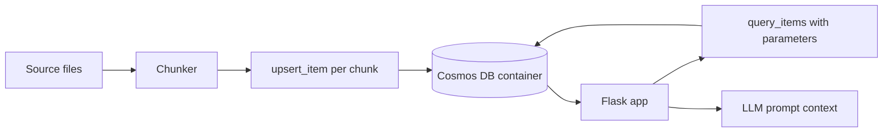

## What this covers

This hands-on exercise (about 30 minutes) builds the storage layer of a retrieval-augmented generation (RAG) app. You deploy an Azure Cosmos DB for NoSQL account, design a container for chunked documents, write Python functions that store and fetch chunks, and test them from a small Flask app. Embeddings and vector search come in the next module; here the focus is the SDK, the data model and SQL queries.

**Exam weight:** Develop AI solutions by using Azure data management services (30–35%)

**Skills measured**

- "Connect to Azure Cosmos DB for NoSQL by using the SDK and run queries"

## Key concepts

### What the lab asks you to do

1. Download the starter project and configure its deployment script.
2. Deploy a Cosmos DB for NoSQL account, database and container with the Azure CLI.
3. Implement Python functions that store and retrieve document chunks.
4. Run the Flask app to exercise those functions.
5. Query document context with the NoSQL query language.

Prerequisites: an Azure subscription, Visual Studio Code, the latest Azure CLI and Python 3.12 or later.

### Chunk document model

RAG splits long documents into chunks small enough to fit an LLM prompt. Each chunk becomes one item:

```json
{
  "id": "handbook-2024-chunk-007",
  "documentId": "handbook-2024",
  "chunkIndex": 7,
  "title": "Employee handbook",
  "category": "hr",
  "content": "Remote employees may claim ...",
  "source": "handbook.pdf",
  "createdDate": "2024-06-15T10:30:00Z"
}
```

Design choices to explain in an exam:

- **Meaningful `id`** (`<documentId>-chunk-<n>`) makes upserts idempotent: re-ingesting a document overwrites its chunks instead of duplicating them.
- **Partition key** should match the dominant filter. `/documentId` keeps all chunks of one document together (cheap "get neighbouring chunks" queries). `/category` or `/tenantId` suits "search within a category or tenant". Avoid low-cardinality keys.
- **Metadata** (`category`, `source`, `createdDate`) lets the retriever filter before results go into the prompt.

### Retrieval queries you'll write

- All chunks for one document in order: `WHERE c.documentId = @doc ORDER BY c.chunkIndex`.
- Keyword-style context: `WHERE c.category = @cat AND CONTAINS(LOWER(c.content), @term)`.
- Recent content: `WHERE c.createdDate >= @since`.

## How it works



The Flask app is only a test harness. The ingestion path writes chunks with `upsert_item`; the retrieval path runs parameterized queries and passes the text to whatever model builds the answer.

## Hands-on

### Azure portal

1. After deployment, open the account's **Data Explorer**.
2. Confirm the database, container and partition key the script created.
3. Run `SELECT TOP 5 c.id, c.chunkIndex FROM c ORDER BY c.chunkIndex` and check **Query Stats** for the RU charge.

### Azure CLI

```bash
az group create --name rg-ai200 --location eastus

az cosmosdb create --name <account-name> --resource-group rg-ai200 \
  --locations regionName=eastus

az cosmosdb sql database create --account-name <account-name> \
  --resource-group rg-ai200 --name ragdb

az cosmosdb sql container create --account-name <account-name> \
  --resource-group rg-ai200 --database-name ragdb --name chunks \
  --partition-key-path "/documentId" --throughput 400
```

### Python

```python
from azure.cosmos import CosmosClient
from azure.identity import DefaultAzureCredential

client = CosmosClient("https://<account-name>.documents.azure.com:443/", DefaultAzureCredential())
chunks = client.get_database_client("ragdb").get_container_client("chunks")


def store_document(doc_id: str, title: str, category: str, text: str, size: int = 800) -> int:
    parts = [text[i:i + size] for i in range(0, len(text), size)]
    for n, part in enumerate(parts):
        chunks.upsert_item({
            "id": f"{doc_id}-chunk-{n:03d}",
            "documentId": doc_id,
            "chunkIndex": n,
            "title": title,
            "category": category,
            "content": part,
        })
    return len(parts)


def get_context(doc_id: str, top: int = 5) -> list[str]:
    rows = chunks.query_items(
        "SELECT TOP @top VALUE c.content FROM c WHERE c.documentId = @doc ORDER BY c.chunkIndex",
        parameters=[{"name": "@doc", "value": doc_id}, {"name": "@top", "value": top}],
        partition_key=doc_id,
    )
    return list(rows)
```

## Exam traps

| Goal | Choice |
| --- | --- |
| Re-ingest without duplicates | Deterministic `id` + `upsert_item` |
| Read all chunks of one document cheaply | Partition key `/documentId`, pass `partition_key=` |
| Filter context by business attributes | Store metadata on each chunk |
| Return only text for the prompt | `SELECT VALUE c.content` |

> [!WARNING]
> **Exam trap:** Using random GUIDs as chunk `id`s with `create_item` means every re-ingestion adds duplicate chunks that pollute retrieval.

> [!WARNING]
> **Exam trap:** Account keys in the starter code are fine for a sandbox; production answers favour `DefaultAzureCredential` with a managed identity.

> [!TIP]
> Think "one chunk = one item, metadata travels with it". That shape later accepts an `embedding` property without redesign.

> [!NOTE]
> The next module adds a vector embedding policy so these chunks can be found by meaning; see [store and retrieve embeddings](/study/develop-ai-solutions-with-azure-cosmos-db-for-nosql/store-and-retrieve-embeddings-in-azure-cosmos-db).

## Quick review

- A RAG store keeps chunks plus metadata as separate items.
- Deterministic IDs + upsert make ingestion idempotent.
- Pick the partition key from the main retrieval filter.
- Parameterized queries supply prompt context.
- `SELECT VALUE` returns bare strings for prompt assembly.
- The lab takes about 30 minutes and needs Python 3.12+ and the Azure CLI.

## Practice

[Practice: Cosmos DB SDK and query questions](/practice/cosmos-sdk-queries)

## Official references

- [Exercise: Build a RAG document store on Azure Cosmos DB for NoSQL](https://learn.microsoft.com/en-us/training/modules/build-query-azure-cosmos-db/5-exercise-build-rag-document-store)
- [Module: Build queries for Azure Cosmos DB for NoSQL](https://learn.microsoft.com/en-us/training/modules/build-query-azure-cosmos-db/)
- [AI-200 study guide](https://learn.microsoft.com/en-us/credentials/certifications/resources/study-guides/ai-200)
