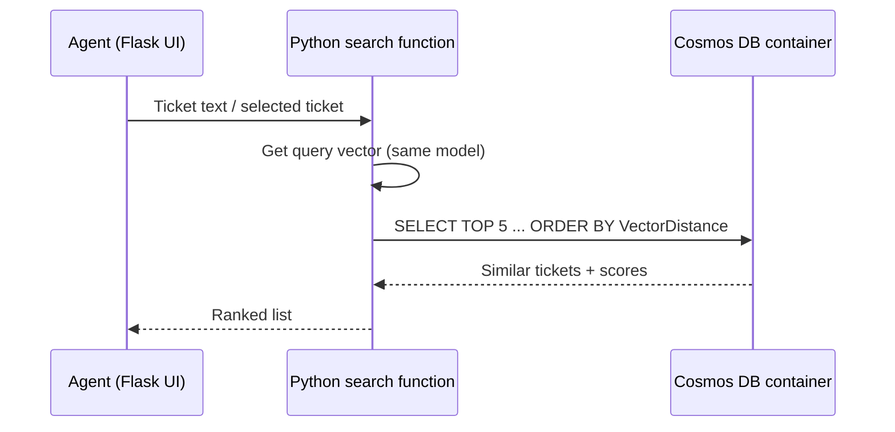

## What this covers

This exercise (about 30 minutes) puts the vector search module into practice. You deploy an Azure Cosmos DB for NoSQL account with vector search enabled, create a container with a vector embedding policy and vector index, load support tickets that already include embeddings, and find similar tickets with `VectorDistance` from Python, tested through a Flask web app. The scenario: help support agents resolve a new case faster by surfacing similar past cases.

**Exam weight:** Develop AI solutions by using Azure data management services (30–35%)

**Skills measured**

- "Store and retrieve embeddings and execute vector similarity search for semantic retrieval"

## Key concepts

### Lab tasks

1. Download the starter files and configure the deployment script.
2. Deploy a Cosmos DB for NoSQL account with the vector search capability.
3. Write Python functions for vector similarity search.
4. Create a container with vector embedding and indexing policies.
5. Test search through the Flask app.

Prerequisites: Azure subscription, Visual Studio Code, latest Azure CLI, Python 3.12+.

### Pre-computed embeddings

The sample tickets ship with vectors already generated, so the lab doesn't need an embedding deployment to load data. The rule still applies: the query vector must come from the **same model and dimension count** as the stored vectors, or similarity scores are meaningless.

### Container design for the scenario

- Partition key such as `/category` so agents can search within a product area on one partition.
- Vector policy: `/embedding`, `float32`, `cosine`, dimensions equal to the sample model's output.
- Index policy: exclude `/embedding/*` from range indexing; add a vector index. With fewer than 1,000 vectors, `quantizedFlat` and `diskANN` fall back to a full scan, so a small lab dataset behaves like brute force anyway.

### Search function contract

Input: query vector and optional filters. Output: top N tickets with ID, title, resolution and similarity score. Return the score so the UI can hide weak matches.

## How it works



## Hands-on

### Azure portal

1. Open the deployed account > **Features** and confirm **Vector Search for NoSQL API** is on.
2. In **Data Explorer**, open the container **Settings** and review **Vector Policy** and **Indexing Policy**.
3. Run a vector query and note the RU charge in **Query Stats**.

### Azure CLI

```bash
az cosmosdb create --name <account-name> --resource-group <resource-group> \
  --locations regionName=eastus \
  --capabilities EnableNoSQLVectorSearch

az cosmosdb sql database create --account-name <account-name> \
  --resource-group <resource-group> --name supportdb
```

### Python

```python
from azure.cosmos import CosmosClient, PartitionKey
from azure.identity import DefaultAzureCredential

client = CosmosClient("https://<account-name>.documents.azure.com:443/", DefaultAzureCredential())
db = client.get_database_client("supportdb")

tickets = db.create_container_if_not_exists(
    id="tickets",
    partition_key=PartitionKey(path="/category"),
    vector_embedding_policy={"vectorEmbeddings": [
        {"path": "/embedding", "dataType": "float32", "distanceFunction": "cosine", "dimensions": 1536}]},
    indexing_policy={
        "includedPaths": [{"path": "/*"}],
        "excludedPaths": [{"path": "/\"_etag\"/?"}, {"path": "/embedding/*"}],
        "vectorIndexes": [{"path": "/embedding", "type": "quantizedFlat"}],
    },
)


def find_similar(query_vector: list[float], category: str | None = None, top: int = 5):
    where = "WHERE c.category = @category" if category else ""
    query = f"""
        SELECT TOP @top c.id, c.title, c.resolution,
               VectorDistance(c.embedding, @v) AS score
        FROM c {where}
        ORDER BY VectorDistance(c.embedding, @v)"""
    params = [{"name": "@v", "value": query_vector}, {"name": "@top", "value": top}]
    if category:
        params.append({"name": "@category", "value": category})
        return list(tickets.query_items(query, parameters=params, partition_key=category))
    return list(tickets.query_items(query, parameters=params, enable_cross_partition_query=True))
```

## Exam traps

| Lab decision | Why |
| --- | --- |
| Enable `EnableNoSQLVectorSearch` before creating the container | Vector policies are rejected otherwise |
| Set vector policy at creation | It can't be edited in place later |
| `TOP N` in every vector query | Bounds RU cost and latency |
| Optional category filter with `partition_key=` | Single-partition, cheaper search |
| Return the score | UI can apply a relevance threshold |

> [!WARNING]
> **Exam trap:** Generating the query vector with a different embedding model from the one used for the stored tickets produces poor results even though the query "works".

> [!WARNING]
> **Exam trap:** In a small lab container, approximate indexes behave like a full scan until 1,000 vectors exist, so RU numbers won't match production.

> [!TIP]
> Lab flow to remember: **enable → policy → load → `VectorDistance` → `TOP N`**.

> [!NOTE]
> To compare index types on the same data, see the [optimize query performance exercise](/study/develop-ai-solutions-with-azure-cosmos-db-for-nosql/exercise-optimize-query-performance-with-vector-indexes-on-azure-cosmos-db).

## Quick review

- The lab takes about 30 minutes and uses Python 3.12+ and the Azure CLI.
- Vector search is enabled at account level first.
- The container gets both a vector embedding policy and a vector index.
- Tickets arrive with pre-computed embeddings.
- Queries use `VectorDistance` with `TOP N` and `ORDER BY`.
- Filters plus `partition_key=` keep searches on one partition.

## Practice

[Practice: Cosmos DB vector search questions](/practice/cosmos-vector-search)

## Official references

- [Exercise: Build a semantic search application with Azure Cosmos DB for NoSQL](https://learn.microsoft.com/en-us/training/modules/implement-vector-search-azure-cosmos-db/6-exercise-build-semantic-search)
- [Module: Implement vector search on Azure Cosmos DB for NoSQL](https://learn.microsoft.com/en-us/training/modules/implement-vector-search-azure-cosmos-db/)
- [Integrated vector store in Azure Cosmos DB](https://learn.microsoft.com/en-us/azure/cosmos-db/vector-search)
- [AI-200 study guide](https://learn.microsoft.com/en-us/credentials/certifications/resources/study-guides/ai-200)
