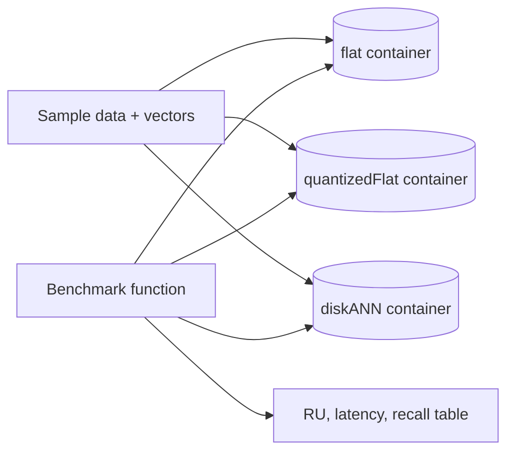

## What this covers

This exercise (about 30 minutes) turns index theory into numbers. You deploy an Azure Cosmos DB for NoSQL account with vector search, create three containers that differ only in vector index type (`flat`, `quantizedFlat`, `diskANN`), load the same sample data into each, and use Python functions behind a Flask app to compare RU charge, latency and result overlap for the same queries.

**Exam weight:** Develop AI solutions by using Azure data management services (30–35%)

**Skills measured**

- "Optimize query performance and Request Units (RUs) consumption by using indexing policies and consistency levels"
- "Store and retrieve embeddings and execute vector similarity search for semantic retrieval"

## Key concepts

### Lab tasks

1. Download the starter files and configure the deployment script.
2. Deploy a Cosmos DB for NoSQL account with vector search enabled.
3. Write Python functions that run and time vector queries.
4. Create the flat, quantizedFlat and diskANN containers.
5. Compare results in the Flask app.

Prerequisites: Azure subscription, Visual Studio Code, latest Azure CLI, Python 3.12+.

### A fair comparison

- **Same data, same partition key, same vector embedding policy** in all three containers; only `vectorIndexes[].type` changes.
- **Same query vectors and `TOP N`**, run several times; ignore the first (cold) run.
- Record `x-ms-request-charge`, wall-clock latency and the returned IDs.
- Treat `flat` as ground truth (exact) and measure **recall@N** for the others: the share of flat's top-N IDs that also appear in their top-N.
- Note the vector dimensions: `flat` only accepts up to 505, so a 1,536-dimension dataset needs smaller sample vectors for the flat container, or flat must be skipped.

### What you should observe

| Index | Recall | RU and latency as data grows |
| --- | --- | --- |
| `flat` | 100% | Grows linearly with vectors scanned |
| `quantizedFlat` | Near 100% | Lower than flat; still grows with scope |
| `diskANN` | High, occasionally slightly different order | Lowest and flattest at scale |

With a small lab dataset (under 1,000 vectors per container) `quantizedFlat` and `diskANN` fall back to full scans, so differences are small. That's an exam point in its own right: index benefits appear at scale.

### Applying the results

Choose the index that meets your recall target at the lowest RU. Add range indexes on filter fields so selective filters can shrink the candidate set, and keep `/embedding/*` out of range indexing in every container.

## How it works



## Hands-on

### Azure portal

1. After deployment, open **Data Explorer** and compare the three containers' **Indexing Policy** documents.
2. Run the same `SELECT TOP 10 ... ORDER BY VectorDistance(...)` against each and note **Query Stats**.
3. Check **Metrics** > *Total Request Units* split by collection name.

### Azure CLI

```bash
az cosmosdb create --name <account-name> --resource-group <resource-group> \
  --locations regionName=eastus --capabilities EnableNoSQLVectorSearch

az cosmosdb sql database create --account-name <account-name> \
  --resource-group <resource-group> --name indexlab
```

### Python

```python
import time
from azure.cosmos import CosmosClient, PartitionKey
from azure.identity import DefaultAzureCredential

client = CosmosClient("https://<account-name>.documents.azure.com:443/", DefaultAzureCredential())
db = client.get_database_client("indexlab")
DIMS = 384  # flat supports at most 505 dimensions

def make(index_type: str):
    return db.create_container_if_not_exists(
        id=f"docs-{index_type.lower()}",
        partition_key=PartitionKey(path="/category"),
        vector_embedding_policy={"vectorEmbeddings": [
            {"path": "/embedding", "dataType": "float32", "distanceFunction": "cosine", "dimensions": DIMS}]},
        indexing_policy={
            "includedPaths": [{"path": "/*"}],
            "excludedPaths": [{"path": "/\"_etag\"/?"}, {"path": "/embedding/*"}],
            "vectorIndexes": [{"path": "/embedding", "type": index_type}],
        },
    )

containers = {t: make(t) for t in ("flat", "quantizedFlat", "diskANN")}

def run(container, vector, top=10):
    q = f"SELECT TOP {top} c.id FROM c ORDER BY VectorDistance(c.embedding, @v)"
    start = time.perf_counter()
    ids = [r["id"] for r in container.query_items(q, parameters=[{"name": "@v", "value": vector}],
                                                  enable_cross_partition_query=True)]
    ms = (time.perf_counter() - start) * 1000
    ru = float(container.client_connection.last_response_headers["x-ms-request-charge"])
    return ids, ru, ms

truth, _, _ = run(containers["flat"], query_vector)
for name, c in containers.items():
    ids, ru, ms = run(c, query_vector)
    recall = len(set(ids) & set(truth)) / len(truth)
    print(f"{name:14} RU={ru:7.2f} latency={ms:6.1f} ms recall@10={recall:.2f}")
```

## Exam traps

| Finding | Conclusion |
| --- | --- |
| diskANN and flat costs look the same on 500 items | Below 1,000 vectors, approximate indexes aren't used |
| flat container rejects 1,536-dimension policy | flat max is 505 dimensions |
| diskANN misses one of flat's top 10 | Expected ANN behaviour; raise `searchListSizeMultiplier` if needed |
| RU grows with data on flat | Brute-force cost scales with vectors scanned |

> [!WARNING]
> **Exam trap:** Benchmarks on tiny datasets mislead. Index choice should be justified at production volume.

> [!WARNING]
> **Exam trap:** Comparing containers with different partition keys or filters measures the wrong thing; change one variable only.

> [!TIP]
> Measure three things: **RU**, **latency**, **recall against flat**.

> [!NOTE]
> Index theory for this lab is on [Tune vector indexes for embedding workloads](/study/develop-ai-solutions-with-azure-cosmos-db-for-nosql/tune-vector-indexes-for-embedding-workloads).

## Quick review

- The lab compares `flat`, `quantizedFlat` and `diskANN` on identical data.
- `flat` is the exact baseline for recall.
- `x-ms-request-charge` provides RU per query.
- Approximate indexes need 1,000+ vectors to differ from a scan.
- `flat` can't hold vectors above 505 dimensions.
- Choose the cheapest index that meets your recall target.

## Practice

[Practice: Cosmos DB RU and indexing questions](/practice/cosmos-ru-indexing)

[Practice: Cosmos DB vector search questions](/practice/cosmos-vector-search)

## Official references

- [Exercise: Optimize query performance with vector indexes](https://learn.microsoft.com/en-us/training/modules/optimize-query-performance-azure-cosmos-db/7-exercise-optimize-query-performance)
- [Module: Optimize query performance for Azure Cosmos DB for NoSQL](https://learn.microsoft.com/en-us/training/modules/optimize-query-performance-azure-cosmos-db/)
- [Integrated vector store in Azure Cosmos DB](https://learn.microsoft.com/en-us/azure/cosmos-db/vector-search)
- [AI-200 study guide](https://learn.microsoft.com/en-us/credentials/certifications/resources/study-guides/ai-200)
