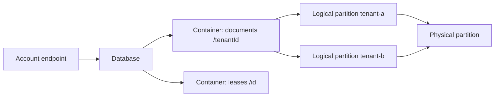

## What this covers

Azure Cosmos DB for NoSQL is a globally distributed, schema-agnostic JSON database that suits AI workloads needing low-latency document storage, flexible schemas and built-in vector search for RAG pipelines. This page covers the resource hierarchy, how partition keys spread data, how throughput is bought in request units (RUs), and the system properties every item carries. Everything else in this learning path builds on these choices.

**Exam weight:** Develop AI solutions by using Azure data management services (30–35%)

**Skills measured**

- "Connect to Azure Cosmos DB for NoSQL by using the SDK and run queries"
- "Optimize query performance and Request Units (RUs) consumption by using indexing policies and consistency levels"

## Key concepts

### Resource hierarchy

- **Account**: the top-level resource with its own DNS endpoint, `https://<account-name>.documents.azure.com:443/`. Account-level settings include the default consistency level, replicated regions and network rules. Use separate accounts for dev, test and production.
- **Database**: a namespace for containers and the optional scope for **shared throughput**. By default an account can hold up to 500 databases and containers combined.
- **Container**: the unit of scale. It holds JSON items, is schema-agnostic (items with different shapes can share a container) and **must** have a partition key.
- **Item**: a JSON document. Every item needs an `id`; the SDK doesn't generate one for you. The `id` plus the partition key value uniquely identifies an item.

### Partition keys

The partition key path (for example `/tenantId`, `/userId` or nested `/metadata/region`) decides which logical partition an item lands in; Cosmos DB then maps logical partitions to physical partitions. A good key:

- exists in every item,
- has high cardinality (many distinct values),
- spreads both storage and request volume evenly,
- appears in your most frequent query filters so queries stay single-partition.

Low-cardinality keys (a boolean like `isActive`) or time-based keys (today's date) create **hot partitions** that throttle. The partition key **can't be changed** after the container exists; you create a new container and migrate.

### Request units and throughput

An RU is a normalized blend of CPU, memory and IOPS. Rough reference costs from the module:

| Operation | Approximate cost |
| --- | --- |
| Point read of a 1 KB item (`id` + partition key) | ~1 RU |
| Write of a 1 KB item | ~5–10 RUs (depends on indexing) |
| Simple filtered query | a few RUs |
| Aggregate scanning thousands of items | hundreds of RUs |

Cost rises with item size, number of indexed paths, stronger consistency (Strong and Bounded staleness reads cost about double), query complexity and cross-partition fan-out. Every response returns its cost in the `x-ms-request-charge` header.

Throughput can be provisioned at the **container** level (dedicated) or the **database** level (shared by up to 25 containers). Two modes:

- **Manual**: fixed RU/s, minimum 400 RU/s for a container or a shared database.
- **Autoscale**: you set a maximum; the service scales between 10% and 100% of it. The smallest allowed maximum is 1,000 RU/s.

### System properties

Cosmos DB adds `_rid` (internal ID), `_self` (resource URI), `_etag` (version tag for optimistic concurrency), `_ts` (last-modified Unix time in seconds) and the legacy `_attachments`.

### Where Cosmos DB fits for AI

Know when Cosmos DB fits compared with Azure Database for PostgreSQL with pgvector or Azure Managed Redis: Cosmos DB wins on elastic scale, global distribution, schema flexibility and native vector indexing next to operational data. PostgreSQL suits relational joins and SQL tooling; Redis suits sub-millisecond caching and short-lived vectors.

## How it works



The SDK hashes the partition key value to route each request to the physical partition that owns it. Queries that filter on the partition key touch one partition; others fan out to all of them and cost more.

## Hands-on

### Azure portal

1. Create a resource and select **Azure Cosmos DB** > **Azure Cosmos DB for NoSQL**.
2. Pick the resource group, account name, region and capacity mode (**Provisioned throughput** or **Serverless**).
3. Open **Data Explorer** > **New Container**, enter database `vectordb`, container `documents` and partition key `/tenantId`.
4. Choose **Autoscale** or **Manual** throughput, then select **OK**.

### Azure CLI

```bash
# Create Cosmos DB account (NoSQL API)
az cosmosdb create \
  --name cosmos-ai200 \
  --resource-group rg-ai200 \
  --locations regionName=eastus

az cosmosdb sql database create \
  --account-name cosmos-ai200 \
  --resource-group rg-ai200 \
  --name vectordb

az cosmosdb sql container create \
  --account-name cosmos-ai200 \
  --resource-group rg-ai200 \
  --database-name vectordb \
  --name documents \
  --partition-key-path "/tenantId" \
  --max-throughput 1000
```

### Python

```python
from azure.cosmos import CosmosClient, PartitionKey
from azure.identity import DefaultAzureCredential

url = "https://<account-name>.documents.azure.com:443/"
client = CosmosClient(url, credential=DefaultAzureCredential())

database = client.create_database_if_not_exists(id="vectordb")
container = database.create_container_if_not_exists(
    id="documents",
    partition_key=PartitionKey(path="/tenantId"),
    offer_throughput=400,
)

doc = {
    "id": "doc-1",
    "tenantId": "tenant-a",
    "content": "Azure AI services overview",
    "embedding": [0.12, 0.45, 0.78],
}
container.upsert_item(doc)
print(container.client_connection.last_response_headers["x-ms-request-charge"])
```

The original version of this snippet used `CosmosClient(url, credential=key)`. Keys still work, but each key grants full account access, so prefer Microsoft Entra ID with a managed identity.

## Exam traps

| Need | Choose |
| --- | --- |
| Even spread for per-user AI data | Partition key `/userId` or `/tenantId` |
| Unpredictable inference traffic | Autoscale throughput |
| Many small containers with uneven load | Database-level shared throughput |
| Steady, predictable load | Manual throughput at container level |
| Read one known item | Point read (`id` + partition key) |

> [!WARNING]
> **Exam trap:** You can't change a container's partition key. A question that offers "update the partition key path" is wrong; the answer is a new container plus data migration.

> [!WARNING]
> **Exam trap:** The SDK doesn't create an `id` for you. Inserting an item without `id` fails.

> [!TIP]
> Memory aid for consistency: **S**trong, **B**ounded staleness, **S**ession, **C**onsistent prefix, **E**ventual, from most to least strict. Session, Bounded staleness and Strong trade freshness for cost; see [consistency levels](/study/develop-ai-solutions-with-azure-cosmos-db-for-nosql/choose-consistency-levels-for-optimal-performance).

> [!NOTE]
> Autoscale with a 4,000 RU/s maximum bills between 400 and 4,000 RU/s depending on load each hour.

## Quick review

- Hierarchy: account > database > container > item.
- The container is the unit of scale and needs an immutable partition key.
- `id` + partition key value uniquely identifies an item.
- Manual minimum 400 RU/s; autoscale scales 10–100% of a maximum of at least 1,000 RU/s.
- A shared-throughput database can serve up to 25 containers.
- `_etag` enables optimistic concurrency; `_ts` is seconds since epoch.
- `x-ms-request-charge` reports the RU cost of every operation.

## Practice

[Practice: Cosmos DB SDK and query questions](/practice/cosmos-sdk-queries)

[Practice: Cosmos DB RU and indexing questions](/practice/cosmos-ru-indexing)

## Official references

- [Module: Build queries for Azure Cosmos DB for NoSQL](https://learn.microsoft.com/en-us/training/modules/build-query-azure-cosmos-db/)
- [Unit: Explore Azure Cosmos DB for NoSQL](https://learn.microsoft.com/en-us/training/modules/build-query-azure-cosmos-db/2-explore-cosmos-db-nosql)
- [Cosmos DB for NoSQL](https://learn.microsoft.com/en-us/azure/cosmos-db/nosql/)
- [Vector search in Cosmos DB](https://learn.microsoft.com/en-us/azure/cosmos-db/nosql/vector-search)
- [AI-200 study guide](https://learn.microsoft.com/en-us/credentials/certifications/resources/study-guides/ai-200)
