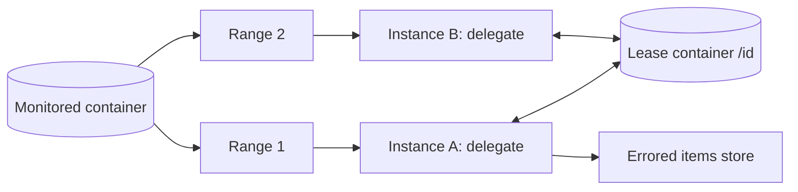

## What this covers

The change feed processor is the library that turns the Azure Cosmos DB change feed into a reliable, horizontally scalable event stream. It's what runs inside the Azure Functions Cosmos DB trigger, and you can host it yourself in a VM, an AKS pod, a Container App or an ASP.NET hosted service. This page covers its four components, the processing life cycle, error handling, start-time options, scaling rules, lease tuning and the permissions it needs.

**Exam weight:** Develop AI solutions by using Azure data management services (30–35%)

**Skills measured**

- "Implement a change feed processor to detect and handle new or updated items"

## Key concepts

### Four components

| Component | Role |
| --- | --- |
| Monitored container | The data whose inserts and updates feed the processor |
| Lease container | Stores one lease document per partition range with its checkpoint; partition key must be `/id`; can live in another account |
| Compute instance | A host running the processor, identified by a unique **instance name** |
| Delegate | Your code that handles each batch of changes |

### SDK support

The processor library ships in the **.NET V3** and **Java V4** SDKs. Python and Node.js don't include it: use the Azure Functions trigger (available for every Functions language) or the **pull model** with your own checkpoints.

| Read method | .NET | Java | Python | Node.js |
| --- | --- | --- | --- | --- |
| Change feed processor | Yes | Yes | No | No |
| Pull model | Yes | Yes | Yes | Yes |
| Azure Functions trigger | Yes | Yes | Yes | Yes |

### Life cycle

1. Read the change feed for each owned lease.
2. If nothing changed, wait the poll interval (`WithPollInterval`) and read again.
3. Pass the batch to the delegate.
4. When the delegate returns **successfully**, write the new checkpoint to the lease.

### Error handling and at-least-once delivery

If the delegate throws, the batch isn't checkpointed. A new worker restarts from the last saved checkpoint and delivers the same batch again, repeatedly, until it succeeds. That's why the guarantee is **at least once** and why handlers must be idempotent. To avoid getting stuck on a poison item, catch failures inside the delegate, write the item to an errored-message store (another container or a queue) and let the batch complete. Register `WithErrorNotification` to see failures; `ChangeFeedProcessorUserException` means your delegate threw. Don't fire off async work without awaiting it: the lease may be checkpointed before the work finishes.

### Start time

On first start the processor initializes the lease container and reads **from now**; earlier changes are skipped. `WithStartTime(dateTime)` begins at a point in time and `WithStartTime(DateTime.MinValue.ToUniversalTime())` reads from the beginning. These settings only apply when the lease container is first initialized; afterwards the stored leases win. All versions and deletes mode can only start from now or a saved checkpoint.

### Deployment units and scaling

A **deployment unit** is a set of instances sharing the same `processorName` and lease container, each with a different instance name. Leases are spread evenly across them and rebalanced when instances join or leave. A lease is owned by one instance at a time, so instances beyond the number of leases sit idle. When the container splits partitions, the processor adds leases automatically. Different deployment units (for example "refresh embeddings" and "sync to search index") each get every change; they can share a lease container if their `processorName` (or Functions `leaseContainerPrefix`) differs.

### Lease timing and RUs

Defaults: acquire check every 17 s, renew every 13 s, expire after 60 s. Shorter values recover faster but spend more RUs on the lease container. Change feed reads consume RUs on the monitored container and lease updates consume RUs on the lease container; throttling either one delays processing. Use the **change feed estimator** to measure lag.

### Endpoint and permissions

Use the account's global endpoint and choose regions with `ApplicationRegion` or `ApplicationPreferredRegions`; leases are scoped to the endpoint, so switching to a regional endpoint creates a fresh set of leases. With Microsoft Entra ID the identity needs `readMetadata` and `readChangeFeed` on the monitored container and item read, create, replace, delete and `executeQuery` on the lease container.

## How it works



## Hands-on

### Azure portal

1. In **Data Explorer**, create container `leases` with partition key `/id` and 400 RU/s.
2. Grant the host's managed identity the Cosmos DB Built-in Data Contributor role (it includes the change feed and item actions above).
3. In **Metrics**, watch normalized RU consumption on both containers while the processor runs.

### Azure CLI

```bash
az cosmosdb sql container create \
  --account-name <account-name> --resource-group <resource-group> \
  --database-name support-db --name leases \
  --partition-key-path "/id" --throughput 400
```

### Python

Python has no processor library, so a self-hosted Python worker uses the pull model and persists its own continuation token (or you use the Functions trigger shown in [change feed embedding refresh](/study/develop-ai-solutions-with-azure-cosmos-db-for-nosql/use-the-change-feed-to-trigger-embedding-refresh)).

```python
import time
from azure.cosmos import CosmosClient
from azure.identity import DefaultAzureCredential

client = CosmosClient("https://<account-name>.documents.azure.com:443/", DefaultAzureCredential())
container = client.get_database_client("support-db").get_container_client("knowledge-base")

token = load_token()  # your own store, e.g. a blob or a Cosmos item
while True:
    kwargs = {"continuation": token} if token else {"start_time": "Now"}
    for change in container.query_items_change_feed(**kwargs):
        handle(change)  # idempotent
    token = container.client_connection.last_response_headers["etag"]
    save_token(token)
    time.sleep(5)
```

### C#

```csharp
Container leases = client.GetContainer("support-db", "leases");
ChangeFeedProcessor processor = client.GetContainer("support-db", "knowledge-base")
    .GetChangeFeedProcessorBuilder<KbDoc>("embeddingRefresh", HandleChangesAsync)
    .WithInstanceName(Environment.MachineName)   // unique per instance
    .WithLeaseContainer(leases)
    .WithStartTime(DateTime.MinValue.ToUniversalTime()) // first run only: from the beginning
    .WithErrorNotification((lease, ex) => { Console.WriteLine($"{lease}: {ex}"); return Task.CompletedTask; })
    .Build();

await processor.StartAsync();
// ... on shutdown
await processor.StopAsync();

static async Task HandleChangesAsync(
    ChangeFeedProcessorContext context, IReadOnlyCollection<KbDoc> changes, CancellationToken ct)
{
    Console.WriteLine($"Lease {context.LeaseToken} used {context.Headers.RequestCharge} RU");
    foreach (KbDoc doc in changes)
    {
        await RefreshEmbeddingAsync(doc, ct); // awaited before returning
    }
}
```

## Exam traps

| Scenario | Answer |
| --- | --- |
| Python app needs change feed processing | Azure Functions trigger or pull model |
| Two hosts should split the work | Same `processorName` and lease container, different instance names |
| Two separate workflows on one container | Different `processorName` (or lease prefix) per workflow |
| Process all historic items on first run | `WithStartTime(DateTime.MinValue.ToUniversalTime())` |
| Delegate keeps failing on one item | Catch, write to an errored-items store, continue |

> [!WARNING]
> **Exam trap:** Changing `WithStartTime` after the lease container already holds leases does nothing. Delete the leases (or use a new processor name) to restart from a different point.

> [!WARNING]
> **Exam trap:** Adding more instances than leases doesn't add throughput; the extra instances stay idle.

> [!WARNING]
> **Exam trap:** The lease container's partition key must be `/id`.

> [!TIP]
> Four parts: **M**onitored, **L**ease, **I**nstance, **D**elegate.

> [!NOTE]
> The pull model's continuation token and the processor's leases are both bookmarks, but you can't convert one into the other.

## Quick review

- The processor ships in .NET V3 and Java V4 only.
- Components: monitored container, lease container, instance, delegate.
- Checkpoint happens after the delegate succeeds, giving at-least-once delivery.
- Default start is "now"; start options only matter on first initialization.
- Same processor name + lease container + unique instance names = load balancing.
- Lease defaults: acquire 17 s, renew 13 s, expire 60 s.
- Both monitored and lease containers consume RUs; throttling delays events.

## Practice

[Practice: Cosmos DB change feed questions](/practice/cosmos-change-feed)

## Official references

- [Change feed processor in Azure Cosmos DB](https://learn.microsoft.com/en-us/azure/cosmos-db/change-feed-processor)
- [Change feed modes](https://learn.microsoft.com/en-us/azure/cosmos-db/change-feed-modes)
- [Change feed pull model](https://learn.microsoft.com/en-us/azure/cosmos-db/change-feed-pull-model)
- [Unit: Use the change feed to trigger embedding refresh](https://learn.microsoft.com/en-us/training/modules/implement-vector-search-azure-cosmos-db/5-change-feed-trigger-embedding-refresh)
- [AI-200 study guide](https://learn.microsoft.com/en-us/credentials/certifications/resources/study-guides/ai-200)
