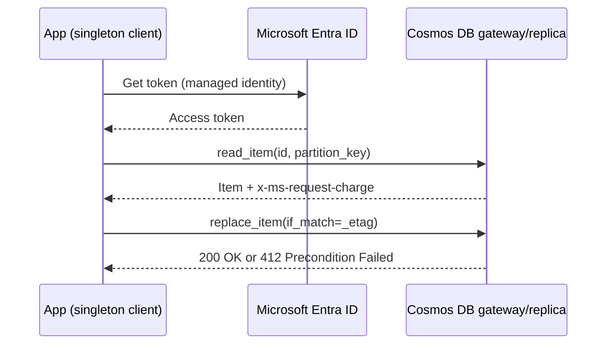

## What this covers

The `azure-cosmos` SDK is how a back-end AI service talks to Azure Cosmos DB for NoSQL: it opens connections, picks the right partition, retries throttled requests and exposes RU charges. This page covers authenticating the client, reusing it, creating databases and containers from code, choosing between create, upsert and replace, reading by point read, deleting, and inspecting response metadata.

**Exam weight:** Develop AI solutions by using Azure data management services (30–35%)

**Skills measured**

- "Connect to Azure Cosmos DB for NoSQL by using the SDK and run queries"

## Key concepts

### CosmosClient and the client hierarchy

`CosmosClient` is the single entry point. It owns the connection pool, caches partition routing and handles regional failover. SDKs exist for .NET, Python, JavaScript, Java and Go with the same concepts. `get_database_client()` and `get_container_client()` return lightweight proxies and make **no network call**, so a typo in a container name only shows up when you run the first operation (as `CosmosResourceNotFoundError`).

### Authentication

| Method | How | Notes |
| --- | --- | --- |
| Account key | `CosmosClient(url, credential="<key>")` | Primary and secondary keys allow rotation; each grants full access to the whole account |
| Microsoft Entra ID | `CosmosClient(url, credential=DefaultAzureCredential())` | Uses RBAC; supports managed identity, Conditional Access and auditing |

`DefaultAzureCredential` uses your Azure CLI or IDE sign-in locally and the managed identity when deployed, so the same code runs everywhere. Data-plane access needs a Cosmos DB **data-plane** role: **Cosmos DB Built-in Data Reader** (`00000000-0000-0000-0000-000000000001`) or **Cosmos DB Built-in Data Contributor** (`00000000-0000-0000-0000-000000000002`). These are assigned with `az cosmosdb sql role assignment create`, not with ordinary Azure RBAC; a role such as Contributor on the account manages the resource but can't read items.

### Singleton client

Create one `CosmosClient` per process at startup (for example in a FastAPI lifespan handler or a module-level object) and reuse it. A client per request throws away warm connections and routing caches, adds latency and can exhaust sockets.

### Write operations

| Method | Item missing | Item exists |
| --- | --- | --- |
| `create_item` | Inserts | Fails with 409, `CosmosResourceExistsError` |
| `upsert_item` | Inserts | Replaces whole item |
| `replace_item` | Fails with 404 | Replaces; supports `if_match` ETag check |
| `patch_item` | Fails with 404 | Changes only the listed paths |
| `delete_item` | Fails with 404 | Deletes (needs `id` + partition key) |

For optimistic concurrency, pass the item's `_etag` as `if_match`. If another writer changed the item first, the call fails with 412 Precondition Failed (`CosmosAccessConditionFailedError`). Re-read and retry.

### Point reads versus queries

`read_item(item=<id>, partition_key=<value>)` goes straight to one partition with no query engine. For a 1 KB item it costs about 1 RU, the cheapest operation there is. Use point reads whenever you know both values: user profiles, cached inference results, config documents. Queries are for "find items where…" and cost more.

### Response metadata

`container.client_connection.last_response_headers` exposes `x-ms-request-charge` (RUs) and `x-ms-activity-id` (give it to Azure support). You can also pass `response_hook=lambda headers, body: ...` to most operations.

## How it works



The SDK retries 429 (Request rate too large) responses on its own, using the server's `x-ms-retry-after-ms` hint, before it surfaces the error.

## Hands-on

### Azure portal

1. Open the Cosmos DB account > **Keys** to see the URI (and the keys you should avoid in production).
2. Turn on a system-assigned managed identity for the App Service, Container App or Function that calls Cosmos DB.
3. Assign the data-plane role with the CLI below; the portal **Access control (IAM)** blade handles control-plane roles only.

### Azure CLI

```bash
principal_id=$(az webapp identity show -g <resource-group> -n <app-name> --query principalId -o tsv)

az cosmosdb sql role assignment create \
  --account-name <account-name> \
  --resource-group <resource-group> \
  --role-definition-id 00000000-0000-0000-0000-000000000002 \
  --principal-id "$principal_id" \
  --scope "/"
```

### Python

```python
from azure.cosmos import CosmosClient, PartitionKey, ThroughputProperties, exceptions
from azure.identity import DefaultAzureCredential


class CosmosService:
    """Create once at startup and reuse."""

    def __init__(self, endpoint: str):
        self._client = CosmosClient(endpoint, credential=DefaultAzureCredential())
        db = self._client.create_database_if_not_exists(id="productcatalog")
        self.products = db.create_container_if_not_exists(
            id="products",
            partition_key=PartitionKey(path="/categoryId"),
            offer_throughput=ThroughputProperties(auto_scale_max_throughput=4000),
        )


svc = CosmosService("https://<account-name>.documents.azure.com:443/")
c = svc.products

product = {"id": "product-12345", "categoryId": "electronics", "name": "Smart Speaker", "price": 99.99}
try:
    c.create_item(body=product)
except exceptions.CosmosResourceExistsError:
    print("Item already exists")

item = c.read_item(item="product-12345", partition_key="electronics")  # ~1 RU point read
item["price"] = 149.99
try:
    c.replace_item(item=item["id"], body=item, if_match=item["_etag"])
except exceptions.CosmosAccessConditionFailedError:
    print("Item was modified by another process")

headers = c.client_connection.last_response_headers
print(headers["x-ms-request-charge"], headers["x-ms-activity-id"])

c.delete_item(item="product-12345", partition_key="electronics")
```

`create_database` and `create_container` raise if the resource exists; the `_if_not_exists` variants are idempotent and suit startup code. Omit `offer_throughput` when the database already has shared throughput.

## Exam traps

| Scenario | Use |
| --- | --- |
| Insert, but detect accidental duplicates | `create_item` (409 on conflict) |
| Cache model output whether new or not | `upsert_item` |
| Update only if nobody changed it since read | `replace_item` with `if_match=_etag` |
| Change one field on a large document | `patch_item` |
| Fetch a known item cheaply | `read_item` |

> [!WARNING]
> **Exam trap:** Creating a `CosmosClient` inside every request handler is a classic wrong answer. Use a singleton.

> [!WARNING]
> **Exam trap:** Giving a managed identity the Azure **Contributor** role doesn't let it read items. It needs a Cosmos DB data-plane role such as Built-in Data Contributor.

> [!TIP]
> Status codes to remember: 404 not found, 409 conflict, 412 ETag mismatch, 429 throttled.

> [!NOTE]
> `get_container_client()` never validates existence; errors surface on the first real call.

## Quick review

- One `CosmosClient` per app; it pools connections and caches routing.
- `DefaultAzureCredential` plus a data-plane role replaces account keys.
- `create_item` fails on duplicates; `upsert_item` doesn't.
- `replace_item(..., if_match=etag)` gives optimistic concurrency.
- Point reads need `id` and partition key and cost about 1 RU per KB.
- `x-ms-request-charge` shows RU cost; `x-ms-activity-id` helps support.
- `ThroughputProperties(auto_scale_max_throughput=4000)` means autoscale between 400 and 4,000 RU/s.

## Practice

[Practice: Cosmos DB SDK and query questions](/practice/cosmos-sdk-queries)

## Official references

- [Unit: Implement the Azure Cosmos DB for NoSQL SDK](https://learn.microsoft.com/en-us/training/modules/build-query-azure-cosmos-db/3-implement-cosmos-db-sdk)
- [Azure Cosmos DB Python SDK quickstart](https://learn.microsoft.com/en-us/azure/cosmos-db/nosql/quickstart-python)
- [Data-plane role-based access control](https://learn.microsoft.com/en-us/azure/cosmos-db/nosql/security/how-to-grant-data-plane-role-based-access)
- [AI-200 study guide](https://learn.microsoft.com/en-us/credentials/certifications/resources/study-guides/ai-200)
