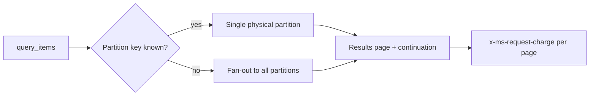

## What this covers

Point reads fetch one known item; queries find everything that matches a condition. Azure Cosmos DB for NoSQL uses a SQL-like language over JSON. This page covers projections, filters, parameterized queries, partition-aware routing, sorting and paging, shaping results with `VALUE`, aggregates, array queries and measuring query cost in Python.

**Exam weight:** Develop AI solutions by using Azure data management services (30–35%)

**Skills measured**

- "Connect to Azure Cosmos DB for NoSQL by using the SDK and run queries"

## Key concepts

### One container per query

A query targets a single container. `FROM` names an alias (usually `c`) rather than a table; cross-container joins don't exist. `JOIN` only joins an item with arrays **inside the same item**.

### Projection and filtering

- `SELECT *` returns whole documents; listing properties (`SELECT c.id, c.name`) shrinks the payload and the RU bill.
- `WHERE` supports `=`, `!=`, `<`, `>`, `<=`, `>=`, `AND`, `OR`, `NOT`, `BETWEEN`, `IN` / `NOT IN`.
- String functions: `CONTAINS`, `STARTSWITH`, `ENDSWITH`, `UPPER`, `LOWER`. String comparison is case-sensitive unless you normalize or pass the case-insensitive flag.
- `TOP n` limits results; `OFFSET … LIMIT …` skips and takes, but deep offsets still pay for the skipped items.

### Parameterized queries

Write `@category` in the text and pass `parameters=[{"name": "@category", "value": "electronics"}]`. Parameters stop injection, keep long values (such as 1,536-number vectors) out of the query string, and let the service reuse query plans.

### Single-partition versus cross-partition

If the query has an equality filter on the partition key, or you pass `partition_key=` to `query_items`, the request goes to one partition. Otherwise you must set `enable_cross_partition_query=True` and the SDK fans out to every physical partition, which costs more RUs and adds latency.

### Shaping results

- `SELECT VALUE c.name` returns a flat array of strings, not objects.
- `SELECT VALUE { "productId": c.id, "isAvailable": c.quantity > 0 }` builds a custom shape and renames properties.
- Aggregates: `COUNT`, `SUM`, `AVG`, `MIN`, `MAX`. `SELECT VALUE COUNT(1)` returns a number. Aggregates read every matching item, so filter first.

### Arrays

- `ARRAY_CONTAINS(c.features, "wifi")` tests membership.
- `JOIN f IN c.features` flattens an array so you can filter or project individual elements.

### Paging

`max_item_count` sets page size; `by_page()` iterates pages; the continuation token captures where you are. Return it to API clients to page through results, and treat it as opaque.

## How it works



The query engine uses the indexing policy to find matching items. Cost tracks the work done: index lookups, documents loaded, and partitions touched.

## Hands-on

### Azure portal

1. Open **Data Explorer**, expand the container, and select **New SQL Query**.
2. Run `SELECT * FROM c WHERE c.categoryId = "electronics"`.
3. Open **Query Stats** to see the request charge, retrieved document count and index hit details.

### Azure CLI

```bash
# The CLI manages resources but doesn't run data-plane queries.
# Check the indexing policy that queries depend on:
az cosmosdb sql container show \
  --account-name <account-name> --resource-group <resource-group> \
  --database-name productcatalog --name products \
  --query "resource.indexingPolicy"
```

### Python

```python
from azure.cosmos import CosmosClient
from azure.identity import DefaultAzureCredential

client = CosmosClient("https://<account-name>.documents.azure.com:443/", DefaultAzureCredential())
container = client.get_database_client("productcatalog").get_container_client("products")

query = """
    SELECT VALUE { "productId": p.id, "productName": p.name, "currentPrice": p.price }
    FROM products p
    WHERE p.categoryId = @category AND p.price < @maxPrice
    ORDER BY p.price DESC
"""
params = [{"name": "@category", "value": "electronics"}, {"name": "@maxPrice", "value": 500.00}]

pages = container.query_items(
    query=query,
    parameters=params,
    partition_key="electronics",   # single-partition routing
    max_item_count=50,             # page size
).by_page()

total_rus = 0.0
for page in pages:
    for item in page:
        print(f"{item['productName']}: ${item['currentPrice']}")
    total_rus += float(container.client_connection.last_response_headers["x-ms-request-charge"])
print(f"Total: {total_rus:.2f} RUs")

# Cross-partition aggregate and array filters
count = list(container.query_items(
    "SELECT VALUE COUNT(1) FROM c WHERE ARRAY_CONTAINS(c.features, 'wifi')",
    enable_cross_partition_query=True,
))[0]

for row in container.query_items(
    "SELECT p.name, f AS feature FROM products p JOIN f IN p.features WHERE f IN ('wifi', 'bluetooth')",
    enable_cross_partition_query=True,
):
    print(row)
```

## Exam traps

| Requirement | Query technique |
| --- | --- |
| Return only names as a string array | `SELECT VALUE c.name` |
| User input in a filter | Parameter `@value`, never string concatenation |
| Cheapest filtered query | Include partition key equality or `partition_key=` |
| Items whose tag array has "wifi" | `ARRAY_CONTAINS(c.tags, "wifi")` |
| Filter on individual array elements | `JOIN t IN c.tags WHERE t = …` |
| Large result sets to a web client | `max_item_count` + continuation token |

> [!WARNING]
> **Exam trap:** `JOIN` in Cosmos DB is a self-join with an array in the same item. It can't join two containers.

> [!WARNING]
> **Exam trap:** Without the partition key, a query over a multi-partition container needs `enable_cross_partition_query=True`; a missing flag is a common "why does this fail" distractor.

> [!TIP]
> Cost checklist: filter early, project only needed fields, route to one partition, use `TOP`, and make sure the indexing policy covers your filters.

> [!NOTE]
> `ORDER BY` on two or more properties needs a matching composite index; see [range and composite indexes](/study/develop-ai-solutions-with-azure-cosmos-db-for-nosql/configure-range-and-composite-indexes).

## Quick review

- Queries run against one container with an alias such as `c`.
- Parameters prevent injection and allow plan reuse.
- Partition key in the filter means single-partition and fewer RUs.
- `VALUE` removes the wrapping object.
- Aggregates read every match; filter first.
- `max_item_count` and `by_page()` control paging; continuation tokens resume.
- Sum `x-ms-request-charge` across pages for the real query cost.

## Practice

[Practice: Cosmos DB SDK and query questions](/practice/cosmos-sdk-queries)

## Official references

- [Unit: Query Azure Cosmos DB for NoSQL](https://learn.microsoft.com/en-us/training/modules/build-query-azure-cosmos-db/4-query-cosmos-db-nosql)
- [Query language overview](https://learn.microsoft.com/en-us/cosmos-db/query/overview)
- [AI-200 study guide](https://learn.microsoft.com/en-us/credentials/certifications/resources/study-guides/ai-200)
