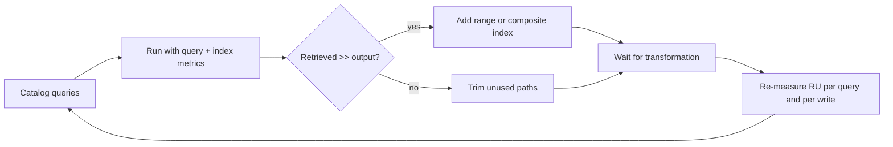

## What this covers

RUs are the bill. A query that can use indexes costs roughly in proportion to what it returns; one that can't costs in proportion to how much data it has to read. Meanwhile every indexed path adds to the cost of every write. This page shows how to catalog query patterns, read query and index metrics from the Python SDK, trim the indexing policy, pick composite indexes worth their write cost, and validate changes with realistic data.

**Exam weight:** Develop AI solutions by using Azure data management services (30–35%)

**Skills measured**

- "Optimize query performance and Request Units (RUs) consumption by using indexing policies and consistency levels"

## Key concepts

### Start from real query patterns

List, for each query the app runs:

- **Filter properties** and whether they're equality or range filters.
- **Sort properties** and directions.
- **Combinations** that appear together.
- **Frequency**: a query running thousands of times a minute justifies index overhead that a daily report doesn't.

### Metrics that reveal missing indexes

- `populate_query_metrics=True` returns `x-ms-documentdb-query-metrics`: **retrieved document count** versus **output document count**, index lookup time and document load time. Retrieving 10,000 documents to return 10 means the filter isn't indexed.
- `populate_index_metrics=True` returns `x-ms-cosmos-index-utilization`, listing **utilized** indexes and **potential** single and composite indexes that would help. Use it while tuning, not on every production request, because it adds overhead.
- `x-ms-request-charge` gives the RU cost per page.

### Opt-in indexing for AI documents

AI items often carry long `content`, a `summary`, raw metadata and a 1,536-float embedding that nobody filters on. Index only what queries use:

```json
{
  "indexingMode": "consistent",
  "includedPaths": [
    { "path": "/title/?" }, { "path": "/documentType/?" },
    { "path": "/category/?" }, { "path": "/uploadDate/?" }
  ],
  "excludedPaths": [ { "path": "/*" } ],
  "vectorIndexes": [ { "path": "/embedding", "type": "diskANN" } ]
}
```

With `/*` excluded, the **partition key isn't indexed automatically**. If it's `/tenantId`, include `/tenantId/?` so `WHERE c.tenantId = … AND c.status = …` doesn't scan within the partition.

### Composite indexes: fewer, better

Each composite adds write cost. Prioritize by frequency, data volume and filter complexity, and cover the five to ten most impactful patterns rather than every edge case.

### Workload profile

| Profile | Signs | Index strategy |
| --- | --- | --- |
| Write-heavy | Bulk ingestion, frequent embedding updates, streaming | Minimal paths and composites |
| Read-heavy | Many concurrent searches, dashboards | Cover all filters and common sorts |

Most AI retrieval apps are read-heavy: ingestion happens in batches, searches happen constantly.

### Other RU levers

Point reads instead of queries where `id` and partition key are known; projections instead of `SELECT *`; `TOP N`; single-partition routing; Session consistency rather than Strong (half the read RUs).

### Rolling out and testing

Policy changes run as background transformations that can take hours on large containers; new indexes help only once complete. Add the new index, wait, then remove the old. Test with data that has production-like volume, cardinality and skew, measure each query type with and without the index, and adjust.

## How it works



## Hands-on

### Azure portal

1. **Data Explorer** > run the query > **Query Stats**: compare *Retrieved document count* with *Output document count* and note *Request charge*.
2. **Insights** (or **Metrics** > *Total Request Units*) to find the most expensive operations over time.
3. Edit **Indexing Policy**; the portal shows transformation progress as a percentage.

### Azure CLI

```bash
az cosmosdb sql container update \
  --account-name <account-name> --resource-group <resource-group> \
  --database-name documents-db --name documents --idx @policy.json

az monitor metrics list \
  --resource "/subscriptions/<sub-id>/resourceGroups/<resource-group>/providers/Microsoft.DocumentDB/databaseAccounts/<account-name>" \
  --metric TotalRequestUnits --interval PT1H --aggregation Total
```

### Python

```python
from azure.cosmos import CosmosClient
from azure.identity import DefaultAzureCredential

client = CosmosClient("https://<account-name>.documents.azure.com:443/", DefaultAzureCredential())
container = client.get_database_client("documents-db").get_container_client("documents")

captured = {}
def hook(headers, results):
    captured["metrics"] = headers.get("x-ms-documentdb-query-metrics", "")
    captured["index"] = headers.get("x-ms-cosmos-index-utilization", "")
    captured["ru"] = headers.get("x-ms-request-charge", "")

items = list(container.query_items(
    query="SELECT * FROM c WHERE c.documentType = @type ORDER BY c.uploadDate DESC",
    parameters=[{"name": "@type", "value": "pdf"}],
    enable_cross_partition_query=True,
    populate_query_metrics=True,
    populate_index_metrics=True,
    response_hook=hook,
))
print(captured["ru"], "RUs")
print(captured["metrics"])   # retrievedDocumentCount vs outputDocumentCount
print(captured["index"])     # utilized vs potential indexes (base64 JSON)
```

## Exam traps

| Symptom | Fix |
| --- | --- |
| Writes cost 40+ RUs on 2 KB items | Exclude unqueried paths, especially embeddings |
| Retrieved count far above output count | Add a range or composite index on the filter |
| Filters on partition key still pricey with opt-in policy | Include the partition key path |
| Many rarely used composites | Drop them; keep the top patterns |
| New index added but cost unchanged | Wait for the transformation to finish |

> [!WARNING]
> **Exam trap:** "Index everything to make queries cheap" ignores write cost. On write-heavy ingestion the right answer is a lean opt-in policy.

> [!WARNING]
> **Exam trap:** Excluding `/*` without re-including the partition key path makes partition-key filters scan.

> [!TIP]
> Two numbers tell the story: **retrieved vs output documents** for reads, **RU per write** for indexing overhead.

> [!NOTE]
> Index metrics only return results when you request them; they aren't on by default.

## Quick review

- Indexed queries cost by result size; scans cost by data size.
- Catalog filters, sorts, combinations and frequency first.
- `populate_query_metrics` and `populate_index_metrics` expose the evidence.
- Opt-in policy: exclude `/*`, include queried paths and the partition key.
- Limit composites to the top five to ten patterns.
- Write-heavy: lean indexes; read-heavy: broad coverage.
- Test with production-like data before and after changes.

## Practice

[Practice: Cosmos DB RU and indexing questions](/practice/cosmos-ru-indexing)

## Official references

- [Unit: Reduce RU costs with strategic indexing](https://learn.microsoft.com/en-us/training/modules/optimize-query-performance-azure-cosmos-db/5-reduce-ru-costs-strategic-indexing)
- [Indexing metrics](https://learn.microsoft.com/en-us/azure/cosmos-db/index-metrics)
- [Request units in Azure Cosmos DB](https://learn.microsoft.com/en-us/azure/cosmos-db/request-units)
- [AI-200 study guide](https://learn.microsoft.com/en-us/credentials/certifications/resources/study-guides/ai-200)
