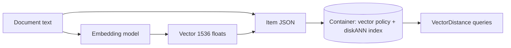

## What this covers

Azure Cosmos DB for NoSQL can keep embedding vectors in the same JSON item as the text and metadata they describe, so you don't need a separate vector database. This page covers enabling the feature, the container **vector embedding policy**, distance functions, vector data types, the three vector index types, and inserting items with embeddings from Python.

**Exam weight:** Develop AI solutions by using Azure data management services (30–35%)

**Skills measured**

- "Store and retrieve embeddings and execute vector similarity search for semantic retrieval"

## Key concepts

### Embeddings

An embedding model turns content into an array of floats; similar meaning gives nearby vectors. Dimensions depend on the model: `text-embedding-ada-002` produces 1,536, `text-embedding-3-large` produces 3,072. Store the vector as an array property (for example `embedding`) beside `title`, `content` and filterable metadata such as `category` or `productId`.

### Enable the feature

Vector search is an account capability: **Settings > Features > Vector Search for NoSQL API** in the portal, or `az cosmosdb update --capabilities EnableNoSQLVectorSearch`. Approval is automatic but can take about 15 minutes.

### Vector embedding policy

Defined on the container (`vectorEmbeddingPolicy` / `vectorEmbeddings`), one entry per vector path:

| Field | Values | Default |
| --- | --- | --- |
| `path` | JSON path such as `/embedding` (required; no wildcards or arrays of vectors) | none |
| `dataType` | `float32`, `float16`, `int8`, `uint8` | `float32` |
| `dimensions` | Must equal the model's output length | 1536 |
| `distanceFunction` | `cosine`, `dotproduct`, `euclidean` | `cosine` |

You can have several paths, for example `/titleEmbedding` and `/contentEmbedding`. `float16` halves vector storage with little loss in quality for most text models; `int8`/`uint8` are for vectors you've already quantized.

### Distance functions

- **cosine**: angle only; scores from -1 to +1, higher means more similar. The normal choice for text embeddings, including Azure OpenAI's (which are normalized).
- **dotproduct**: angle and magnitude; for normalized vectors it ranks the same as cosine and is slightly cheaper to compute. Range is unbounded.
- **euclidean**: straight-line distance; 0 is identical, larger means **less** similar.

### Vector index types

| Type | Search | Max dimensions | Best for |
| --- | --- | --- | --- |
| `flat` | Exact (brute force), 100% recall | 505 | Small sets or heavily filtered searches |
| `quantizedFlat` | Brute force over compressed vectors | 4,096 | Up to about 50,000 vectors in the search scope |
| `diskANN` | Approximate nearest neighbour (Microsoft Research DiskANN) | 4,096 | Large sets, lowest latency and RU |

`quantizedFlat` and `diskANN` need at least 1,000 vectors before the index is used; below that, queries do a full scan and cost more RUs. Exclude the vector path from the normal range index (`/embedding/*` in `excludedPaths`): range-indexing thousands of floats per item raises storage and write RUs for no query benefit.

### Plan the policy up front

Set both policies when you create the container. You can't edit a vector policy or vector index in place; changing dimensions, data type or distance function means dropping and re-adding the path or, as the training module recommends, creating a new container and migrating. Vector search isn't supported on databases with shared throughput, and once enabled on a container it can't be turned off.

## How it works



At write time the vector is validated against the policy and added to the vector index. At query time `VectorDistance` uses the index named for that path.

## Hands-on

### Azure portal

1. Account > **Features** > enable **Vector Search for NoSQL API**.
2. **Data Explorer** > **New Container**; set partition key `/category`.
3. Expand **Container Vector Policy**, add path `/embedding`, `float32`, `cosine`, 1536 dimensions and index type `diskANN`.

### Azure CLI

```bash
az cosmosdb update \
  --resource-group <resource-group> \
  --name <account-name> \
  --capabilities EnableNoSQLVectorSearch
```

### Python

```python
from azure.cosmos import CosmosClient, PartitionKey
from azure.identity import DefaultAzureCredential
from openai import AzureOpenAI

cosmos = CosmosClient("https://<account-name>.documents.azure.com:443/", DefaultAzureCredential())
db = cosmos.create_database_if_not_exists("support-db")

vector_embedding_policy = {
    "vectorEmbeddings": [
        {"path": "/embedding", "dataType": "float32", "distanceFunction": "cosine", "dimensions": 1536}
    ]
}
indexing_policy = {
    "indexingMode": "consistent",
    "automatic": True,
    "includedPaths": [{"path": "/*"}],
    "excludedPaths": [{"path": "/\"_etag\"/?"}, {"path": "/embedding/*"}],
    "vectorIndexes": [{"path": "/embedding", "type": "diskANN"}],
}
container = db.create_container_if_not_exists(
    id="knowledge-base",
    partition_key=PartitionKey(path="/category"),
    indexing_policy=indexing_policy,
    vector_embedding_policy=vector_embedding_policy,
    offer_throughput=1000,
)

aoai = AzureOpenAI(azure_endpoint="<aoai-endpoint>", api_key="<key>", api_version="2024-02-01")
title, content = "Troubleshooting wireless network connections", "Common WiFi issues ..."
vector = aoai.embeddings.create(input=f"{title} {content}", model="text-embedding-ada-002").data[0].embedding

container.upsert_item({
    "id": "doc-12345", "title": title, "content": content,
    "category": "networking", "productId": "router-x100", "embedding": vector,
})

# Retrieve the stored vector with a point read
item = container.read_item("doc-12345", partition_key="networking")
print(len(item["embedding"]))  # 1536
```

## Exam traps

| Need | Choose |
| --- | --- |
| Exact results, 384-dimension vectors, small data | `flat` |
| 1,536 dimensions, ~20,000 vectors per search scope | `quantizedFlat` |
| Millions of 1,536- or 3,072-dimension vectors | `diskANN` |
| Halve vector storage | `dataType: float16` |
| Azure OpenAI text embeddings | `cosine` |

> [!WARNING]
> **Exam trap:** `flat` caps at 505 dimensions, so a 1,536-dimension embedding can't use it. Choose `quantizedFlat` or `diskANN`.

> [!WARNING]
> **Exam trap:** With `euclidean`, a **smaller** score means more similar. With `cosine`, a **larger** score does.

> [!WARNING]
> **Exam trap:** Leaving `/*` included without excluding `/embedding/*` range-indexes every float and inflates write RUs.

> [!TIP]
> "505 flat, 4,096 the rest, 1,000 to start": the three numbers worth memorizing.

> [!NOTE]
> When content changes, regenerate the embedding and upsert the item; see [change feed embedding refresh](/study/develop-ai-solutions-with-azure-cosmos-db-for-nosql/use-the-change-feed-to-trigger-embedding-refresh).

## Quick review

- Enable `EnableNoSQLVectorSearch` on the account first.
- The policy lists `path`, `dataType`, `dimensions`, `distanceFunction` per vector.
- Defaults: `float32`, 1,536 dimensions, `cosine`.
- Index types: `flat` (≤505, exact), `quantizedFlat` and `diskANN` (≤4,096).
- `quantizedFlat`/`diskANN` need 1,000+ vectors; otherwise full scan.
- Exclude vector paths from range indexing.
- Policies are set at creation and can't be edited in place.

## Practice

[Practice: Cosmos DB vector search questions](/practice/cosmos-vector-search)

## Official references

- [Unit: Store and retrieve embeddings in Azure Cosmos DB](https://learn.microsoft.com/en-us/training/modules/implement-vector-search-azure-cosmos-db/2-store-retrieve-embeddings)
- [Integrated vector store in Azure Cosmos DB](https://learn.microsoft.com/en-us/azure/cosmos-db/vector-search)
- [Indexing policies: vector indexes](https://learn.microsoft.com/en-us/azure/cosmos-db/index-policy#vector-indexes)
- [AI-200 study guide](https://learn.microsoft.com/en-us/credentials/certifications/resources/study-guides/ai-200)
