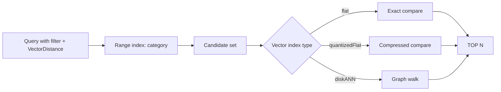

## What this covers

The vector index you pick decides the latency, accuracy and RU cost of every semantic query. This page compares `flat`, `quantizedFlat` and `diskANN` by dataset size and accuracy needs, explains the optional tuning parameters, shows how vector indexes sit beside range and composite indexes in one policy, and covers what you must plan before creating the container.

**Exam weight:** Develop AI solutions by using Azure data management services (30–35%)

**Skills measured**

- "Store and retrieve embeddings and execute vector similarity search for semantic retrieval"
- "Optimize query performance and Request Units (RUs) consumption by using indexing policies and consistency levels"

## Key concepts

### Vector indexes live in the indexing policy

`vectorIndexes` entries reference paths that must already be declared in the container's vector embedding policy (path, data type, dimensions, distance function). The same policy also holds range paths and composite indexes for metadata.

### Choosing the type

| | `flat` | `quantizedFlat` | `diskANN` |
| --- | --- | --- | --- |
| Search | Exact kNN over full vectors | Brute force over compressed vectors | Approximate nearest neighbour graph |
| Recall | 100% | Near 100% (small quantization loss) | High, tunable |
| Max dimensions | 505 | 4,096 | 4,096 |
| Sweet spot | Few vectors per search, or filters shrink candidates | ~1,000–50,000 vectors per physical partition / search scope | More than 50,000; millions |
| RU and latency | Highest at scale | Lower | Lowest at scale |

Both `quantizedFlat` and `diskANN` need **at least 1,000 vectors** before they're used; until then queries run a full scan with higher RU charges. For a container that starts tiny, `flat` (if dimensions allow) or accepting early scans are both valid plans.

`diskANN` results are approximate, so the same query can occasionally rank slightly differently between runs; use `flat` when exact answers are a hard requirement.

### Tuning parameters

| Parameter | Applies to | Effect | Range / default |
| --- | --- | --- | --- |
| `quantizationByteSize` | `quantizedFlat`, `diskANN` | Bytes kept per vector after compression; more = better accuracy, more storage | 1–512, default chosen dynamically |
| `indexingSearchListSize` | `diskANN` | Candidates examined while building the graph; more = better index, slower ingestion | 10–500, default 100 |
| `quantizerType` | `quantizedFlat`, `diskANN` | `product` (default) or `spherical` | product |
| `searchListSizeMultiplier` | Query option in `VectorDistance` | Raises DiskANN recall per query at more latency and RUs | Per query |

Defaults are fine for most workloads. Tune only when evaluation shows weak recall or you have a latency target to hit.

### Coordinating vector and metadata indexes

Range indexes on filter properties (`category`, `createdDate`, `documentType`) let the engine pre-filter candidates before comparing vectors, which can cut RUs dramatically. A composite such as `(category ASC, createdDate DESC)` supports filter-then-sort queries. Exclude the embedding path from range indexing: in an opt-in policy simply don't include it; in an opt-out policy add `/embedding/*` to `excludedPaths`. Exclude each vector path if there are several.

### Plan the vector policy up front

Dimensions, data type and distance function can't be edited in place. Upgrading to a model with a different dimension count means a new container (or dropping and re-adding the vector path) and re-embedding. `float16` halves storage with minimal accuracy impact for most models; pick the distance function your embedding model was trained for (cosine for most text models).

## How it works



## Hands-on

### Azure portal

1. **Data Explorer** > **New Container** > **Container Vector Policy**: path `/embedding`, `float32`, `cosine`, 1536.
2. Choose index type `diskANN` (or `quantizedFlat` for a smaller set).
3. Under **Indexing Policy**, switch to opt-in paths for metadata and remove `/embedding` from range indexing.

### Azure CLI

```bash
# Inspect what a container is using before tuning
az cosmosdb sql container show \
  --account-name <account-name> --resource-group <resource-group> \
  --database-name <database> --name <container> \
  --query "resource.indexingPolicy.vectorIndexes"
```

### Python

```python
from azure.cosmos import CosmosClient, PartitionKey
from azure.identity import DefaultAzureCredential

db = CosmosClient("https://<account-name>.documents.azure.com:443/",
                  DefaultAzureCredential()).get_database_client("documents-db")

indexing_policy = {
    "indexingMode": "consistent",
    "automatic": True,
    "includedPaths": [
        {"path": "/category/?"}, {"path": "/department/?"},
        {"path": "/createdDate/?"}, {"path": "/documentType/?"},
    ],
    "excludedPaths": [{"path": "/*"}],
    "compositeIndexes": [[
        {"path": "/category", "order": "ascending"},
        {"path": "/createdDate", "order": "descending"},
    ]],
    "vectorIndexes": [{
        "path": "/embedding", "type": "diskANN",
        "quantizationByteSize": 64, "indexingSearchListSize": 150,
    }],
}
db.create_container_if_not_exists(
    id="documents-v2",
    partition_key=PartitionKey(path="/category"),
    indexing_policy=indexing_policy,
    vector_embedding_policy={"vectorEmbeddings": [
        {"path": "/embedding", "dataType": "float16", "distanceFunction": "cosine", "dimensions": 1536}]},
)
```

## Exam traps

| Workload | Index |
| --- | --- |
| 300-dimension vectors, must be exact | `flat` |
| 1,536 dimensions, 20,000 vectors, filters by tenant | `quantizedFlat` |
| 3,072 dimensions, 10 million vectors | `diskANN` |
| 1,536 dimensions, exact recall required | `quantizedFlat` is closest; `flat` isn't allowed above 505 |
| Need better DiskANN recall for one query | `searchListSizeMultiplier` |

> [!WARNING]
> **Exam trap:** `flat` is limited to 505 dimensions. Any answer putting 1,536-dimension Azure OpenAI vectors on `flat` is wrong.

> [!WARNING]
> **Exam trap:** Expecting `diskANN` speed on 500 vectors: below 1,000 vectors the index isn't used and queries scan.

> [!TIP]
> Size ladder: **flat** (small, exact) → **quantizedFlat** (up to ~50k) → **diskANN** (beyond).

> [!NOTE]
> The [optimize query performance exercise](/study/develop-ai-solutions-with-azure-cosmos-db-for-nosql/exercise-optimize-query-performance-with-vector-indexes-on-azure-cosmos-db) compares all three types on the same data.

## Quick review

- Vector indexes reference paths from the vector embedding policy.
- `flat` ≤505 dimensions and exact; others ≤4,096.
- `quantizedFlat` ~1k–50k vectors per partition; `diskANN` above that.
- 1,000-vector minimum for `quantizedFlat` and `diskANN`.
- `quantizationByteSize` 1–512; `indexingSearchListSize` 10–500, default 100.
- Range-index filter fields so vector search can pre-filter.
- Exclude embedding paths from range indexes.

## Practice

[Practice: Cosmos DB vector search questions](/practice/cosmos-vector-search)

[Practice: Cosmos DB RU and indexing questions](/practice/cosmos-ru-indexing)

## Official references

- [Unit: Tune vector indexes for embedding workloads](https://learn.microsoft.com/en-us/training/modules/optimize-query-performance-azure-cosmos-db/4-tune-vector-indexes-embeddings)
- [Integrated vector store in Azure Cosmos DB](https://learn.microsoft.com/en-us/azure/cosmos-db/vector-search)
- [Indexing policies: vector indexes](https://learn.microsoft.com/en-us/azure/cosmos-db/index-policy#vector-indexes)
- [AI-200 study guide](https://learn.microsoft.com/en-us/credentials/certifications/resources/study-guides/ai-200)
