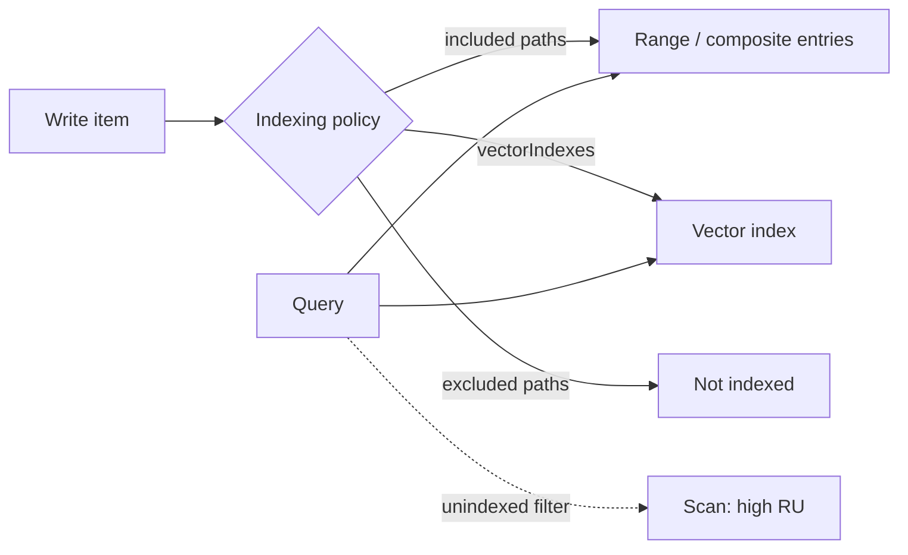

## What this covers

Every Azure Cosmos DB container has an indexing policy that decides which JSON paths are indexed and how. Good policies make queries cheap; careless ones make every write expensive or force full scans. This page covers what's indexed by default, the index kinds, the two indexing modes, include/exclude path syntax and the system properties that are always indexed.

**Exam weight:** Develop AI solutions by using Azure data management services (30–35%)

**Skills measured**

- "Optimize query performance and Request Units (RUs) consumption by using indexing policies and consistency levels"

## Key concepts

### Default behaviour

A new container indexes **every property of every item** with range indexes. The default policy includes `/*` and excludes only `/"_etag"/?`. Any property is queryable straight away, which is convenient while you're exploring, but each indexed path costs storage and write RUs. AI items with long text and 1,536-float embedding arrays pay heavily for paths that are never filtered.

### Index kinds

| Kind | Serves | Example |
| --- | --- | --- |
| Range | `=`, `>`, `<`, `>=`, `<=`, `!=`, single-property `ORDER BY`, `CONTAINS`, `STARTSWITH`, `ENDSWITH`, `StringEquals`, `IS_DEFINED` | `WHERE c.status = 'published'` |
| Composite | `ORDER BY` on 2+ properties; equality + range filters on different properties | `ORDER BY c.score DESC, c.date DESC` |
| Spatial | `ST_DISTANCE`, `ST_WITHIN`, `ST_INTERSECTS` | Nearby stores |
| Vector | `VectorDistance` (`flat`, `quantizedFlat`, `diskANN`) | Semantic search |
| Full-text | `FullTextContains`, `FullTextScore` | Keyword and hybrid search |
| Tuple | Several properties within the same array element | `/chunks/[]/{position, tokens}/?` |

### Indexing modes

- **consistent** (default): the index updates synchronously with each write, so queries see committed data immediately.
- **none**: no indexing; the container acts as a key-value store reached by point reads. Useful for bulk loads or pure lookup tables; queries scan everything.
- **lazy** is deprecated and can't be used on new containers.

### Path syntax

- `/*` everything under the root (recursive).
- `/title/?` the scalar value of `title`.
- `/tags/[]` every element of an array.
- `/metadata/*` everything under `metadata`.

When included and excluded paths overlap, the **more specific path wins**. That lets you exclude `/*` and include a short list of queried paths (opt-in), or include `/*` and exclude a few heavy paths (opt-out).

### What drives index size

More indexed paths, high-cardinality values (IDs, timestamps) and large arrays (each element is indexed) all grow the index. Embeddings are the extreme case: exclude `/embedding/*` and let the vector index handle them.

### System properties and the partition key

`id` and `_ts` are always indexed in consistent mode and can't be excluded. `_etag` is excluded by default. The partition key path (unless it's `/id`) isn't automatically indexed when you use an opt-in policy, so add it explicitly; otherwise filters on it scan within each partition.

## How it works



In consistent mode, the write's RU charge includes updating every index entry, which is why trimming paths lowers write cost.

## Hands-on

### Azure portal

1. **Data Explorer** > container > **Settings** > **Indexing Policy**.
2. Replace `/*` in `includedPaths` with the paths you query and add `{"path": "/*"}` to `excludedPaths`.
3. Save; the change runs as a background index transformation.

### Azure CLI

```bash
cat > policy.json <<'EOF'
{
  "indexingMode": "consistent",
  "automatic": true,
  "includedPaths": [
    { "path": "/title/?" }, { "path": "/category/?" },
    { "path": "/createdDate/?" }, { "path": "/metadata/*" }
  ],
  "excludedPaths": [ { "path": "/*" } ]
}
EOF

az cosmosdb sql container update \
  --account-name <account-name> --resource-group <resource-group> \
  --database-name <database> --name <container> --idx @policy.json
```

### Python

```python
from azure.cosmos import CosmosClient, PartitionKey
from azure.identity import DefaultAzureCredential

client = CosmosClient("https://<account-name>.documents.azure.com:443/", DefaultAzureCredential())
db = client.get_database_client("documents-db")

opt_in_policy = {
    "indexingMode": "consistent",
    "automatic": True,
    "includedPaths": [
        {"path": "/category/?"},      # partition key: include explicitly
        {"path": "/title/?"},
        {"path": "/createdDate/?"},
        {"path": "/metadata/*"},
    ],
    "excludedPaths": [{"path": "/*"}],
}
db.replace_container(
    container="documents",
    partition_key=PartitionKey(path="/category"),
    indexing_policy=opt_in_policy,
)
print(db.get_container_client("documents").read()["indexingPolicy"])
```

## Exam traps

| Requirement | Index choice |
| --- | --- |
| Filter by status, sort by one date | Range (default) |
| Sort by score then date | Composite |
| Find items within 5 km | Spatial |
| Semantic similarity | Vector |
| Pure key-value cache, point reads only | Indexing mode `none` |
| Cut write RUs on large docs | Opt-in policy, exclude `/*` |

> [!WARNING]
> **Exam trap:** With `indexingMode: none`, queries still run but scan the whole container. Only choose it when access is by `id` + partition key.

> [!WARNING]
> **Exam trap:** "Use lazy indexing to speed up writes" is outdated; lazy mode is deprecated.

> [!TIP]
> Path endings: `?` = scalar, `[]` = array elements, `*` = everything below.

> [!NOTE]
> You can't stop indexing `id` or `_ts`.

## Quick review

- Default: range-index everything (`/*`), exclude `_etag`.
- Modes: consistent (default) or none; lazy is gone.
- Composite indexes serve multi-property sorts and mixed filters.
- More specific paths override broader ones.
- Exclude embeddings and large text from range indexes.
- Include the partition key path in opt-in policies.
- `id` and `_ts` are always indexed.

## Practice

[Practice: Cosmos DB RU and indexing questions](/practice/cosmos-ru-indexing)

## Official references

- [Unit: Understand indexes in Azure Cosmos DB](https://learn.microsoft.com/en-us/training/modules/optimize-query-performance-azure-cosmos-db/2-understand-indexes-cosmos-db)
- [Indexing policies in Azure Cosmos DB](https://learn.microsoft.com/en-us/azure/cosmos-db/index-policy)
- [AI-200 study guide](https://learn.microsoft.com/en-us/credentials/certifications/resources/study-guides/ai-200)
