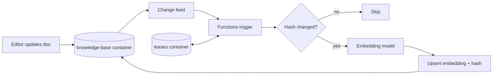

## What this covers

When a source document changes, its stored embedding goes stale and vector search starts returning the wrong items. The Azure Cosmos DB change feed lets you react to every insert and update without polling the container yourself. This page covers what the change feed records, push versus pull consumption, the Azure Functions Cosmos DB trigger in Python, the lease container, selective re-embedding with content hashes, and the failure modes you must design for.

**Exam weight:** Develop AI solutions by using Azure data management services (30–35%)

**Skills measured**

- "Implement a change feed processor to detect and handle new or updated items"
- "Store and retrieve embeddings and execute vector similarity search for semantic retrieval"

## Key concepts

### What the change feed is

A persistent, ordered record of creates and updates on a container, switched on by default for every container.

- **Ordering** is guaranteed within a partition key value, not across the container.
- **Persistent**: a consumer that was offline catches up from its saved position.
- **Latest version mode** (the default) gives the current version of each changed item. If an item changes twice between reads you may only see the last version, and **deletes don't appear**. Use a soft-delete flag (`"deleted": true`) plus TTL, or the all versions and deletes mode (requires continuous backup), when deletes matter.
- Delivery is **at least once**: consumers checkpoint their own progress, and a retried batch can repeat items, so processing must be idempotent.

### Push versus pull

| | Push (Functions trigger or change feed processor) | Pull (`query_items_change_feed`) |
| --- | --- | --- |
| Bookmark | Lease documents in a lease container | Continuation token you store |
| Scaling | Automatic lease balancing across instances | You split work by `feed_range` |
| Polling | Built in | You loop and sleep |
| Fits | Continuous embedding refresh | Batch backfills, migrations, one partition key |

In Python, the push options are the **Azure Functions Cosmos DB trigger** or hosting the .NET/Java change feed processor; the processor library itself isn't in the Python SDK. See [Implement a change feed processor with a lease container](/study/develop-ai-solutions-with-azure-cosmos-db-for-nosql/implement-a-change-feed-processor-with-a-lease-container) for the library details.

### Lease container

The trigger (which runs the change feed processor under the hood) stores one lease per physical partition range. Leases give you checkpointing (resume after a crash), coordination (instances split leases) and failover (a dead instance's leases are taken over). A small container at 400 RU/s is usually enough. Give it a different name from your data containers; two functions watching the same container either use separate lease containers or distinct `leaseContainerPrefix` values.

### Selective refresh and the write-back loop

Embedding calls cost money and hit rate limits, so re-embed only when the text that feeds the embedding changes. Store a `contentHash` (for example SHA-256 of `title + content`) next to the vector. When a change arrives, recompute the hash; if it matches, skip.

That check also prevents an **infinite loop**: writing the new embedding back to the monitored container is itself an update, which lands in the change feed and fires the trigger again. Without a hash or similar guard the function re-embeds the same document forever.

### High volume

- Batch several texts into one embeddings call where the API accepts arrays.
- Retry with exponential backoff on 429s from the embedding service.
- Decouple with Azure Queue Storage or Service Bus: the trigger enqueues IDs; a separate worker embeds at its own pace.
- Prioritize live content over archives.

### Failures to handle

- Item deleted before you process it: catch `CosmosResourceNotFoundError`.
- Concurrent edits: use `if_match=_etag` on the write-back if you must not overwrite.
- Repeated failures: log and park the item in a dead-letter store, otherwise the same batch is retried indefinitely.

## How it works



## Hands-on

### Azure portal

1. Create a Function App (Python) with a system-assigned managed identity.
2. Assign it the Cosmos DB Built-in Data Contributor data-plane role on the account.
3. Add app setting `CosmosDBConnection__accountEndpoint` = `https://<account-name>.documents.azure.com:443/` for identity-based connections.
4. Deploy the function and watch **Monitor** for invocations after editing an item in Data Explorer.

### Azure CLI

```bash
az cosmosdb sql container create \
  --account-name <account-name> --resource-group <resource-group> \
  --database-name support-db --name leases \
  --partition-key-path "/id" --throughput 400

az functionapp config appsettings set -g <resource-group> -n <function-app> \
  --settings "CosmosDBConnection__accountEndpoint=https://<account-name>.documents.azure.com:443/"
```

### Python

```python
import hashlib, logging, os
import azure.functions as func
from azure.cosmos import CosmosClient
from azure.cosmos.exceptions import CosmosResourceNotFoundError
from azure.identity import DefaultAzureCredential
from openai import AzureOpenAI

app = func.FunctionApp()
cosmos = CosmosClient(os.environ["CosmosDBConnection__accountEndpoint"], DefaultAzureCredential())
container = cosmos.get_database_client("support-db").get_container_client("knowledge-base")
aoai = AzureOpenAI(azure_endpoint=os.environ["OPENAI_ENDPOINT"],
                   api_key=os.environ["OPENAI_API_KEY"], api_version="2024-02-01")


def content_hash(doc: dict) -> str:
    return hashlib.sha256(f"{doc.get('title', '')} {doc.get('content', '')}".encode()).hexdigest()


@app.cosmos_db_trigger(
    arg_name="documents",
    container_name="knowledge-base",
    database_name="support-db",
    connection="CosmosDBConnection",
    lease_container_name="leases",
    create_lease_container_if_not_exists=True,
)
def refresh_embeddings(documents: func.DocumentList):
    for d in documents:
        doc = dict(d)
        new_hash = content_hash(doc)
        if doc.get("contentHash") == new_hash:
            continue  # metadata-only change or our own write-back
        try:
            text = f"{doc.get('title', '')} {doc.get('content', '')}"
            doc["embedding"] = aoai.embeddings.create(input=text, model="text-embedding-ada-002").data[0].embedding
            doc["contentHash"] = new_hash
            container.upsert_item(doc)
        except CosmosResourceNotFoundError:
            pass  # deleted meanwhile
        except Exception:
            logging.exception("Embedding refresh failed for %s", doc.get("id"))
            raise  # let the trigger retry; add dead-lettering for poison items
```

Pull model for a nightly backfill:

```python
feed = container.query_items_change_feed(start_time="Beginning")
for change in feed:
    ...  # same hash check and upsert
token = container.client_connection.last_response_headers["etag"]  # persist; resume with continuation=token
```

## Exam traps

| Requirement | Choose |
| --- | --- |
| Re-embed automatically on every edit | Functions Cosmos DB trigger (push) |
| One-off backfill of all items | Pull model from `"Beginning"` |
| Detect deletes | Soft delete + TTL, or all versions and deletes mode |
| Avoid paying for metadata-only edits | Content hash check |
| Scale to several workers | More instances sharing the same lease container |

> [!WARNING]
> **Exam trap:** A trigger that always re-embeds and writes back to the same container re-triggers itself endlessly. Guard with a hash or write to a different container.

> [!WARNING]
> **Exam trap:** Latest version mode doesn't record deletes. "Use the change feed to remove vectors of deleted documents" needs soft deletes or all versions and deletes mode.

> [!TIP]
> Change feed = **inserts + updates, ordered per partition key, at least once**.

> [!NOTE]
> Lease containers created for the trigger use `/id` as the partition key.

## Quick review

- Change feed is on by default and records creates and updates.
- Order holds per partition key value only.
- Push uses a lease container; pull uses continuation tokens.
- Delivery is at least once, so handlers must be idempotent.
- `create_lease_container_if_not_exists=True` creates `leases` automatically.
- Hash the embedded text to skip unneeded refreshes and stop write-back loops.
- Queue-based decoupling and backoff protect embedding quotas.

## Practice

[Practice: Cosmos DB change feed questions](/practice/cosmos-change-feed)

[Practice: Cosmos DB vector search questions](/practice/cosmos-vector-search)

## Official references

- [Unit: Use the change feed to trigger embedding refresh](https://learn.microsoft.com/en-us/training/modules/implement-vector-search-azure-cosmos-db/5-change-feed-trigger-embedding-refresh)
- [Change feed in Azure Cosmos DB](https://learn.microsoft.com/en-us/azure/cosmos-db/change-feed)
- [Change feed modes](https://learn.microsoft.com/en-us/azure/cosmos-db/change-feed-modes)
- [Change feed pull model](https://learn.microsoft.com/en-us/azure/cosmos-db/change-feed-pull-model)
- [AI-200 study guide](https://learn.microsoft.com/en-us/credentials/certifications/resources/study-guides/ai-200)
